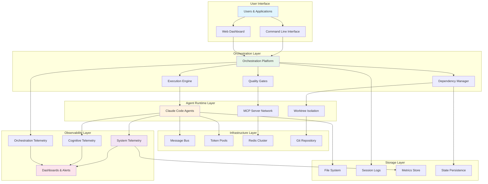
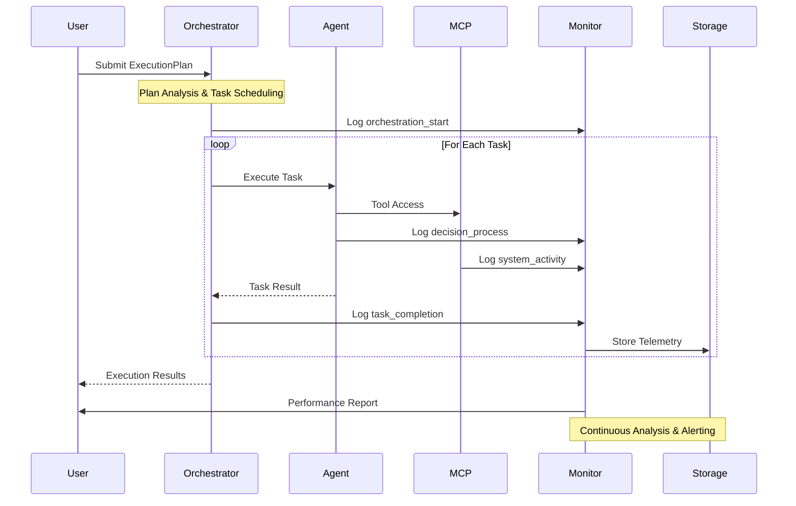

# Claude Agent Integrated Knowledge Base

*Last Updated: 2025-09-06*
*Master Reference for Agent Systems, Monitoring, and Orchestration*

## Quick Navigation

### 📚 **Core Documents**
- **[Claude Code Agents Guide](./CLAUDE_CODE_AGENTS_COMPREHENSIVE_GUIDE.md)** - Individual agent architecture and capabilities
- **[Monitoring & Observability Guide](./CLAUDE_AGENT_MONITORING_OBSERVABILITY_GUIDE.md)** - Complete telemetry and analysis framework
- **[Orchestration Guide](./CLAUDE_AGENT_ORCHESTRATION_GUIDE.md)** - Multi-agent coordination and workflow management

### 🏗️ **Implementation Resources**
- **[Agent Orchestrator](./apps/agent-orchestrator/)** - Production-ready orchestration framework
- **[Multi-Agent Reference](./multi-agent-reference/)** - Historical patterns and examples
- **[Session Documentation](~/.claude/projects/)** - Session logs and audit trails

---

## Executive Summary

This knowledge base covers **three interconnected domains** for building production-grade AI agent systems:

### 1. Individual Agent Systems
**Foundation**: Understanding how Claude Code agents work, their capabilities, configuration, and execution patterns.

**Key Topics**:
- Agent architecture and MCP server ecosystem
- Configuration inheritance and workspace isolation
- Performance characteristics and optimization
- Security boundaries and risk management

### 2. Monitoring & Observability
**Visibility**: Comprehensive telemetry across system, configuration, cognitive, and coordination layers.

**Key Topics**:
- Multi-layer monitoring architecture
- System telemetry and resource tracking
- Cognitive decision-making analysis
- Real-time alerting and dashboard systems

### 3. Multi-Agent Orchestration
**Coordination**: Production framework for managing agent teams with advanced workflow control.

**Key Topics**:
- Execution plan system and dependency management
- Quality gates and validation frameworks
- Real-time collaboration via message bus
- Performance optimization and scaling patterns

---

## Architecture Integration Overview

### System Component Relationships



### Data Flow Architecture



---

## Cross-Domain Integration Patterns

### 1. Individual Agent → Monitoring Integration

#### Agent Telemetry Collection
```python
class AgentTelemetryCollector:
    def __init__(self, agent_session_id: str):
        self.session_id = agent_session_id
        self.system_monitor = SystemResourceMonitor()
        self.cognitive_logger = CognitiveProcessLogger()

    async def start_monitoring(self, agent_process):
        """Start comprehensive agent monitoring"""

        # System resource monitoring
        system_task = asyncio.create_task(
            self.system_monitor.monitor_agent_process(agent_process.pid)
        )

        # Cognitive process monitoring
        cognitive_task = asyncio.create_task(
            self.cognitive_logger.monitor_session(self.session_id)
        )

        # Configuration state monitoring
        config_task = asyncio.create_task(
            self.monitor_configuration_changes(agent_process.working_dir)
        )

        return await asyncio.gather(system_task, cognitive_task, config_task)
```

#### Performance Baseline Integration
```json
{
  "agent_performance_profile": {
    "agent_type": "development-specialist",
    "model": "sonnet",
    "baseline_metrics": {
      "avg_task_duration_seconds": 45.2,
      "token_efficiency": 0.89,
      "success_rate": 0.96,
      "resource_usage": {
        "avg_cpu_percent": 23.4,
        "avg_memory_mb": 1250,
        "avg_file_descriptors": 42
      }
    },
    "performance_thresholds": {
      "max_duration_seconds": 120,
      "max_cpu_percent": 80,
      "max_memory_mb": 2000
    }
  }
}
```

### 2. Monitoring → Orchestration Integration

#### Orchestration Telemetry Framework
```python
class OrchestrationMonitor:
    def __init__(self, orchestrator_instance):
        self.orchestrator = orchestrator_instance
        self.agent_monitors = {}
        self.workflow_tracker = WorkflowStateTracker()

    async def monitor_execution_plan(self, execution_plan):
        """Monitor complete execution plan lifecycle"""

        # Track workflow state
        await self.workflow_tracker.start_workflow(execution_plan.plan_id)

        # Monitor individual agents
        for task in execution_plan.tasks:
            agent_monitor = AgentTelemetryCollector(task.task_id)
            self.agent_monitors[task.task_id] = agent_monitor

        # Coordination overhead tracking
        coordination_monitor = CoordinationOverheadTracker()
        await coordination_monitor.start_tracking(execution_plan)

        # Quality gate monitoring
        quality_monitor = QualityGateMonitor()
        await quality_monitor.monitor_gates(execution_plan.quality_gates)
```

#### Multi-Agent Performance Analysis
```python
class MultiAgentPerformanceAnalyzer:
    def analyze_orchestration_efficiency(self, execution_results):
        """Analyze multi-agent execution efficiency"""

        # Calculate parallel execution benefit
        sequential_time = sum(task['duration'] for task in execution_results)
        actual_time = execution_results['total_execution_time']
        parallel_benefit = (sequential_time - actual_time) / sequential_time

        # Coordination overhead analysis
        coordination_time = sum(task['coordination_time'] for task in execution_results)
        overhead_percentage = coordination_time / actual_time * 100

        # Resource utilization analysis
        peak_resource_usage = max(task['peak_memory'] for task in execution_results)
        avg_resource_usage = sum(task['avg_memory'] for task in execution_results) / len(execution_results)

        return {
            'parallel_execution_benefit': parallel_benefit,
            'coordination_overhead_percentage': overhead_percentage,
            'resource_utilization': {
                'peak_memory_mb': peak_resource_usage,
                'average_memory_mb': avg_resource_usage
            },
            'optimization_recommendations': self.generate_optimization_recommendations()
        }
```

### 3. Agent → Orchestration Integration

#### Agent Capability Registration
```python
class AgentCapabilityRegistry:
    def register_agent_capabilities(self, agent_environment_path: Path):
        """Register agent capabilities based on environment"""

        # Analyze MCP configuration
        mcp_config_path = agent_environment_path / ".mcp.json"
        if mcp_config_path.exists():
            mcp_config = json.loads(mcp_config_path.read_text())
            available_tools = self.extract_tools_from_mcp_config(mcp_config)
        else:
            available_tools = []

        # Analyze agent personality
        claude_md_path = agent_environment_path / "CLAUDE.md"
        agent_type = self.extract_agent_type_from_claude_md(claude_md_path)

        # Register capabilities
        capabilities = {
            'agent_environment': str(agent_environment_path),
            'agent_type': agent_type,
            'available_tools': available_tools,
            'mcp_servers': list(mcp_config.get('mcpServers', {}).keys()),
            'estimated_performance': self.estimate_performance_profile(agent_type),
            'resource_requirements': self.estimate_resource_requirements(available_tools)
        }

        return capabilities
```

#### Dynamic Agent Selection
```python
class DynamicAgentSelector:
    def select_optimal_agent_environment(self, task: AgentTask):
        """Select optimal agent environment for task"""

        # Analyze task requirements
        required_capabilities = self.analyze_task_requirements(task)

        # Find matching agent environments
        available_environments = self.scan_agent_environments()

        # Score environments based on task match
        environment_scores = []
        for env in available_environments:
            score = self.calculate_environment_fitness(env, required_capabilities)
            environment_scores.append((env, score))

        # Select best environment
        best_environment, best_score = max(environment_scores, key=lambda x: x[1])

        if best_score < 0.5:  # Threshold for acceptable match
            # Create new specialized environment
            return self.create_specialized_environment(required_capabilities)

        return best_environment
```

---

## Operational Workflows

### 1. End-to-End Agent Deployment

#### Complete Deployment Pipeline
```python
class CompleteAgentDeployment:
    async def deploy_monitored_agent_workflow(self, execution_plan: ExecutionPlan):
        """Deploy complete agent workflow with monitoring"""

        # 1. Environment Setup
        logger.info("Setting up agent environments...")
        worktree_manager = WorktreeOrchestrator()
        agent_environments = await worktree_manager.create_agent_worktrees(execution_plan)

        # 2. Monitoring Infrastructure
        logger.info("Initializing monitoring infrastructure...")
        monitoring_system = ComprehensiveMonitoringSystem()
        await monitoring_system.initialize_for_workflow(execution_plan)

        # 3. Orchestrator Configuration
        logger.info("Configuring orchestrator...")
        orchestrator = EnhancedOrchestrator(
            max_parallel=self.calculate_optimal_parallelism(),
            enable_quality_gates=True,
            enable_monitoring=True
        )

        # 4. Start Monitoring
        logger.info("Starting telemetry collection...")
        await monitoring_system.start_monitoring()

        # 5. Execute Workflow
        logger.info("Executing agent workflow...")
        try:
            results = await orchestrator.execute_plan(execution_plan)

            # 6. Performance Analysis
            logger.info("Analyzing performance...")
            performance_report = await monitoring_system.generate_performance_report()

            return {
                'execution_results': results,
                'performance_analysis': performance_report,
                'environments_created': agent_environments,
                'monitoring_data': await monitoring_system.export_telemetry()
            }

        finally:
            # 7. Cleanup
            logger.info("Cleaning up resources...")
            await worktree_manager.cleanup_worktrees(execution_plan.plan_id)
            await monitoring_system.stop_monitoring()
```

### 2. Real-Time Operations Dashboard

#### Integrated Dashboard Configuration
```json
{
  "integrated_dashboard": {
    "layout": "multi_pane",
    "refresh_interval": "30s",
    "panes": [
      {
        "id": "workflow_status",
        "title": "Active Workflows",
        "size": "large",
        "metrics": [
          "orchestration.active_workflows",
          "orchestration.workflow_success_rate",
          "orchestration.average_workflow_duration"
        ],
        "visualization": "status_cards"
      },
      {
        "id": "agent_health",
        "title": "Individual Agent Health",
        "size": "medium",
        "metrics": [
          "agents.active_count",
          "agents.average_cpu_usage",
          "agents.average_memory_usage",
          "agents.error_rate"
        ],
        "visualization": "health_grid"
      },
      {
        "id": "coordination_flow",
        "title": "Agent Coordination",
        "size": "large",
        "metrics": [
          "coordination.message_throughput",
          "coordination.average_latency",
          "coordination.active_collaborations",
          "coordination.bottlenecks"
        ],
        "visualization": "network_diagram"
      },
      {
        "id": "resource_utilization",
        "title": "System Resources",
        "size": "medium",
        "metrics": [
          "system.cpu_utilization",
          "system.memory_utilization",
          "system.disk_usage",
          "system.network_throughput"
        ],
        "visualization": "time_series"
      },
      {
        "id": "performance_trends",
        "title": "Performance Analytics",
        "size": "large",
        "metrics": [
          "performance.task_completion_trends",
          "performance.cost_per_task",
          "performance.quality_metrics",
          "performance.optimization_opportunities"
        ],
        "visualization": "trend_analysis"
      }
    ]
  }
}
```

### 3. Incident Response Procedures

#### Automated Incident Handling
```python
class AgentIncidentHandler:
    def __init__(self):
        self.alert_rules = AlertRuleEngine()
        self.response_playbooks = ResponsePlaybookManager()
        self.escalation_manager = EscalationManager()

    async def handle_incident(self, incident: Incident):
        """Handle agent system incidents"""

        logger.error(f"Incident detected: {incident.type} - {incident.description}")

        # 1. Classify incident
        incident_category = self.classify_incident(incident)

        # 2. Execute immediate response
        if incident_category.severity == "critical":
            await self.execute_emergency_response(incident)
        elif incident_category.severity == "high":
            await self.execute_high_priority_response(incident)
        else:
            await self.execute_standard_response(incident)

        # 3. Collect diagnostic data
        diagnostic_data = await self.collect_diagnostic_data(incident)

        # 4. Apply remediation
        remediation_result = await self.apply_remediation(incident, diagnostic_data)

        # 5. Update monitoring and alerting
        await self.update_monitoring_based_on_incident(incident)

        # 6. Generate incident report
        report = await self.generate_incident_report(incident, diagnostic_data, remediation_result)

        return report

    async def execute_emergency_response(self, incident: Incident):
        """Execute emergency response for critical incidents"""

        if incident.type == "orchestrator_failure":
            # Failover to backup orchestrator
            await self.failover_orchestrator()

        elif incident.type == "agent_resource_exhaustion":
            # Terminate resource-heavy agents
            await self.emergency_agent_termination()

        elif incident.type == "security_breach":
            # Immediate lockdown
            await self.initiate_security_lockdown()

        # Always notify ops team for critical incidents
        await self.notify_ops_team(incident, urgency="immediate")
```

---

## Development & Testing Integration

### 1. Integrated Testing Framework

#### Multi-Layer Testing Strategy
```python
class IntegratedTestSuite:
    def __init__(self):
        self.unit_tests = AgentUnitTests()
        self.integration_tests = OrchestrationIntegrationTests()
        self.performance_tests = PerformanceTestSuite()
        self.monitoring_tests = MonitoringValidationTests()

    async def run_complete_test_suite(self):
        """Run comprehensive test suite across all domains"""

        test_results = {}

        # 1. Unit Tests - Individual Agent Functions
        logger.info("Running agent unit tests...")
        test_results['unit_tests'] = await self.unit_tests.run_all()

        # 2. Integration Tests - Agent + Orchestration
        logger.info("Running orchestration integration tests...")
        test_results['integration_tests'] = await self.integration_tests.run_all()

        # 3. Performance Tests - End-to-End Performance
        logger.info("Running performance validation tests...")
        test_results['performance_tests'] = await self.performance_tests.run_all()

        # 4. Monitoring Tests - Telemetry Validation
        logger.info("Running monitoring system tests...")
        test_results['monitoring_tests'] = await self.monitoring_tests.run_all()

        # 5. Generate Comprehensive Report
        comprehensive_report = self.generate_test_report(test_results)

        return comprehensive_report

    async def validate_production_readiness(self):
        """Validate system is ready for production deployment"""

        production_checks = [
            self.validate_agent_performance_baselines(),
            self.validate_orchestration_scalability(),
            self.validate_monitoring_coverage(),
            self.validate_security_configurations(),
            self.validate_error_handling(),
            self.validate_resource_management()
        ]

        check_results = await asyncio.gather(*production_checks)

        all_passed = all(result['passed'] for result in check_results)

        return {
            'production_ready': all_passed,
            'check_results': check_results,
            'recommendations': self.generate_production_recommendations(check_results)
        }
```

### 2. Continuous Integration Pipeline

#### CI/CD Integration Points
```yaml
# .github/workflows/integrated-agent-system.yml
name: Integrated Agent System CI/CD

on:
  push:
    branches: [main, develop]
    paths:
      - 'apps/agent-orchestrator/**'
      - 'CLAUDE_*_GUIDE.md'
      - 'multi-agent-reference/**'

jobs:
  test-individual-agents:
    runs-on: ubuntu-latest
    steps:
      - uses: actions/checkout@v3
      - name: Test Individual Agent Capabilities
        run: |
          python -m pytest tests/agent/ -v
          python tests/validate_agent_environments.py

  test-monitoring-system:
    runs-on: ubuntu-latest
    services:
      redis:
        image: redis:7-alpine
    steps:
      - uses: actions/checkout@v3
      - name: Test Monitoring Infrastructure
        run: |
          python -m pytest tests/monitoring/ -v
          python tests/validate_telemetry_collection.py

  test-orchestration:
    runs-on: ubuntu-latest
    services:
      redis:
        image: redis:7-alpine
    steps:
      - uses: actions/checkout@v3
      - name: Test Orchestration Framework
        run: |
          cd apps/agent-orchestrator
          python -m pytest tests/ -v
          python examples/validation_examples.py

  integration-tests:
    needs: [test-individual-agents, test-monitoring-system, test-orchestration]
    runs-on: ubuntu-latest
    steps:
      - uses: actions/checkout@v3
      - name: Run End-to-End Integration Tests
        run: |
          python tests/test_integrated_system.py
          python tests/test_production_readiness.py

  performance-validation:
    needs: integration-tests
    runs-on: ubuntu-latest
    steps:
      - uses: actions/checkout@v3
      - name: Validate Performance Benchmarks
        run: |
          python tests/benchmark_agent_performance.py
          python tests/benchmark_orchestration_throughput.py
          python tests/validate_monitoring_overhead.py

  deploy-staging:
    needs: performance-validation
    if: github.ref == 'refs/heads/main'
    runs-on: ubuntu-latest
    steps:
      - uses: actions/checkout@v3
      - name: Deploy to Staging
        run: |
          docker-compose -f deployment/staging/docker-compose.yml up -d
          python tests/staging_validation.py
```

---

## Knowledge Management & Learning

### 1. Session Analysis & Learning

#### Automated Knowledge Extraction
```python
class SessionKnowledgeExtractor:
    def __init__(self):
        self.pattern_analyzer = PatternAnalyzer()
        self.knowledge_synthesizer = KnowledgeSynthesizer()

    async def extract_insights_from_session(self, session_file: Path):
        """Extract actionable insights from agent session"""

        # Load session data
        session_data = self.load_session_jsonl(session_file)

        # Extract patterns
        patterns = await self.pattern_analyzer.analyze_session(session_data)

        insights = {
            'decision_patterns': patterns.get('decision_patterns', []),
            'performance_insights': patterns.get('performance_insights', []),
            'error_patterns': patterns.get('error_patterns', []),
            'optimization_opportunities': patterns.get('optimizations', [])
        }

        # Synthesize knowledge
        synthesized_knowledge = await self.knowledge_synthesizer.synthesize(insights)

        # Store in knowledge base
        await self.store_knowledge(synthesized_knowledge)

        return synthesized_knowledge

    async def analyze_orchestration_patterns(self, orchestration_logs: List[Dict]):
        """Analyze multi-agent orchestration patterns"""

        coordination_patterns = []
        performance_patterns = []
        failure_patterns = []

        for log_entry in orchestration_logs:
            if log_entry.get('type') == 'coordination_event':
                coordination_patterns.append(log_entry)
            elif log_entry.get('type') == 'performance_metric':
                performance_patterns.append(log_entry)
            elif log_entry.get('error'):
                failure_patterns.append(log_entry)

        return {
            'coordination_insights': self.analyze_coordination_patterns(coordination_patterns),
            'performance_insights': self.analyze_performance_patterns(performance_patterns),
            'failure_insights': self.analyze_failure_patterns(failure_patterns)
        }
```

### 2. Best Practice Evolution

#### Continuous Improvement Framework
```python
class BestPracticeEvolution:
    def __init__(self):
        self.practice_tracker = BestPracticeTracker()
        self.effectiveness_analyzer = EffectivenessAnalyzer()
        self.recommendation_engine = RecommendationEngine()

    async def evolve_best_practices(self, performance_data: Dict):
        """Evolve best practices based on performance data"""

        # Analyze current practices effectiveness
        current_practices = await self.practice_tracker.get_current_practices()
        effectiveness_scores = await self.effectiveness_analyzer.score_practices(
            current_practices, performance_data
        )

        # Identify improvement opportunities
        improvement_opportunities = []
        for practice, score in effectiveness_scores.items():
            if score < 0.8:  # Below effectiveness threshold
                opportunities = await self.identify_improvements(practice, performance_data)
                improvement_opportunities.extend(opportunities)

        # Generate new practice recommendations
        new_recommendations = await self.recommendation_engine.generate_recommendations(
            improvement_opportunities
        )

        # Validate recommendations
        validated_recommendations = await self.validate_recommendations(new_recommendations)

        # Update practice database
        await self.practice_tracker.update_practices(validated_recommendations)

        return {
            'current_practice_scores': effectiveness_scores,
            'improvement_opportunities': improvement_opportunities,
            'new_recommendations': validated_recommendations
        }
```

---

## Production Deployment Templates

### 1. Complete Deployment Configuration

#### Production-Ready Docker Compose
```yaml
# docker-compose.production.yml
version: '3.8'

services:
  # Redis Cluster for Message Bus
  redis-master:
    image: redis:7-alpine
    command: redis-server --appendonly yes --replica-announce-ip redis-master
    volumes:
      - redis_master_data:/data
    networks:
      - agent_network

  redis-replica:
    image: redis:7-alpine
    command: redis-server --slaveof redis-master 6379 --appendonly yes
    depends_on:
      - redis-master
    volumes:
      - redis_replica_data:/data
    networks:
      - agent_network

  # Monitoring Infrastructure
  prometheus:
    image: prom/prometheus:latest
    ports:
      - "9090:9090"
    volumes:
      - ./monitoring/prometheus.yml:/etc/prometheus/prometheus.yml
      - prometheus_data:/prometheus
    networks:
      - agent_network

  grafana:
    image: grafana/grafana:latest
    ports:
      - "3000:3000"
    volumes:
      - grafana_data:/var/lib/grafana
      - ./monitoring/grafana/dashboards:/var/lib/grafana/dashboards
    environment:
      - GF_SECURITY_ADMIN_PASSWORD=admin
    networks:
      - agent_network

  # Agent Orchestrator Cluster
  orchestrator-primary:
    build:
      context: ./apps/agent-orchestrator
      dockerfile: Dockerfile
    ports:
      - "8000:8000"
      - "8767:8767"
      - "8768:8768"
    depends_on:
      - redis-master
      - prometheus
    environment:
      - REDIS_URL=redis://redis-master:6379
      - ORCHESTRATOR_MODE=primary
      - MONITORING_ENABLED=true
      - PROMETHEUS_URL=http://prometheus:9090
    volumes:
      - ./output:/app/output
      - ./logs:/app/logs
      - agent_cache:/app/cache
    networks:
      - agent_network
    restart: unless-stopped

  orchestrator-worker:
    build:
      context: ./apps/agent-orchestrator
      dockerfile: Dockerfile
    depends_on:
      - redis-master
      - orchestrator-primary
    environment:
      - REDIS_URL=redis://redis-master:6379
      - ORCHESTRATOR_MODE=worker
      - PRIMARY_ORCHESTRATOR_URL=http://orchestrator-primary:8000
    volumes:
      - ./output:/app/output
      - ./logs:/app/logs
      - agent_cache:/app/cache
    networks:
      - agent_network
    deploy:
      replicas: 3
    restart: unless-stopped

  # Agent Environment Manager
  environment-manager:
    build:
      context: .
      dockerfile: Dockerfile.environment-manager
    depends_on:
      - orchestrator-primary
    volumes:
      - /tmp/agent_worktrees:/app/worktrees
      - ./output:/app/output
    networks:
      - agent_network
    restart: unless-stopped

  # Load Balancer
  nginx:
    image: nginx:alpine
    ports:
      - "80:80"
      - "443:443"
    volumes:
      - ./nginx/nginx.conf:/etc/nginx/nginx.conf
      - ./nginx/ssl:/etc/nginx/ssl
    depends_on:
      - orchestrator-primary
    networks:
      - agent_network
    restart: unless-stopped

volumes:
  redis_master_data:
  redis_replica_data:
  prometheus_data:
  grafana_data:
  agent_cache:

networks:
  agent_network:
    driver: bridge
```

### 2. Kubernetes Deployment

#### Helm Chart Configuration
```yaml
# helm/claude-agents/values.yaml
global:
  imageRegistry: "your-registry.com"
  imageTag: "latest"

orchestrator:
  replicas: 3
  resources:
    requests:
      memory: "2Gi"
      cpu: "1000m"
    limits:
      memory: "4Gi"
      cpu: "2000m"

redis:
  enabled: true
  cluster:
    enabled: true
    slaveCount: 2
  persistence:
    enabled: true
    size: 10Gi

monitoring:
  prometheus:
    enabled: true
  grafana:
    enabled: true
    adminPassword: "secure-password"

ingress:
  enabled: true
  className: "nginx"
  annotations:
    cert-manager.io/cluster-issuer: "letsencrypt-prod"
  hosts:
    - host: agents.yourdomain.com
      paths:
        - path: /
          pathType: Prefix
  tls:
    - secretName: agents-tls
      hosts:
        - agents.yourdomain.com
```

---

## Future Evolution & Roadmap

### 1. Planned Enhancements

#### Near-term Improvements (3-6 months)
- **Advanced Agent Specialization**: Domain-specific agent types with enhanced capabilities
- **Improved Quality Gates**: ML-based quality assessment and adaptive thresholds
- **Enhanced Monitoring**: Predictive analytics and anomaly detection
- **Performance Optimization**: Advanced caching and memoization strategies

#### Medium-term Goals (6-12 months)
- **Multi-Cloud Deployment**: Support for AWS, GCP, Azure orchestration
- **Agent Learning**: Continuous improvement through session analysis
- **Advanced Coordination**: Multi-agent negotiation and resource allocation
- **Security Enhancement**: Advanced threat detection and response

#### Long-term Vision (12+ months)
- **Autonomous Operations**: Self-healing and self-optimizing agent systems
- **Cross-Domain Intelligence**: Agents that can work across multiple problem domains
- **Enterprise Integration**: Deep integration with enterprise development workflows
- **Research Capabilities**: Agents that can conduct independent research and learning

### 2. Community & Ecosystem

#### Open Source Contributions
- **Agent Template Library**: Reusable agent configurations for common tasks
- **Monitoring Dashboards**: Pre-built dashboards for different use cases
- **Integration Patterns**: Best practices for integrating with existing systems
- **Performance Benchmarks**: Standardized benchmarks for agent system performance

#### Research Directions
- **Multi-Agent Coordination**: Advanced coordination algorithms and patterns
- **Quality Assessment**: Automated quality evaluation for agent outputs
- **Resource Optimization**: ML-driven resource allocation and scheduling
- **Security Models**: Advanced security frameworks for AI agent systems

---

## Conclusion

This integrated knowledge base provides **comprehensive coverage** of the three critical domains for production AI agent systems:

### Knowledge Base Benefits

1. **Complete Coverage**: Individual agents, monitoring, and orchestration in one reference
2. **Practical Implementation**: Real code examples, deployment templates, and operational procedures
3. **Production Focus**: Enterprise-grade patterns, security considerations, and scalability
4. **Integration Guidance**: How the three domains work together seamlessly
5. **Future-Proof**: Extensible architecture supporting continued evolution

### Strategic Value

This knowledge base **transforms theoretical AI capabilities into practical, production-ready systems** that can:

- **Automate Complex Workflows**: Multi-phase projects with quality assurance
- **Scale Operations**: From individual tasks to enterprise-wide automation
- **Ensure Reliability**: Comprehensive monitoring, alerting, and incident response
- **Enable Innovation**: Platform for building advanced AI-powered automation

### Key Success Factors

1. **Start Small**: Begin with individual agent monitoring and simple orchestration
2. **Iterate Rapidly**: Use monitoring insights to optimize orchestration patterns
3. **Scale Systematically**: Add complexity only when previous layers are stable
4. **Monitor Everything**: Comprehensive telemetry is essential for production success
5. **Plan for Growth**: Architecture supports evolution from simple to complex workflows

**Bottom Line**: This integrated knowledge base provides the **complete foundation for building, monitoring, and orchestrating production-grade AI agent systems** that can transform how organizations approach automation and complex problem-solving.

---

*This document serves as the master reference for the complete Claude Code agent ecosystem. Consult it when planning agent system deployments, designing monitoring strategies, or implementing multi-agent coordination at any scale.*

### Document Cross-References

- **Individual Agent Deep Dive**: [CLAUDE_CODE_AGENTS_COMPREHENSIVE_GUIDE.md](./CLAUDE_CODE_AGENTS_COMPREHENSIVE_GUIDE.md)
- **Monitoring Implementation**: [CLAUDE_AGENT_MONITORING_OBSERVABILITY_GUIDE.md](./CLAUDE_AGENT_MONITORING_OBSERVABILITY_GUIDE.md)
- **Orchestration Framework**: [CLAUDE_AGENT_ORCHESTRATION_GUIDE.md](./CLAUDE_AGENT_ORCHESTRATION_GUIDE.md)
- **Implementation Code**: [apps/agent-orchestrator/](./apps/agent-orchestrator/)
- **Historical Examples**: [multi-agent-reference/](./multi-agent-reference/)
