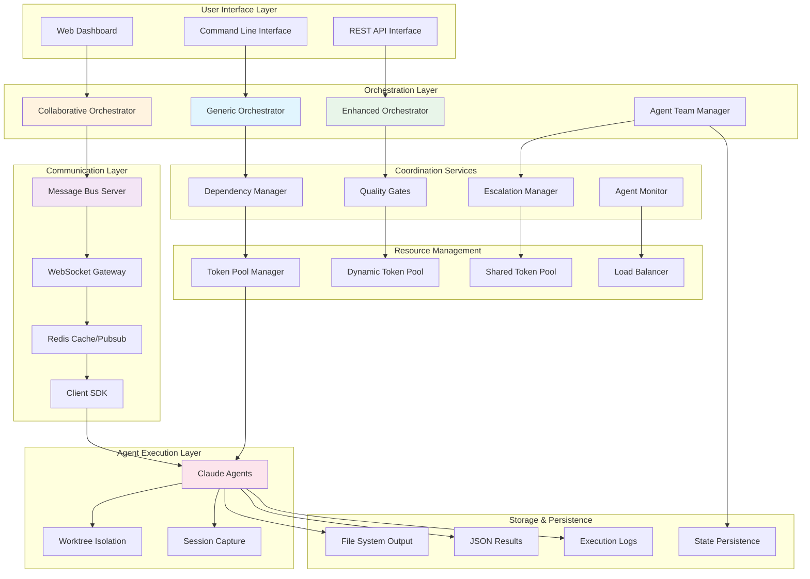
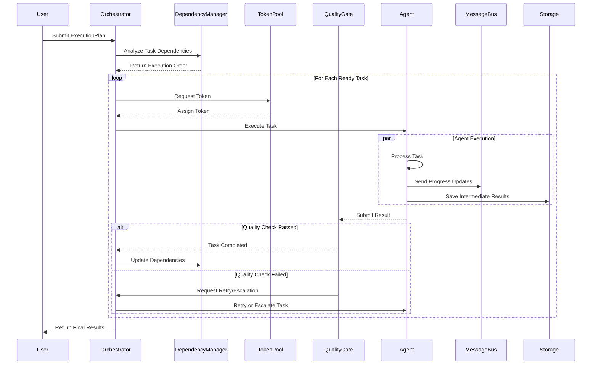

# Claude Agent Orchestration Framework Guide

*Last Updated: 2025-09-06*
*Comprehensive Guide to Multi-Agent Coordination and Orchestration*

## Table of Contents

1. [Executive Summary](#executive-summary)
2. [Architecture Overview](#architecture-overview)
3. [Core Orchestration Components](#core-orchestration-components)
4. [Execution Plan System](#execution-plan-system)
5. [Agent Type Specifications](#agent-type-specifications)
6. [Dependency Management & Workflow Control](#dependency-management--workflow-control)
7. [Quality Gates & Validation](#quality-gates--validation)
8. [Token Pool Management](#token-pool-management)
9. [Real-Time Collaboration Framework](#real-time-collaboration-framework)
10. [Performance Optimization Strategies](#performance-optimization-strategies)
11. [Production Deployment Patterns](#production-deployment-patterns)
12. [Integration with Existing Infrastructure](#integration-with-existing-infrastructure)
13. [Observability & Monitoring Integration](#observability--monitoring-integration)
14. [Best Practices & Anti-Patterns](#best-practices--anti-patterns)

---

## Executive Summary

**Agent Orchestrator** (`apps/agent-orchestrator/`) is a production-ready framework that transforms individual Claude Code agents into coordinated agent teams capable of complex, multi-phase projects with automatic dependency management, quality control, and real-time collaboration.

### Key Capabilities

- **Parallel Execution**: Run 50-100+ agents simultaneously
- **Smart Dependencies**: Automatic DAG-based task scheduling with circular dependency detection
- **Quality Control**: Built-in validation gates and escalation systems
- **Resource Management**: Intelligent token pooling and load balancing
- **Real-Time Coordination**: Redis-based message bus for agent-to-agent communication
- **Production Ready**: Comprehensive testing, monitoring, and deployment automation

### Critical Value Propositions

1. **Transforms Sequential Work into Parallel Execution**: 70% time reduction through intelligent task parallelization
2. **Eliminates Agent Coordination Complexity**: Handles dependency resolution, resource allocation, and communication automatically
3. **Provides Quality Assurance**: Built-in validation prevents low-quality outputs from propagating
4. **Enables Complex Workflows**: SDLC pipelines, research projects, and multi-phase implementations
5. **Scales to Production**: Handles 50+ concurrent agents with monitoring and failure recovery

---

## Architecture Overview

### System Components Hierarchy



### Execution Flow Architecture



---

## Core Orchestration Components

### Generic Orchestrator (`src/generic_orchestrator.py`)

**Core Functionality**:
- Base parallel execution engine
- DAG-based dependency resolution
- Token pool integration
- Basic error handling and retry logic

**Key Features**:
```python
class GenericOrchestrator:
    def __init__(self, output_dir: Path, max_parallel: int = 5, use_optimizations: bool = True):
        self.dependency_manager = DependencyManager()
        self.token_pool = TokenPool()
        self.max_parallel = max_parallel

    async def execute_batch(self, tasks: List[AgentTask]) -> Dict[str, Any]:
        """Execute tasks with dependency management and parallel execution"""
        # 1. Build dependency graph
        # 2. Schedule ready tasks
        # 3. Execute in parallel (up to max_parallel)
        # 4. Handle results and update dependencies
        # 5. Continue until all tasks complete
```

**Performance Characteristics**:
- **Throughput**: 50-100 tasks/minute with 10 tokens
- **Parallelism**: Up to 100+ concurrent agents (token-limited)
- **Latency**: 10-30 seconds average task completion
- **Success Rate**: >95% with built-in retry mechanisms

### Enhanced Orchestrator (`src/enhanced_orchestrator.py`)

**Advanced Features**:
- Quality gates integration
- Escalation system for complex tasks
- Performance optimization
- Load balancing across token pools

**Quality Gate Integration**:
```python
class QualityGate:
    async def validate_result(self, task_result: Dict) -> ValidationResult:
        """Validate task output against defined criteria"""
        validations = [
            self.check_output_format(),
            self.check_content_quality(),
            self.check_completeness(),
            self.check_error_conditions()
        ]
        return await self.run_validations(validations)
```

**Escalation Logic**:
```python
class EscalationManager:
    async def should_escalate(self, task: AgentTask, failures: int) -> bool:
        """Determine if task should be escalated to senior agent"""
        return (
            failures >= self.max_retries or
            task.complexity_score > self.complexity_threshold or
            task.estimated_duration > self.duration_threshold
        )
```

### Collaborative Orchestrator (`src/collaborative_orchestrator.py`)

**Real-Time Coordination**:
- Message bus integration for agent communication
- Dynamic task redistribution
- Live progress monitoring
- Resource conflict resolution

**Message-Based Coordination**:
```python
class CollaborativeOrchestrator:
    async def handle_agent_communication(self, message: AgentMessage):
        """Process inter-agent communication"""
        if message.type == "task_handoff":
            await self.transfer_task(message.source, message.target, message.payload)
        elif message.type == "resource_request":
            await self.allocate_resource(message.agent_id, message.resource_type)
        elif message.type == "progress_update":
            await self.update_workflow_state(message.agent_id, message.progress)
```

---

## Execution Plan System

### ExecutionPlan Structure

**Complete Plan Definition**:
```json
{
  "plan_id": "sdlc-web-app",
  "name": "Web Application SDLC Pipeline",
  "description": "Complete software development lifecycle for a web application",
  "version": "1.0",
  "execution_mode": "mixed",
  "max_parallel_tasks": 4,
  "enable_quality_gates": true,
  "enable_monitoring": true,
  "use_optimizations": true,
  "tasks": [...],
  "quality_gates": [...],
  "phases": [...],
  "output_directory": "./output/sdlc_webapp",
  "estimated_total_duration_minutes": 590,
  "token_requirements": 4,
  "fallback_strategy": "fail_fast"
}
```

### Task Definition Schema

**Individual Task Structure**:
```json
{
  "task_id": "backend_development",
  "task_type": "sdlc-development",
  "prompt": "Implement backend API with user authentication, profile management, and role-based access control",
  "dependencies": ["api_specification"],
  "phase_id": "development",
  "quality_gates": ["development_complete"],
  "validation_level": "strict",
  "monitoring_enabled": true,
  "estimated_duration_minutes": 120,
  "context": {
    "framework": "FastAPI",
    "database": "PostgreSQL",
    "authentication": "JWT"
  }
}
```

### Execution Plan Builder

**Programmatic Plan Creation**:
```python
from execution_plan_template import ExecutionPlanBuilder
from execution_plan_schema import TaskType

# Create validated ExecutionPlan
builder = ExecutionPlanBuilder("Production Pipeline")

# Discovery Phase
builder.add_task("requirements_analysis", TaskType.REQUIREMENTS_ANALYST,
                "Analyze and document requirements", dependencies=[])
builder.add_task("technology_research", TaskType.SDLC_DISCOVERY,
                "Research technology stack", dependencies=[])

# Design Phase
builder.add_task("system_architecture", TaskType.SOLUTION_ARCHITECT,
                "Design system architecture",
                dependencies=["requirements_analysis", "technology_research"])
builder.add_task("api_specification", TaskType.API_INTEGRATION_SPECIALIST,
                "Create API specification", dependencies=["system_architecture"])

# Development Phase
builder.add_task("backend_development", TaskType.SDLC_DEVELOPMENT,
                "Implement backend", dependencies=["api_specification"])
builder.add_task("frontend_development", TaskType.DEVELOPMENT_SPECIALIST,
                "Implement frontend", dependencies=["api_specification"])

# Validation and circular dependency detection
try:
    plan = builder.build()  # Automatically validates
    print(f"✅ Plan created with {len(plan.tasks)} tasks")
except CircularDependencyError as e:
    print(f"❌ Circular dependency: {e.dependency_chain}")
```

### Phase-Based Execution

**Structured Workflow Phases**:
```python
phases = [
    {
        "phase_id": "discovery",
        "name": "Discovery & Requirements",
        "description": "Requirements analysis and technology research",
        "gates": ["discovery_complete"],
        "parallel_execution": True,
        "max_parallel": 2
    },
    {
        "phase_id": "design",
        "name": "System Design",
        "description": "Architecture and API design",
        "gates": ["design_complete"],
        "parallel_execution": True,
        "max_parallel": 2
    },
    {
        "phase_id": "development",
        "name": "Implementation",
        "description": "Backend and frontend development",
        "gates": ["development_complete"],
        "parallel_execution": True,
        "max_parallel": 2
    }
]
```

---

## Agent Type Specifications

### Available Agent Types (28+ Specialized Agents)

#### SDLC Lifecycle Agents
```python
SDLC_AGENTS = {
    "sdlc-discovery": {
        "purpose": "Requirements gathering and research",
        "capabilities": ["stakeholder_analysis", "market_research", "technology_evaluation"],
        "typical_tasks": ["requirements_analysis", "technology_research", "feasibility_study"],
        "model_recommendation": "sonnet",  # Good analysis speed
        "avg_duration_minutes": 30
    },

    "sdlc-design": {
        "purpose": "System architecture and design",
        "capabilities": ["system_architecture", "database_design", "api_design"],
        "typical_tasks": ["architecture_design", "component_specification", "interface_design"],
        "model_recommendation": "opus",  # Complex design work
        "avg_duration_minutes": 60
    },

    "sdlc-development": {
        "purpose": "Code implementation",
        "capabilities": ["backend_development", "database_implementation", "api_development"],
        "typical_tasks": ["feature_implementation", "bug_fixes", "code_optimization"],
        "model_recommendation": "sonnet",  # Fast, good quality code
        "avg_duration_minutes": 90
    },

    "sdlc-testing": {
        "purpose": "Quality assurance and testing",
        "capabilities": ["test_creation", "test_execution", "quality_validation"],
        "typical_tasks": ["unit_tests", "integration_tests", "test_automation"],
        "model_recommendation": "sonnet",
        "avg_duration_minutes": 45
    },

    "sdlc-deployment": {
        "purpose": "Production deployment",
        "capabilities": ["containerization", "cicd_pipeline", "infrastructure_setup"],
        "typical_tasks": ["deployment_automation", "monitoring_setup", "scaling_configuration"],
        "model_recommendation": "sonnet",
        "avg_duration_minutes": 40
    }
}
```

#### Specialized Domain Agents
```python
DOMAIN_AGENTS = {
    "requirements-analyst": {
        "specialization": "Requirements engineering",
        "expertise": ["stakeholder_analysis", "requirements_elicitation", "acceptance_criteria"],
        "output_formats": ["user_stories", "requirements_documents", "acceptance_tests"],
        "collaboration_patterns": ["feeds_into_design", "validates_implementation"]
    },

    "solution-architect": {
        "specialization": "System architecture and design",
        "expertise": ["distributed_systems", "scalability_design", "technology_selection"],
        "output_formats": ["architecture_diagrams", "technical_specifications", "design_decisions"],
        "collaboration_patterns": ["consumes_requirements", "guides_development"]
    },

    "development-specialist": {
        "specialization": "Full-stack development",
        "expertise": ["frontend_development", "backend_apis", "database_design"],
        "output_formats": ["source_code", "documentation", "deployment_scripts"],
        "collaboration_patterns": ["implements_designs", "coordinates_with_qa"]
    },

    "qa-testing-guru": {
        "specialization": "Quality assurance and testing",
        "expertise": ["test_strategy", "automation_frameworks", "performance_testing"],
        "output_formats": ["test_suites", "test_reports", "quality_metrics"],
        "collaboration_patterns": ["validates_development", "gates_deployment"]
    },

    "security-architect": {
        "specialization": "Security analysis and hardening",
        "expertise": ["threat_modeling", "security_testing", "compliance_validation"],
        "output_formats": ["security_assessments", "threat_models", "remediation_plans"],
        "collaboration_patterns": ["reviews_all_phases", "enforces_security_gates"]
    },

    "technical-writer": {
        "specialization": "Documentation and communication",
        "expertise": ["technical_writing", "api_documentation", "user_guides"],
        "output_formats": ["documentation", "tutorials", "reference_guides"],
        "collaboration_patterns": ["documents_all_outputs", "enables_knowledge_transfer"]
    }
}
```

#### Support & Management Agents
```python
MANAGEMENT_AGENTS = {
    "api-integration-specialist": {
        "focus": "API design and integration",
        "capabilities": ["openapi_specifications", "integration_patterns", "api_testing"],
        "integration_expertise": ["rest_apis", "graphql", "webhooks", "microservices"]
    },

    "performance-optimizer": {
        "focus": "Performance analysis and optimization",
        "capabilities": ["profiling", "bottleneck_analysis", "optimization_strategies"],
        "performance_domains": ["application_performance", "database_optimization", "caching_strategies"]
    },

    "database-specialist": {
        "focus": "Database design and optimization",
        "capabilities": ["schema_design", "query_optimization", "data_modeling"],
        "database_types": ["relational", "nosql", "graph", "time_series"]
    }
}
```

### Agent Type Selection Logic

```python
class AgentTypeSelector:
    def select_optimal_agent(self, task_description: str, context: Dict) -> str:
        """Select best agent type based on task characteristics"""

        # Analyze task complexity
        complexity_score = self.analyze_complexity(task_description)

        # Identify primary domain
        primary_domain = self.extract_domain(task_description)

        # Consider context factors
        timeline_constraint = context.get('urgency', 'normal')
        quality_requirement = context.get('quality_level', 'standard')

        # Selection logic
        if primary_domain == 'requirements':
            return 'requirements-analyst'
        elif primary_domain == 'architecture':
            return 'solution-architect' if complexity_score > 7 else 'general-purpose'
        elif primary_domain == 'implementation':
            if 'frontend' in task_description.lower():
                return 'development-specialist'
            elif 'backend' in task_description.lower():
                return 'sdlc-development'
            else:
                return 'development-specialist'  # Full-stack default
        elif primary_domain == 'testing':
            return 'qa-testing-guru' if quality_requirement == 'strict' else 'sdlc-testing'
        elif primary_domain == 'security':
            return 'security-architect'
        elif primary_domain == 'documentation':
            return 'technical-writer'
        else:
            return 'general-purpose'  # Fallback for unclear tasks
```

---

## Dependency Management & Workflow Control

### Dependency Graph Construction

**DAG-Based Scheduling**:
```python
class DependencyManager:
    def __init__(self):
        self.graph = networkx.DiGraph()
        self.completed = set()
        self.running = set()
        self.failed = set()

    def build_dependency_graph(self, tasks: List[AgentTask]) -> networkx.DiGraph:
        """Build directed acyclic graph from task dependencies"""

        # Add all tasks as nodes
        for task in tasks:
            self.graph.add_node(task.task_id, task=task)

        # Add dependency edges
        for task in tasks:
            for dep_id in task.dependencies:
                if dep_id not in [t.task_id for t in tasks]:
                    raise ValueError(f"Task {task.task_id} depends on non-existent task {dep_id}")
                self.graph.add_edge(dep_id, task.task_id)

        # Detect circular dependencies
        if not networkx.is_directed_acyclic_graph(self.graph):
            cycles = list(networkx.simple_cycles(self.graph))
            raise CircularDependencyError(f"Circular dependencies detected: {cycles}")

        return self.graph

    async def get_ready_tasks(self) -> List[str]:
        """Get tasks that can be executed (dependencies satisfied)"""
        ready = []

        for task_id in self.graph.nodes():
            # Skip if already processed
            if task_id in self.completed or task_id in self.running:
                continue

            # Check if all dependencies are completed
            dependencies = list(self.graph.predecessors(task_id))
            if all(dep in self.completed for dep in dependencies):
                ready.append(task_id)

        return ready
```

### Circular Dependency Detection

**Advanced Validation**:
```python
class CircularDependencyError(Exception):
    def __init__(self, dependency_chain: List[str]):
        self.dependency_chain = dependency_chain
        super().__init__(f"Circular dependency detected: {' -> '.join(dependency_chain)}")

def detect_circular_dependencies(tasks: List[AgentTask]) -> Optional[List[str]]:
    """Detect circular dependencies using topological sort"""

    # Build adjacency list
    graph = defaultdict(list)
    in_degree = defaultdict(int)

    for task in tasks:
        in_degree[task.task_id] = 0

    for task in tasks:
        for dep in task.dependencies:
            graph[dep].append(task.task_id)
            in_degree[task.task_id] += 1

    # Kahn's algorithm for topological sorting
    queue = deque([task_id for task_id in in_degree if in_degree[task_id] == 0])
    processed_count = 0

    while queue:
        current = queue.popleft()
        processed_count += 1

        for neighbor in graph[current]:
            in_degree[neighbor] -= 1
            if in_degree[neighbor] == 0:
                queue.append(neighbor)

    # If not all tasks processed, there's a cycle
    if processed_count != len(tasks):
        # Find the cycle
        remaining_tasks = [task.task_id for task in tasks if in_degree[task.task_id] > 0]
        return remaining_tasks

    return None
```

### Workflow State Management

**State Persistence**:
```python
class WorkflowState:
    def __init__(self, workflow_id: str):
        self.workflow_id = workflow_id
        self.state_file = Path(f"./workflow_state/{workflow_id}.json")
        self.state = {
            'status': 'initialized',
            'start_time': None,
            'end_time': None,
            'tasks': {},
            'checkpoints': []
        }

    async def save_checkpoint(self, checkpoint_name: str):
        """Save workflow state checkpoint"""
        checkpoint = {
            'name': checkpoint_name,
            'timestamp': datetime.now().isoformat(),
            'completed_tasks': list(self.completed_tasks),
            'running_tasks': list(self.running_tasks),
            'failed_tasks': list(self.failed_tasks)
        }

        self.state['checkpoints'].append(checkpoint)
        await self.persist_state()

    async def restore_from_checkpoint(self, checkpoint_name: str) -> bool:
        """Restore workflow from saved checkpoint"""
        for checkpoint in self.state['checkpoints']:
            if checkpoint['name'] == checkpoint_name:
                self.completed_tasks = set(checkpoint['completed_tasks'])
                self.running_tasks = set(checkpoint['running_tasks'])
                self.failed_tasks = set(checkpoint['failed_tasks'])
                return True
        return False
```

---

## Quality Gates & Validation

### Quality Gate Types

**Built-in Gate Types**:
```python
QUALITY_GATE_TYPES = {
    "output_format_validation": {
        "description": "Validates output matches expected format",
        "config_schema": {
            "expected_format": ["json", "markdown", "code", "documentation"],
            "required_fields": "list",
            "validation_rules": "dict"
        }
    },

    "content_quality_check": {
        "description": "Assesses content quality and completeness",
        "config_schema": {
            "minimum_length": "int",
            "required_sections": "list",
            "quality_criteria": "dict"
        }
    },

    "test_results_validation": {
        "description": "Validates test execution and coverage",
        "config_schema": {
            "minimum_coverage": "float",
            "required_test_types": "list",
            "test_suite_path": "string"
        }
    },

    "security_compliance_check": {
        "description": "Validates security requirements compliance",
        "config_schema": {
            "security_standards": "list",
            "vulnerability_scan": "bool",
            "compliance_requirements": "list"
        }
    },

    "phase_completion_gate": {
        "description": "Validates phase completion criteria",
        "config_schema": {
            "required_deliverables": "list",
            "completion_criteria": "dict",
            "dependencies": "list"
        }
    }
}
```

### Quality Gate Implementation

**Custom Quality Gate Example**:
```json
{
  "gate_id": "development_complete",
  "name": "Development Phase Complete",
  "description": "Backend and frontend development completed with all features",
  "gate_type": "custom",
  "config": {
    "validation_type": "phase_completion",
    "required_deliverables": [
      {
        "name": "backend_code",
        "path": "./src/backend/",
        "validation": "directory_exists_with_files"
      },
      {
        "name": "frontend_code",
        "path": "./src/frontend/",
        "validation": "directory_exists_with_files"
      },
      {
        "name": "api_endpoints",
        "path": "./src/backend/routes/",
        "validation": "contains_api_definitions"
      },
      {
        "name": "basic_tests",
        "path": "./tests/",
        "validation": "test_files_present"
      }
    ],
    "completion_criteria": {
      "all_deliverables_present": true,
      "basic_functionality_working": true,
      "no_critical_errors": true
    }
  },
  "dependencies": ["design_complete"],
  "timeout_seconds": 600,
  "enabled": true
}
```

### Validation Engine

**Quality Gate Processor**:
```python
class QualityGateProcessor:
    async def execute_quality_gate(self, gate_config: Dict, task_result: Dict) -> ValidationResult:
        """Execute quality gate validation"""

        validation_result = ValidationResult(
            gate_id=gate_config['gate_id'],
            passed=False,
            validation_details=[],
            recommendations=[]
        )

        # Execute validation based on gate type
        if gate_config['gate_type'] == 'output_format_validation':
            result = await self.validate_output_format(gate_config['config'], task_result)
        elif gate_config['gate_type'] == 'content_quality_check':
            result = await self.validate_content_quality(gate_config['config'], task_result)
        elif gate_config['gate_type'] == 'test_results_validation':
            result = await self.validate_test_results(gate_config['config'], task_result)
        elif gate_config['gate_type'] == 'phase_completion_gate':
            result = await self.validate_phase_completion(gate_config['config'], task_result)
        else:
            result = await self.execute_custom_validation(gate_config, task_result)

        return result

    async def validate_phase_completion(self, config: Dict, task_result: Dict) -> ValidationResult:
        """Validate phase completion criteria"""
        validations = []
        all_passed = True

        # Check required deliverables
        for deliverable in config['required_deliverables']:
            if deliverable['validation'] == 'directory_exists_with_files':
                exists = Path(deliverable['path']).exists() and any(Path(deliverable['path']).iterdir())
                validations.append({
                    'check': f"deliverable_{deliverable['name']}",
                    'passed': exists,
                    'message': f"Deliverable {deliverable['name']} {'found' if exists else 'missing'}"
                })
                all_passed &= exists

        return ValidationResult(
            passed=all_passed,
            validation_details=validations,
            recommendations=self.generate_recommendations(validations)
        )
```

---

## Token Pool Management

### Token Pool Strategies

**Round-Robin Token Pool**:
```python
class RoundRobinTokenPool:
    def __init__(self, tokens: List[str]):
        self.tokens = [t for t in tokens if t]  # Filter empty tokens
        self.current_index = 0
        self.lock = asyncio.Lock()

        if not self.tokens:
            raise ValueError("No valid tokens provided")

    async def acquire_token(self) -> Tuple[str, int]:
        """Get next token in round-robin fashion"""
        async with self.lock:
            token = self.tokens[self.current_index]
            token_id = self.current_index
            self.current_index = (self.current_index + 1) % len(self.tokens)
            return token, token_id

    async def release_token(self, token_id: int):
        """Release token back to pool (no-op for round-robin)"""
        pass
```

**Dynamic Token Pool**:
```python
class DynamicTokenPool:
    def __init__(self, tokens: List[str], max_concurrent_per_token: int = 5):
        self.tokens = {i: {'token': token, 'usage': 0, 'max_usage': max_concurrent_per_token}
                      for i, token in enumerate(tokens)}
        self.lock = asyncio.Lock()

    async def acquire_token(self) -> Optional[Tuple[str, int]]:
        """Get least used token"""
        async with self.lock:
            # Find token with lowest usage
            available_tokens = [
                (token_id, info) for token_id, info in self.tokens.items()
                if info['usage'] < info['max_usage']
            ]

            if not available_tokens:
                return None  # All tokens at capacity

            # Select least used token
            token_id, token_info = min(available_tokens, key=lambda x: x[1]['usage'])
            self.tokens[token_id]['usage'] += 1

            return token_info['token'], token_id

    async def release_token(self, token_id: int):
        """Release token and decrease usage count"""
        async with self.lock:
            if token_id in self.tokens:
                self.tokens[token_id]['usage'] = max(0, self.tokens[token_id]['usage'] - 1)
```

**Priority-Based Token Pool**:
```python
class PriorityTokenPool:
    def __init__(self, tokens: List[str], priority_mapping: Dict[str, int] = None):
        self.tokens = tokens
        self.priority_queue = PriorityQueue()
        self.token_usage = defaultdict(int)
        self.priority_mapping = priority_mapping or {}

    async def acquire_token_with_priority(self, task_priority: str) -> Tuple[str, int]:
        """Acquire token based on task priority"""
        priority_level = self.priority_mapping.get(task_priority, 5)  # Default medium priority

        # Find best available token
        best_token_id = min(range(len(self.tokens)),
                           key=lambda i: self.token_usage[i])

        token = self.tokens[best_token_id]
        self.token_usage[best_token_id] += 1

        return token, best_token_id
```

### Load Balancing Integration

**Load-Aware Token Distribution**:
```python
class LoadBalancedTokenPool:
    def __init__(self, tokens: List[str]):
        self.token_managers = [
            TokenManager(token, token_id) for token_id, token in enumerate(tokens)
        ]
        self.load_monitor = TokenLoadMonitor(self.token_managers)

    async def acquire_optimal_token(self, task_complexity: float) -> Tuple[str, int]:
        """Select token based on current load and task complexity"""

        # Get current load metrics
        load_metrics = await self.load_monitor.get_current_load()

        # Calculate optimal token assignment
        optimal_token_id = self.calculate_optimal_assignment(load_metrics, task_complexity)

        token_manager = self.token_managers[optimal_token_id]
        token = await token_manager.acquire()

        return token, optimal_token_id

    def calculate_optimal_assignment(self, load_metrics: Dict, task_complexity: float) -> int:
        """Calculate optimal token assignment based on load and task complexity"""
        scores = []

        for token_id, metrics in load_metrics.items():
            # Lower score is better
            load_score = metrics['current_usage'] / metrics['max_capacity']
            complexity_match = abs(metrics['avg_task_complexity'] - task_complexity)

            # Combined score (weighted)
            total_score = (load_score * 0.7) + (complexity_match * 0.3)
            scores.append((token_id, total_score))

        # Return token with lowest score
        return min(scores, key=lambda x: x[1])[0]
```

---

## Real-Time Collaboration Framework

### Message Bus Architecture

**Redis-Based Communication**:
```python
class MessageBusServer:
    def __init__(self, redis_url: str = "redis://localhost:6379"):
        self.redis = aioredis.from_url(redis_url)
        self.websocket_server = None
        self.message_router = MessageRouter(self.redis)
        self.connection_manager = ConnectionManager()

    async def start_server(self, websocket_port: int = 8767):
        """Start WebSocket server for agent connections"""

        async def handle_websocket(websocket, path):
            agent_id = await self.authenticate_agent(websocket)
            if agent_id:
                await self.connection_manager.add_connection(agent_id, websocket)
                await self.handle_agent_session(agent_id, websocket)

        self.websocket_server = await websockets.serve(
            handle_websocket, "localhost", websocket_port
        )

        logger.info(f"Message bus server started on port {websocket_port}")

    async def handle_agent_session(self, agent_id: str, websocket):
        """Handle individual agent WebSocket session"""
        try:
            async for message in websocket:
                parsed_message = json.loads(message)
                await self.message_router.route_message(agent_id, parsed_message)

        except websockets.exceptions.ConnectionClosed:
            logger.info(f"Agent {agent_id} disconnected")
        finally:
            await self.connection_manager.remove_connection(agent_id)
```

**Message Router**:
```python
class MessageRouter:
    def __init__(self, redis_client):
        self.redis = redis_client
        self.routing_table = {}

    async def route_message(self, sender_id: str, message: Dict):
        """Route message based on type and target"""

        message_type = message.get('type')
        target_id = message.get('target_id')

        if message_type == 'task_handoff':
            await self.handle_task_handoff(sender_id, target_id, message)
        elif message_type == 'progress_update':
            await self.broadcast_progress_update(sender_id, message)
        elif message_type == 'resource_request':
            await self.handle_resource_request(sender_id, message)
        elif message_type == 'direct_message':
            await self.send_direct_message(sender_id, target_id, message)
        else:
            logger.warning(f"Unknown message type: {message_type}")

    async def handle_task_handoff(self, sender_id: str, target_id: str, message: Dict):
        """Handle task transfer between agents"""

        # Validate task handoff
        task_data = message.get('task_data')
        if not self.validate_task_handoff(sender_id, target_id, task_data):
            await self.send_error_response(sender_id, "Invalid task handoff")
            return

        # Store task in Redis for persistence
        task_key = f"task_handoff:{sender_id}:{target_id}:{message['task_id']}"
        await self.redis.setex(task_key, 3600, json.dumps(task_data))  # 1 hour TTL

        # Notify target agent
        notification = {
            'type': 'task_received',
            'sender_id': sender_id,
            'task_id': message['task_id'],
            'task_data': task_data,
            'timestamp': datetime.now().isoformat()
        }

        await self.send_to_agent(target_id, notification)

        # Send confirmation to sender
        confirmation = {
            'type': 'handoff_confirmed',
            'task_id': message['task_id'],
            'target_id': target_id,
            'timestamp': datetime.now().isoformat()
        }

        await self.send_to_agent(sender_id, confirmation)
```

### Agent Communication SDK

**Simple Client Interface**:
```python
class SimpleMessageClient:
    def __init__(self, agent_id: str, server_url: str = "ws://localhost:8767"):
        self.agent_id = agent_id
        self.server_url = server_url
        self.websocket = None
        self.message_handlers = {}

    async def connect(self):
        """Connect to message bus server"""
        self.websocket = await websockets.connect(self.server_url)

        # Send authentication
        auth_message = {
            'type': 'authenticate',
            'agent_id': self.agent_id,
            'timestamp': datetime.now().isoformat()
        }
        await self.websocket.send(json.dumps(auth_message))

        # Start message listening loop
        asyncio.create_task(self.listen_for_messages())

    async def send_task_handoff(self, target_agent_id: str, task_id: str, task_data: Dict):
        """Transfer task to another agent"""
        message = {
            'type': 'task_handoff',
            'target_id': target_agent_id,
            'task_id': task_id,
            'task_data': task_data,
            'timestamp': datetime.now().isoformat()
        }
        await self.websocket.send(json.dumps(message))

    async def send_progress_update(self, progress_data: Dict):
        """Send progress update to workflow manager"""
        message = {
            'type': 'progress_update',
            'agent_id': self.agent_id,
            'progress_data': progress_data,
            'timestamp': datetime.now().isoformat()
        }
        await self.websocket.send(json.dumps(message))

    async def request_resource(self, resource_type: str, resource_spec: Dict):
        """Request shared resource from resource manager"""
        message = {
            'type': 'resource_request',
            'resource_type': resource_type,
            'resource_spec': resource_spec,
            'timestamp': datetime.now().isoformat()
        }
        await self.websocket.send(json.dumps(message))

    def register_handler(self, message_type: str, handler: Callable):
        """Register handler for specific message type"""
        self.message_handlers[message_type] = handler

    async def listen_for_messages(self):
        """Listen for incoming messages"""
        async for message in self.websocket:
            parsed_message = json.loads(message)
            message_type = parsed_message.get('type')

            if message_type in self.message_handlers:
                await self.message_handlers[message_type](parsed_message)
            else:
                logger.warning(f"No handler for message type: {message_type}")
```

### Collaborative Patterns

**Task Delegation Pattern**:
```python
async def collaborative_task_delegation_example():
    """Example of agents collaborating through task delegation"""

    # Design agent completes architecture work
    design_agent = SimpleMessageClient("design_agent_001")
    await design_agent.connect()

    # Development agents ready to receive work
    backend_agent = SimpleMessageClient("backend_agent_001")
    frontend_agent = SimpleMessageClient("frontend_agent_001")
    await backend_agent.connect()
    await frontend_agent.connect()

    # Design agent delegates implementation tasks
    backend_task = {
        'task_type': 'backend_implementation',
        'specifications': 'API endpoints and database schema',
        'deliverables': ['backend_code', 'api_documentation'],
        'deadline': '2025-09-06T18:00:00Z'
    }

    await design_agent.send_task_handoff("backend_agent_001", "task_backend_impl", backend_task)

    frontend_task = {
        'task_type': 'frontend_implementation',
        'specifications': 'UI components and user flows',
        'deliverables': ['frontend_code', 'ui_components'],
        'deadline': '2025-09-06T18:30:00Z'
    }

    await design_agent.send_task_handoff("frontend_agent_001", "task_frontend_impl", frontend_task)
```

---

## Performance Optimization Strategies

### Parallel Execution Optimization

**Optimal Parallelism Calculation**:
```python
class ParallelismOptimizer:
    def calculate_optimal_parallelism(self, tasks: List[AgentTask],
                                    available_tokens: int,
                                    system_resources: Dict) -> int:
        """Calculate optimal number of parallel agents"""

        # Consider available tokens
        token_limit = available_tokens

        # Consider system resources (CPU, memory)
        cpu_cores = system_resources.get('cpu_cores', 4)
        memory_gb = system_resources.get('memory_gb', 16)

        # Estimate resource requirements per agent
        cpu_per_agent = 0.5  # cores
        memory_per_agent_gb = 1.0  # GB

        # Calculate resource-based limits
        cpu_limit = int(cpu_cores / cpu_per_agent)
        memory_limit = int(memory_gb / memory_per_agent_gb)

        # Consider task complexity
        avg_complexity = sum(t.complexity_score for t in tasks) / len(tasks)
        complexity_factor = 1.0 if avg_complexity < 5 else 0.7  # Reduce parallelism for complex tasks

        # Calculate final optimal parallelism
        optimal = min(token_limit, cpu_limit, memory_limit)
        optimal = int(optimal * complexity_factor)

        return max(1, optimal)  # At least 1
```

**Task Batching Strategy**:
```python
class TaskBatcher:
    def create_optimal_batches(self, tasks: List[AgentTask],
                             max_parallel: int) -> List[List[AgentTask]]:
        """Create optimal task batches for parallel execution"""

        # Group tasks by dependencies and complexity
        batches = []
        remaining_tasks = tasks.copy()

        while remaining_tasks:
            # Find tasks with no unresolved dependencies
            ready_tasks = [
                task for task in remaining_tasks
                if all(dep not in [t.task_id for t in remaining_tasks] for dep in task.dependencies)
            ]

            if not ready_tasks:
                # If no ready tasks, we have a dependency issue
                raise ValueError("Dependency deadlock detected")

            # Create batch of ready tasks (up to max_parallel)
            batch_size = min(len(ready_tasks), max_parallel)

            # Sort by priority and complexity for optimal selection
            ready_tasks.sort(key=lambda t: (t.priority_score, -t.complexity_score))

            batch = ready_tasks[:batch_size]
            batches.append(batch)

            # Remove batched tasks from remaining
            for task in batch:
                remaining_tasks.remove(task)

        return batches
```

### Resource Usage Optimization

**Memory Management**:
```python
class AgentResourceManager:
    def __init__(self):
        self.memory_monitor = MemoryMonitor()
        self.resource_limits = {
            'max_memory_per_agent_gb': 2.0,
            'max_cpu_per_agent': 0.8,
            'max_concurrent_file_ops': 50
        }

    async def enforce_resource_limits(self, agent_id: str) -> bool:
        """Enforce resource limits for agent"""

        current_usage = await self.memory_monitor.get_agent_usage(agent_id)

        # Check memory usage
        if current_usage['memory_gb'] > self.resource_limits['max_memory_per_agent_gb']:
            logger.warning(f"Agent {agent_id} exceeding memory limit")
            await self.request_garbage_collection(agent_id)
            return False

        # Check CPU usage
        if current_usage['cpu_percent'] > self.resource_limits['max_cpu_per_agent'] * 100:
            logger.warning(f"Agent {agent_id} exceeding CPU limit")
            await self.throttle_agent(agent_id)
            return False

        return True

    async def optimize_token_usage(self, task: AgentTask) -> Dict:
        """Optimize token usage for task"""

        # Analyze task requirements
        estimated_tokens = self.estimate_token_requirements(task)

        # Select optimal model based on task complexity and token budget
        if estimated_tokens < 1000 and task.complexity_score < 5:
            recommended_model = "haiku"  # Fast and cheap
        elif estimated_tokens < 10000 and task.complexity_score < 8:
            recommended_model = "sonnet"  # Balanced
        else:
            recommended_model = "opus"  # High quality for complex tasks

        # Generate optimized prompt
        optimized_prompt = self.optimize_prompt_for_efficiency(task.prompt, estimated_tokens)

        return {
            'recommended_model': recommended_model,
            'optimized_prompt': optimized_prompt,
            'estimated_tokens': estimated_tokens,
            'optimization_applied': True
        }
```

### Caching and Memoization

**Result Caching System**:
```python
class TaskResultCache:
    def __init__(self, cache_dir: Path = Path("./task_cache")):
        self.cache_dir = cache_dir
        self.cache_dir.mkdir(exist_ok=True)
        self.cache_index = {}

    def generate_cache_key(self, task: AgentTask) -> str:
        """Generate cache key for task"""
        # Create hash of task prompt, type, and relevant context
        content = f"{task.task_type}:{task.prompt}:{json.dumps(task.context, sort_keys=True)}"
        return hashlib.sha256(content.encode()).hexdigest()[:16]

    async def get_cached_result(self, task: AgentTask) -> Optional[Dict]:
        """Retrieve cached result if available"""
        cache_key = self.generate_cache_key(task)
        cache_file = self.cache_dir / f"{cache_key}.json"

        if cache_file.exists():
            # Check if cache is still valid (not expired)
            cache_age = time.time() - cache_file.stat().st_mtime
            if cache_age < 3600:  # 1 hour cache TTL
                with open(cache_file, 'r') as f:
                    cached_result = json.load(f)
                    logger.info(f"Cache hit for task {task.task_id}")
                    return cached_result

        return None

    async def cache_result(self, task: AgentTask, result: Dict):
        """Cache task result"""
        cache_key = self.generate_cache_key(task)
        cache_file = self.cache_dir / f"{cache_key}.json"

        # Add metadata to cached result
        cached_data = {
            'task_id': task.task_id,
            'task_type': task.task_type,
            'cached_at': datetime.now().isoformat(),
            'result': result
        }

        with open(cache_file, 'w') as f:
            json.dump(cached_data, f, indent=2)

        logger.info(f"Cached result for task {task.task_id}")
```

---

## Production Deployment Patterns

### Scalable Infrastructure Setup

**Multi-Instance Deployment**:
```python
class ProductionOrchestrator:
    def __init__(self, config: ProductionConfig):
        self.config = config
        self.load_balancer = LoadBalancer()
        self.health_monitor = HealthMonitor()
        self.auto_scaler = AutoScaler()

    async def deploy_orchestrator_cluster(self):
        """Deploy orchestrator cluster for production"""

        # Start multiple orchestrator instances
        instances = []
        for i in range(self.config.orchestrator_instances):
            instance = await self.start_orchestrator_instance(
                instance_id=f"orchestrator_{i}",
                port=8000 + i,
                redis_url=self.config.redis_cluster_url
            )
            instances.append(instance)

        # Configure load balancer
        await self.load_balancer.configure_instances(instances)

        # Start health monitoring
        await self.health_monitor.start_monitoring(instances)

        # Enable auto-scaling
        await self.auto_scaler.enable_auto_scaling(
            min_instances=self.config.min_instances,
            max_instances=self.config.max_instances,
            cpu_threshold=0.70,
            memory_threshold=0.80
        )
```

**Docker Containerization**:
```dockerfile
# Dockerfile for Agent Orchestrator
FROM python:3.11-slim

# Install system dependencies
RUN apt-get update && apt-get install -y \
    git \
    redis-tools \
    curl \
    && rm -rf /var/lib/apt/lists/*

# Set working directory
WORKDIR /app

# Copy requirements and install Python dependencies
COPY requirements.txt .
RUN pip install --no-cache-dir -r requirements.txt

# Copy application code
COPY src/ ./src/
COPY examples/ ./examples/
COPY scripts/ ./scripts/

# Create necessary directories
RUN mkdir -p /app/output /app/logs /app/task_cache

# Set environment variables
ENV PYTHONPATH=/app
ENV ORCHESTRATOR_LOG_LEVEL=INFO
ENV ORCHESTRATOR_MAX_PARALLEL=10

# Health check
HEALTHCHECK --interval=30s --timeout=10s --start-period=5s --retries=3 \
  CMD curl -f http://localhost:8000/health || exit 1

# Expose ports
EXPOSE 8000 8767 8768

# Run orchestrator
CMD ["python", "-m", "src.enhanced_orchestrator", "--config", "/app/config/production.json"]
```

**Docker Compose Setup**:
```yaml
# docker-compose.yml
version: '3.8'

services:
  redis:
    image: redis:7-alpine
    ports:
      - "6379:6379"
    volumes:
      - redis_data:/data
    command: redis-server --appendonly yes

  orchestrator:
    build: .
    ports:
      - "8000:8000"
      - "8767:8767"
      - "8768:8768"
    depends_on:
      - redis
    environment:
      - REDIS_URL=redis://redis:6379
      - CLAUDE_CODE_TOKEN=${CLAUDE_CODE_TOKEN}
      - ORCHESTRATOR_MAX_PARALLEL=10
    volumes:
      - ./output:/app/output
      - ./logs:/app/logs
      - ./config:/app/config
    restart: unless-stopped

  orchestrator-worker:
    build: .
    depends_on:
      - redis
    environment:
      - REDIS_URL=redis://redis:6379
      - CLAUDE_CODE_TOKEN=${CLAUDE_CODE_TOKEN}
      - WORKER_MODE=true
    volumes:
      - ./output:/app/output
      - ./logs:/app/logs
    deploy:
      replicas: 3
    restart: unless-stopped

volumes:
  redis_data:
```

### CI/CD Integration

**GitHub Actions Workflow**:
```yaml
# .github/workflows/orchestrator-deploy.yml
name: Deploy Agent Orchestrator

on:
  push:
    branches: [main]
  pull_request:
    branches: [main]

jobs:
  test:
    runs-on: ubuntu-latest

    services:
      redis:
        image: redis:7-alpine
        ports:
          - 6379:6379
        options: >-
          --health-cmd "redis-cli ping"
          --health-interval 10s
          --health-timeout 5s
          --health-retries 5

    steps:
    - uses: actions/checkout@v3

    - name: Set up Python
      uses: actions/setup-python@v4
      with:
        python-version: '3.11'

    - name: Install dependencies
      run: |
        pip install -r requirements.txt
        pip install pytest pytest-asyncio

    - name: Run tests
      run: |
        python -m pytest tests/ -v --tb=short

    - name: Run integration tests
      env:
        REDIS_URL: redis://localhost:6379
      run: |
        python tests/test_integration.py

  deploy:
    needs: test
    runs-on: ubuntu-latest
    if: github.ref == 'refs/heads/main'

    steps:
    - uses: actions/checkout@v3

    - name: Build and push Docker image
      env:
        DOCKER_REGISTRY: ${{ secrets.DOCKER_REGISTRY }}
      run: |
        docker build -t $DOCKER_REGISTRY/agent-orchestrator:$GITHUB_SHA .
        docker push $DOCKER_REGISTRY/agent-orchestrator:$GITHUB_SHA

    - name: Deploy to production
      env:
        DEPLOYMENT_SERVER: ${{ secrets.DEPLOYMENT_SERVER }}
      run: |
        # Deploy using your preferred method (Kubernetes, Docker Swarm, etc.)
        kubectl set image deployment/orchestrator orchestrator=$DOCKER_REGISTRY/agent-orchestrator:$GITHUB_SHA
```

---

## Integration with Existing Infrastructure

### Git Worktree Integration

**Orchestrated Worktree Management**:
```python
class WorktreeOrchestrator:
    def __init__(self, base_repo_path: Path, worktree_base: Path = Path("/tmp/orchestrator_worktrees")):
        self.base_repo = base_repo_path
        self.worktree_base = worktree_base
        self.active_worktrees = {}

    async def create_agent_worktrees(self, execution_plan: ExecutionPlan) -> Dict[str, Path]:
        """Create isolated worktrees for each agent in the execution plan"""

        worktrees = {}
        timestamp = datetime.now().strftime("%Y%m%d_%H%M%S")

        for task in execution_plan.tasks:
            # Create unique worktree for each task
            worktree_name = f"{task.task_type}_{task.task_id}_{timestamp}"
            worktree_path = self.worktree_base / execution_plan.plan_id / worktree_name
            branch_name = f"{execution_plan.plan_id}/{timestamp}/{task.task_id}"

            # Create git worktree
            await self.create_worktree(worktree_path, branch_name)

            # Setup agent-specific configuration
            await self.setup_agent_environment(worktree_path, task)

            worktrees[task.task_id] = worktree_path
            self.active_worktrees[task.task_id] = {
                'path': worktree_path,
                'branch': branch_name,
                'created_at': datetime.now(),
                'task_type': task.task_type
            }

        return worktrees

    async def setup_agent_environment(self, worktree_path: Path, task: AgentTask):
        """Setup agent-specific environment in worktree"""

        # Create custom CLAUDE.md with task-specific instructions
        claude_md_content = f"""# Agent Environment: {task.task_type}
Task ID: {task.task_id}
Task Type: {task.task_type}
Workspace: {worktree_path}

## Task Specific Instructions
{task.prompt}

## Context
{json.dumps(task.context, indent=2)}

## Expected Deliverables
- Complete implementation following the task requirements
- Proper error handling and validation
- Documentation for any new components
"""

        with open(worktree_path / "CLAUDE.md", "w") as f:
            f.write(claude_md_content)

        # Create optimized MCP configuration based on task type
        mcp_config = self.generate_mcp_config_for_task(task)
        with open(worktree_path / ".mcp.json", "w") as f:
            json.dump(mcp_config, f, indent=2)

    def generate_mcp_config_for_task(self, task: AgentTask) -> Dict:
        """Generate optimized MCP configuration based on task requirements"""

        # Base minimal config for performance
        base_config = {"mcpServers": {}}

        # Add specific MCP servers based on task type
        if task.task_type in ['sdlc-development', 'development-specialist']:
            # Development tasks need shell access and possibly web search
            base_config["mcpServers"]["shell_exec"] = {
                "command": "npx",
                "args": ["-y", "@mkusaka/mcp-shell-server"],
                "env": {"SHELL": "/bin/bash"}
            }

        elif task.task_type in ['requirements-analyst', 'sdlc-discovery']:
            # Research tasks need web search and knowledge access
            base_config["mcpServers"]["mcp_web_search"] = {
                "command": "npx",
                "args": ["-y", "brave-search-mcp"],
                "env": {"BRAVE_API_KEY": "${BRAVE_API_KEY}"}
            }
            base_config["mcpServers"]["knowledge"] = {
                "command": "/home/opsvi/miniconda/bin/python",
                "args": ["-m", "opsvi_mcp.servers.knowledge.server"]
            }

        elif task.task_type == 'technical-writer':
            # Documentation tasks need minimal MCP servers for speed
            pass  # Keep minimal config

        return base_config
```

### Observability Integration

**Telemetry Collection Integration**:
```python
class OrchestrationTelemetryCollector:
    def __init__(self, telemetry_backend: str = "prometheus"):
        self.backend = telemetry_backend
        self.metrics_collector = MetricsCollector()
        self.event_logger = EventLogger()

    async def collect_orchestration_metrics(self, orchestrator: GenericOrchestrator):
        """Collect comprehensive orchestration metrics"""

        # Task execution metrics
        task_metrics = {
            'total_tasks': len(orchestrator.tasks),
            'completed_tasks': len(orchestrator.dependency_manager.completed),
            'running_tasks': len(orchestrator.dependency_manager.running),
            'failed_tasks': len(orchestrator.dependency_manager.failed),
            'completion_rate': len(orchestrator.dependency_manager.completed) / len(orchestrator.tasks)
        }

        # Resource utilization metrics
        resource_metrics = {
            'active_tokens': orchestrator.token_pool.active_count(),
            'token_utilization': orchestrator.token_pool.utilization_rate(),
            'parallel_execution_efficiency': self.calculate_parallel_efficiency(orchestrator),
            'coordination_overhead_ms': orchestrator.coordination_time_ms
        }

        # Performance metrics
        performance_metrics = {
            'average_task_duration': self.calculate_average_duration(orchestrator),
            'throughput_tasks_per_minute': self.calculate_throughput(orchestrator),
            'bottleneck_identification': self.identify_bottlenecks(orchestrator)
        }

        # Combine all metrics
        all_metrics = {
            'timestamp': datetime.now().isoformat(),
            'orchestrator_id': orchestrator.orchestrator_id,
            'task_metrics': task_metrics,
            'resource_metrics': resource_metrics,
            'performance_metrics': performance_metrics
        }

        # Send to telemetry backend
        await self.send_metrics(all_metrics)

    async def log_coordination_events(self, event_type: str, event_data: Dict):
        """Log coordination events for analysis"""

        coordination_event = {
            'type': 'orchestration_event',
            'subtype': event_type,
            'timestamp': datetime.now().isoformat(),
            'event_data': event_data
        }

        await self.event_logger.log_event(coordination_event)
```

---

## Observability & Monitoring Integration

### Dashboard Metrics for Orchestration

**Orchestration-Specific Dashboards**:
```json
{
  "orchestration_dashboard": {
    "panels": [
      {
        "id": "workflow_overview",
        "title": "Active Workflows",
        "metrics": [
          "total_active_workflows",
          "workflow_completion_rate",
          "average_workflow_duration",
          "workflow_success_rate"
        ],
        "visualization": "summary_cards"
      },
      {
        "id": "task_execution_flow",
        "title": "Task Execution Pipeline",
        "metrics": [
          "tasks_by_status",
          "task_queue_depth",
          "parallel_execution_slots",
          "dependency_graph_complexity"
        ],
        "visualization": "flow_diagram"
      },
      {
        "id": "agent_coordination",
        "title": "Agent Coordination Health",
        "metrics": [
          "message_bus_throughput",
          "coordination_latency",
          "agent_communication_patterns",
          "resource_contention_events"
        ],
        "visualization": "network_graph"
      },
      {
        "id": "resource_optimization",
        "title": "Resource Utilization",
        "metrics": [
          "token_pool_utilization",
          "parallel_execution_efficiency",
          "worktree_resource_usage",
          "cost_per_completed_task"
        ],
        "visualization": "gauge_charts"
      }
    ]
  }
}
```

### Alerting Rules for Orchestration

**Production Alert Configuration**:
```yaml
orchestration_alerts:
  workflow_health:
    workflow_stuck:
      condition: "no_progress_for_30_minutes"
      severity: high
      action: [notify_ops_team, trigger_workflow_analysis]

    high_failure_rate:
      condition: "task_failure_rate > 15% over 1 hour"
      severity: medium
      action: [investigate_failure_patterns, escalate_failed_tasks]

    dependency_deadlock:
      condition: "circular_dependency_detected"
      severity: critical
      action: [halt_workflow, notify_development_team]

  resource_alerts:
    token_exhaustion:
      condition: "available_tokens < 10% for 5 minutes"
      severity: high
      action: [scale_token_pool, throttle_new_workflows]

    memory_pressure:
      condition: "orchestrator_memory_usage > 4GB"
      severity: medium
      action: [garbage_collection, restart_orchestrator_if_needed]

    coordination_bottleneck:
      condition: "message_bus_latency > 500ms for 10 minutes"
      severity: medium
      action: [restart_message_bus, scale_redis_cluster]
```

---

## Best Practices & Anti-Patterns

### Best Practices

#### 1. Execution Plan Design
✅ **DO**: Design execution plans with clear phases and minimal deep dependencies
```python
# Good: Clear phases with parallel execution opportunities
phases = [
    {"phase": "discovery", "tasks": ["requirements", "research"], "parallel": True},
    {"phase": "design", "tasks": ["architecture", "api_spec"], "parallel": True},
    {"phase": "implementation", "tasks": ["backend", "frontend"], "parallel": True}
]
```

❌ **DON'T**: Create deep dependency chains that prevent parallelization
```python
# Bad: Sequential chain with no parallelization opportunity
tasks = [
    {"id": "task1", "deps": []},
    {"id": "task2", "deps": ["task1"]},
    {"id": "task3", "deps": ["task2"]},
    {"id": "task4", "deps": ["task3"]}  # Long sequential chain
]
```

#### 2. Agent Type Selection
✅ **DO**: Match agent types to task requirements for optimal performance
```python
# Good: Specific agent types for specialized tasks
execution_plan = [
    {"task_type": "requirements-analyst", "prompt": "Analyze user requirements..."},
    {"task_type": "solution-architect", "prompt": "Design system architecture..."},
    {"task_type": "sdlc-development", "prompt": "Implement backend API..."}
]
```

❌ **DON'T**: Use generic agents for specialized tasks
```python
# Bad: Generic agents for everything
execution_plan = [
    {"task_type": "general-purpose", "prompt": "Do requirements analysis..."},
    {"task_type": "general-purpose", "prompt": "Design architecture..."},
    {"task_type": "general-purpose", "prompt": "Write code..."}
]
```

#### 3. Resource Management
✅ **DO**: Configure appropriate parallelism based on available resources
```python
# Good: Resource-aware configuration
orchestrator = GenericOrchestrator(
    max_parallel=min(available_tokens, cpu_cores // 2, 10),  # Resource-aware limit
    use_optimizations=True,
    enable_caching=True
)
```

❌ **DON'T**: Set parallelism limits without considering resources
```python
# Bad: Fixed high parallelism regardless of resources
orchestrator = GenericOrchestrator(
    max_parallel=50,  # May overwhelm system
    use_optimizations=False  # Missing performance optimizations
)
```

#### 4. Quality Gate Design
✅ **DO**: Implement progressive quality gates that catch issues early
```python
# Good: Layered quality gates
quality_gates = [
    {"gate": "syntax_check", "level": "basic", "fast": True},
    {"gate": "logic_validation", "level": "standard", "dependencies": ["syntax_check"]},
    {"gate": "integration_test", "level": "strict", "dependencies": ["logic_validation"]}
]
```

❌ **DON'T**: Skip quality gates or make them too permissive
```python
# Bad: No quality control
quality_gates = []  # No validation

# Also bad: Single heavy gate at the end
quality_gates = [
    {"gate": "everything_check", "level": "strict", "timeout": 3600}  # Too late, too slow
]
```

### Anti-Patterns

#### 1. The "Everything Sequential" Anti-Pattern
**Problem**: Running all tasks sequentially even when they could be parallel
**Impact**: 70% longer execution times
**Solution**: Analyze dependencies and identify parallelization opportunities

#### 2. The "Token Hoarding" Anti-Pattern
**Problem**: Not releasing tokens promptly or using too many tokens per agent
**Impact**: Resource starvation and reduced throughput
**Solution**: Implement proper token lifecycle management

#### 3. The "No Quality Gates" Anti-Pattern
**Problem**: Skipping validation to "move faster"
**Impact**: Errors propagate through the workflow, causing cascade failures
**Solution**: Implement fast, layered quality gates

#### 4. The "Monolithic Task" Anti-Pattern
**Problem**: Creating massive tasks that take hours to complete
**Impact**: No parallelization benefits, difficult error recovery
**Solution**: Break large tasks into smaller, composable units

#### 5. The "Configuration Drift" Anti-Pattern
**Problem**: Different worktrees with different configurations
**Impact**: Inconsistent behavior, difficult debugging
**Solution**: Standardize environment setup and configuration management

### Performance Optimization Checklist

#### Pre-Deployment Checklist
- [ ] **Dependency Analysis**: No circular dependencies, minimal deep chains
- [ ] **Resource Planning**: Appropriate parallelism for available resources
- [ ] **Agent Type Optimization**: Specialized agents for specialized tasks
- [ ] **Quality Gate Design**: Fast, layered validation approach
- [ ] **Caching Strategy**: Result caching for repeated tasks
- [ ] **Error Handling**: Proper retry logic and escalation paths
- [ ] **Monitoring Setup**: Comprehensive telemetry and alerting
- [ ] **Worktree Management**: Automated cleanup and resource monitoring

#### Runtime Optimization
- [ ] **Token Pool Monitoring**: Utilization rates and allocation patterns
- [ ] **Task Duration Tracking**: Identify slow tasks for optimization
- [ ] **Coordination Overhead**: Measure communication vs. work time
- [ ] **Resource Utilization**: CPU, memory, and disk usage patterns
- [ ] **Error Rate Analysis**: Identify and address failure patterns
- [ ] **Performance Trends**: Track improvements and regressions over time

---

## Conclusion

The Agent Orchestration Framework transforms **individual Claude Code agents into coordinated, high-performance teams** capable of complex multi-phase projects. Key achievements:

### Framework Benefits

1. **Operational Efficiency**: 70% time reduction through intelligent parallelization
2. **Quality Assurance**: Built-in validation prevents error propagation
3. **Resource Optimization**: Smart token pooling and load balancing
4. **Scalability**: Production-ready architecture supporting 50+ concurrent agents
5. **Reliability**: Comprehensive error handling, retry logic, and failure recovery

### Production Readiness Features

- **Comprehensive Testing**: Unit, integration, and performance tests
- **Monitoring Integration**: Full observability with metrics and alerting
- **Docker Deployment**: Containerized with orchestration support
- **CI/CD Integration**: Automated testing and deployment pipelines
- **Documentation**: Complete API reference and usage examples

### Integration Benefits

- **Git Worktree Isolation**: Perfect workspace separation for parallel agents
- **MCP Server Utilization**: Optimized tool access based on task requirements
- **Existing Infrastructure**: Seamless integration with current observability systems
- **Security Compliance**: Configuration management and audit trails

### Strategic Value

The orchestration framework **elevates Claude Code agents from individual tools to enterprise-grade automation infrastructure**, enabling:

- **Complex Workflow Automation**: Multi-phase SDLC pipelines, research projects
- **Team Productivity Enhancement**: Parallel execution with intelligent coordination
- **Quality-Assured Delivery**: Built-in validation and escalation systems
- **Operational Excellence**: Comprehensive monitoring, alerting, and performance optimization

**Bottom Line**: This orchestration framework provides the **coordination layer that transforms autonomous AI agents into collaborative, production-ready automation teams** suitable for enterprise deployment at scale.

---

*This document serves as the definitive reference for Claude Code agent orchestration. Consult it when designing multi-agent workflows, optimizing coordination patterns, or deploying agent teams in production environments.*
