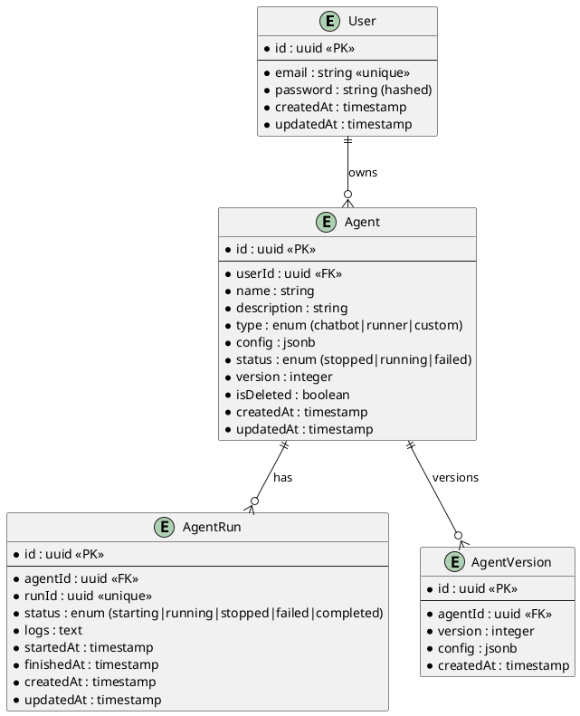

# Agent Manager - System Architecture

## ER Diagram (PlantUML)

## System Components

### Backend (Node.js + TypeScript)
- **Express Server**: REST API endpoints
- **Prisma ORM**: Database access layer
- **JWT Auth**: Authentication middleware
- **WebSocket Server**: Real-time updates
- **Agent Runner**: Background job processor

### Frontend (React + TypeScript)
- **Vite**: Build tool and dev server
- **React Router**: Client-side routing
- **Tailwind CSS**: Styling
- **WebSocket Client**: Real-time updates
- **Axios**: HTTP client

### Infrastructure
- **PostgreSQL**: Primary database
- **Docker Compose**: Local development environment
- **Redis** (optional): Queue and caching

## Data Flow

1. **Authentication Flow**
   - User signs up/logs in → JWT token issued
   - Token attached to all authenticated requests
   - Token validated in middleware

2. **Agent CRUD Flow**
   - Create/Update agent → Version incremented
   - Agent config stored as JSONB
   - Soft delete via isDeleted flag

3. **Agent Execution Flow**
   - Start run → Create AgentRun record
   - Runner picks up job → Updates status
   - Logs streamed via WebSocket
   - Stop signal → Graceful shutdown

## Security Considerations

- Password hashing with bcrypt
- JWT tokens with expiration
- Input validation and sanitization
- SQL injection prevention via Prisma
- Rate limiting on API endpoints
- CORS configuration for frontend

## Scalability Considerations

- Horizontal scaling of API servers
- Database connection pooling
- WebSocket with Redis adapter for multi-instance
- Background job queue for agent runs
- Log rotation and archival
