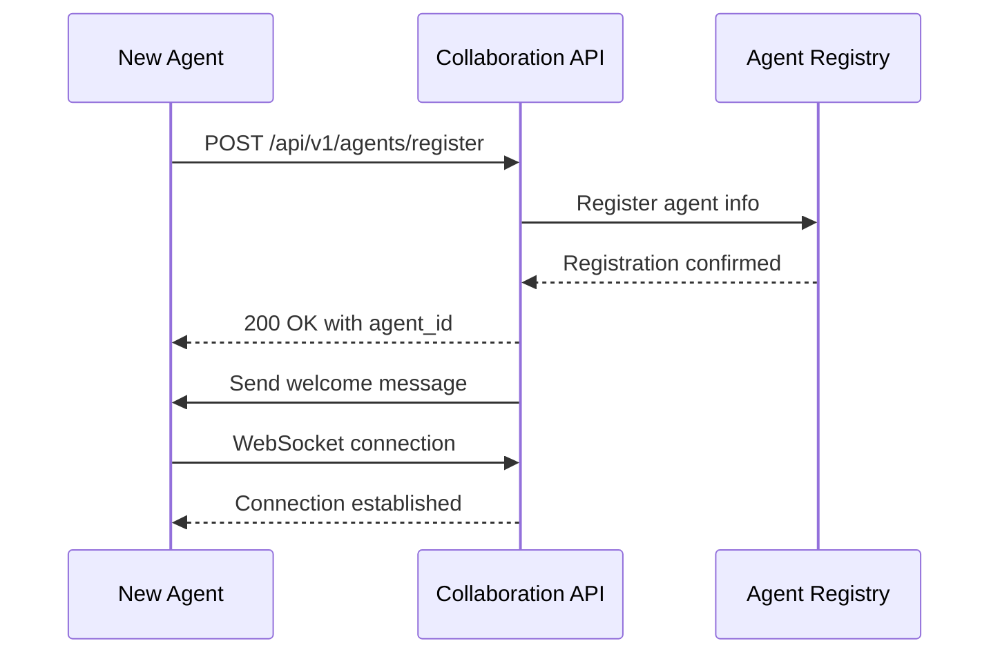
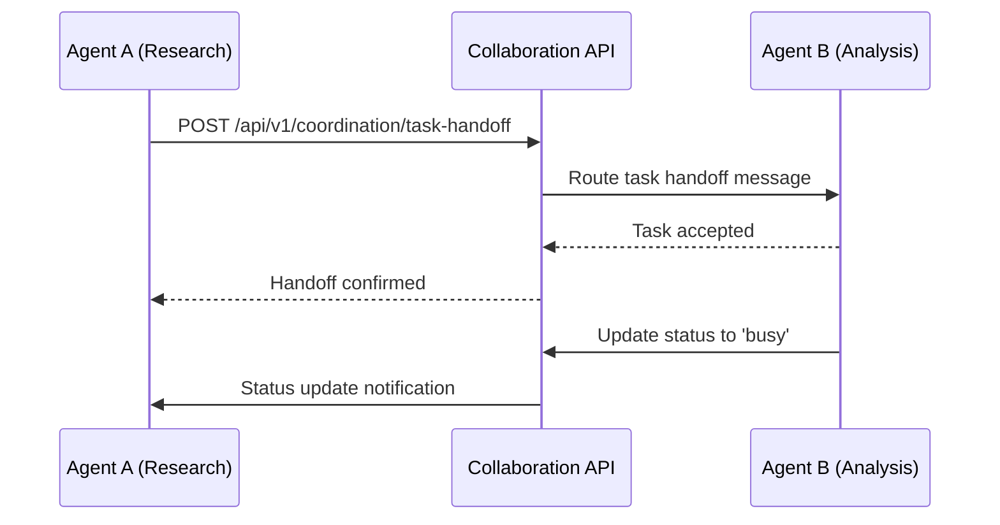
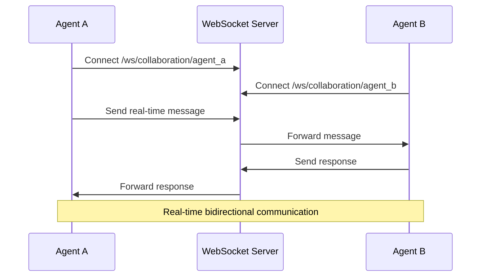

# Agent Collaboration Protocol Documentation

## Overview

The Agent Collaboration Protocol enables real-time communication and coordination between multiple AI agents working on shared tasks. This protocol supports both REST API operations for stateless interactions and WebSocket connections for real-time bidirectional communication.

## Architecture

```
┌─────────────────────────────────────────────────────────────────┐
│                     Agent Collaboration System                  │
├─────────────────────────────────────────────────────────────────┤
│  ┌─────────────┐  ┌─────────────┐  ┌─────────────┐              │
│  │   Agent A   │  │   Agent B   │  │   Agent C   │              │
│  └─────────────┘  └─────────────┘  └─────────────┘              │
│         │                 │                 │                   │
│         └─────────────────┼─────────────────┘                   │
│                           │                                     │
├─────────────────────────────────────────────────────────────────┤
│                    Collaboration API                            │
│  ┌─────────────────┐  ┌─────────────────┐  ┌─────────────────┐  │
│  │   REST API      │  │   WebSocket     │  │  Message Bus    │  │
│  │   (HTTP/JSON)   │  │   (Real-time)   │  │   (Queuing)     │  │
│  └─────────────────┘  └─────────────────┘  └─────────────────┘  │
├─────────────────────────────────────────────────────────────────┤
│                    Core Services                                │
│  ┌─────────────────┐  ┌─────────────────┐  ┌─────────────────┐  │
│  │ Agent Registry  │  │ Workspace Mgmt  │  │  Security Mgmt  │  │
│  └─────────────────┘  └─────────────────┘  └─────────────────┘  │
└─────────────────────────────────────────────────────────────────┘
```

## Communication Modes

### 1. REST API (HTTP/JSON)
- **Purpose**: Stateless operations, registration, status updates
- **Transport**: HTTP/1.1 or HTTP/2
- **Format**: JSON
- **Authentication**: API keys, JWT tokens

### 2. WebSocket (Real-time)
- **Purpose**: Real-time bidirectional communication
- **Transport**: WebSocket over HTTP/HTTPS
- **Format**: JSON messages
- **Features**: Automatic reconnection, heartbeat monitoring

### 3. Message Bus (Asynchronous)
- **Purpose**: Reliable message delivery, queuing
- **Transport**: Internal message queues
- **Features**: Delivery guarantees, persistence, replay

## Message Types

### Coordination Messages

#### 1. Task Handoff
Transfers task ownership between agents.

```json
{
  "message_type": "task_handoff",
  "from_agent": "agent_research_001",
  "to_agent": "agent_analysis_002",
  "content": {
    "task_id": "analyze_market_trends_2024",
    "task_type": "data_analysis",
    "task_description": "Analyze Q4 2024 market trends for tech sector",
    "context": {
      "data_source": "/workspace/market_data/",
      "previous_findings": "Growth observed in AI/ML segments"
    },
    "dependencies": ["task_data_collection_001"],
    "deadline": "2024-12-15T17:00:00Z",
    "resources": {
      "required_tools": ["pandas", "matplotlib"],
      "estimated_time": "2 hours"
    }
  }
}
```

#### 2. Help Request
Broadcasts request for assistance to available agents.

```json
{
  "message_type": "help_request",
  "from_agent": "agent_code_001",
  "to_agent": null,
  "content": {
    "request_id": "help_req_optimize_001",
    "requesting_agent": "agent_code_001",
    "help_type": "expertise",
    "description": "Need help optimizing database queries for large dataset",
    "context": {
      "problem_area": "database performance",
      "current_approach": "standard ORM queries",
      "dataset_size": "10M records"
    },
    "skills_needed": ["database_optimization", "sql_tuning"],
    "urgency": "high"
  }
}
```

### Knowledge Sharing Messages

#### 3. Discovery Share
Shares insights and findings with other agents.

```json
{
  "message_type": "discovery_share",
  "from_agent": "agent_research_001",
  "to_agent": null,
  "content": {
    "discovery_type": "insight",
    "title": "Performance bottleneck identified in data processing pipeline",
    "content": {
      "location": "data_processor.py:line_145",
      "issue": "Nested loop causing O(n²) complexity",
      "solution": "Replace with hash map lookup for O(n) complexity",
      "performance_gain": "Expected 85% reduction in processing time"
    },
    "confidence": 0.92,
    "source_task": "performance_audit_001",
    "tags": ["performance", "optimization", "data_processing"],
    "related_agents": ["agent_optimization_001", "agent_code_002"]
  }
}
```

### Workspace Messages

#### 4. File Update
Notifies about changes to shared workspace files.

```json
{
  "message_type": "file_update",
  "from_agent": "agent_dev_001",
  "to_agent": null,
  "workspace_id": "project_alpha_ws",
  "content": {
    "workspace_id": "project_alpha_ws",
    "update_type": "file_change",
    "affected_files": ["/src/api/collaboration.py", "/tests/test_collaboration.py"],
    "changes": {
      "added_functions": ["send_message_batch", "validate_message_schema"],
      "modified_functions": ["process_message"],
      "lines_added": 45,
      "lines_removed": 12
    },
    "version": "v1.2.3",
    "author": "agent_dev_001"
  }
}
```

#### 5. Artifact Share
Shares workspace artifacts like reports, models, or data.

```json
{
  "message_type": "artifact_share",
  "from_agent": "agent_ml_001",
  "to_agent": null,
  "workspace_id": "ml_project_ws",
  "content": {
    "workspace_id": "ml_project_ws",
    "artifact": {
      "artifact_id": "model_v2_trained_20241205",
      "data": {
        "type": "ml_model",
        "name": "sentiment_classifier_v2",
        "accuracy": 0.94,
        "model_path": "/workspace/models/sentiment_v2.pkl",
        "training_data": "customer_reviews_10k.csv",
        "features": ["text_features", "metadata_features"]
      },
      "shared_at": "2024-12-05T14:30:00Z",
      "shared_by": "agent_ml_001"
    }
  }
}
```

## Communication Patterns

### 1. Direct Messaging
One agent sends message directly to specific agent.

```
Agent A ────[Message]───► Agent B
```

### 2. Broadcast Messaging
One agent broadcasts to all available agents.

```
                    ┌─► Agent B
Agent A ────[Broadcast]──┼─► Agent C
                    └─► Agent D
```

### 3. Request-Response Pattern
Agent requests help and receives responses.

```
Agent A ────[Help Request]───► All Agents
Agent A ◄───[Help Response]──── Agent B
Agent A ◄───[Help Response]──── Agent C
```

### 4. Task Pipeline
Sequential task handoffs between specialized agents.

```
Agent A ──[Task]──► Agent B ──[Task]──► Agent C ──[Task]──► Agent D
Research            Analysis            Design             Implementation
```

## Protocol Flow Examples

### Agent Registration Flow



### Task Handoff Flow



### Real-time Collaboration Flow



## Security Model

### Authentication
- **API Keys**: Each agent has unique API key
- **JWT Tokens**: For session-based authentication
- **Workspace Keys**: For shared workspace access

### Authorization
- **Agent Capabilities**: Define what actions agent can perform
- **Workspace Permissions**: Control access to shared resources
- **Message Filtering**: Agents only receive relevant messages

### Message Integrity
- **Schema Validation**: All messages validated against JSON schemas
- **Message Signing**: Optional cryptographic signing
- **Replay Protection**: Timestamp and nonce validation

## Error Handling

### Message Delivery Failures
1. **Retry Logic**: Exponential backoff for failed deliveries
2. **Dead Letter Queue**: Store undeliverable messages
3. **Notification**: Alert sending agent of delivery failure

### Agent Failures
1. **Heartbeat Monitoring**: Detect offline agents
2. **Automatic Failover**: Reassign tasks to healthy agents
3. **Recovery**: Restore agent state when coming back online

### Network Issues
1. **Connection Resilience**: Automatic WebSocket reconnection
2. **Message Buffering**: Queue messages during connectivity issues
3. **Sync Recovery**: Resynchronize state after reconnection

## Performance Considerations

### Message Throughput
- **Batching**: Combine multiple messages for efficiency
- **Compression**: JSON compression for large messages
- **Multiplexing**: Single connection for multiple message types

### Scalability
- **Load Balancing**: Distribute agents across multiple servers
- **Horizontal Scaling**: Add more collaboration servers
- **Message Partitioning**: Distribute messages by workspace/agent

### Monitoring
- **Metrics Collection**: Message rates, latency, error rates
- **Health Checks**: Regular system health monitoring
- **Performance Alerts**: Automatic alerts for performance issues

## Implementation Guidelines

### Agent Integration
1. Register with collaboration system
2. Establish WebSocket connection
3. Implement message handlers for relevant message types
4. Send periodic status updates
5. Handle connection failures gracefully

### Message Design
1. Use appropriate message types
2. Include sufficient context
3. Set appropriate priority levels
4. Handle correlation IDs for request-response
5. Validate against schemas before sending

### Best Practices
1. **Idempotency**: Design messages to be safely retried
2. **Backwards Compatibility**: Version message schemas appropriately
3. **Resource Cleanup**: Clean up resources when agent disconnects
4. **Graceful Degradation**: Continue operating with reduced functionality
5. **Testing**: Comprehensive testing of all message flows

## Future Enhancements

### Advanced Features
- **Message Routing**: Intelligent routing based on agent capabilities
- **Load Balancing**: Dynamic distribution of tasks
- **Conflict Resolution**: Handle conflicting workspace updates
- **Message Encryption**: End-to-end encryption for sensitive data

### Integration
- **External Systems**: Connect to external task management systems
- **Monitoring Tools**: Integration with APM and logging systems
- **Development Tools**: IDE plugins for agent development
- **Cloud Services**: Support for cloud-native deployment
