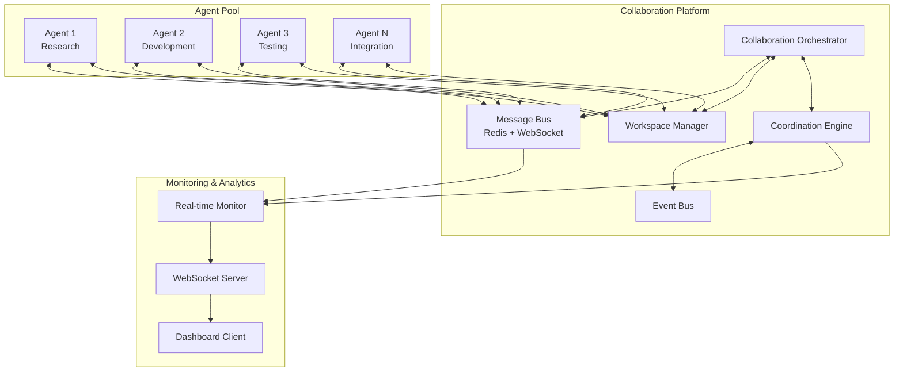

# Real-Time Multi-Agent Collaboration Architecture

## Executive Summary

This document defines the architecture for enabling real-time collaboration between Claude agents during execution, transforming the current orchestrator from a centralized coordinator into a collaborative platform where agents can communicate, share resources, and coordinate dynamically.

## Current System Analysis

### Existing Components
- **GenericOrchestrator**: Core task execution with basic message bus
- **PracticalOrchestrator**: Enhanced monitoring and quality reporting
- **EnhancedOrchestrator**: Quality gates and background execution
- **MessageBus**: Simple file-based message passing
- **WebSocket Infrastructure**: Real-time monitoring and metrics streaming
- **MetricsCollector**: Performance and status tracking

### Current Limitations
- Agents operate in isolation with no inter-agent communication during execution
- File-based MessageBus is async but not real-time
- No shared workspace or collaborative artifact creation
- Limited to orchestrator-mediated coordination
- No dynamic task hand-offs or peer-to-peer communication

## Proposed Architecture

### 1. Real-Time Message Bus System

```
┌─────────────────────────────────────────────────────────────┐
│                    Collaboration Hub                         │
├─────────────────────────────────────────────────────────────┤
│  ┌─────────────────┐  ┌─────────────────┐  ┌─────────────── │
│  │  Message Bus    │  │  Event Bus      │  │ Workspace     │
│  │  (Pub/Sub)      │  │  (Coordination) │  │ Manager       │
│  └─────────────────┘  └─────────────────┘  └─────────────── │
└─────────────────────────────────────────────────────────────┘
              │                    │                    │
    ┌─────────┴─────────┐ ┌────────┴────────┐ ┌────────┴───────
    │    Agent A        │ │    Agent B      │ │   Agent C
    │ session_id: xxx   │ │ session_id: yyy │ │ session_id: zzz
    │ capabilities: [R] │ │ capabilities:[W]│ │ capabilities:[E]
    └───────────────────┘ └─────────────────┘ └────────────────
```

#### Core Components:

**a) Enhanced Message Bus (Redis/WebSocket Hybrid)**
```python
class CollaborationMessageBus:
    def __init__(self, redis_url: str = None, websocket_port: int = 8767):
        # Pub/Sub for high-frequency agent-to-agent messages
        # WebSocket for real-time coordination events
        # File fallback for persistence and reliability
```

**b) Message Types**
- **Direct Messages**: Agent-to-agent communication
- **Broadcast Messages**: One-to-many notifications
- **Coordination Events**: Task hand-offs, resource requests
- **Status Updates**: Progress, completion, failure notifications
- **Resource Sharing**: Code snippets, artifacts, findings

### 2. Shared Workspace Component

```
Shared Workspace Architecture:
┌─────────────────────────────────────────────────────────────┐
│                  Workspace Manager                          │
├─────────────────────────────────────────────────────────────┤
│  ┌─────────────┐  ┌─────────────┐  ┌─────────────────────┐  │
│  │ Artifacts   │  │ Code Repos  │  │ Knowledge Base      │  │
│  │ - Files     │  │ - Shared    │  │ - Research findings │  │
│  │ - Configs   │  │ - Versions  │  │ - Best practices    │  │
│  │ - Reports   │  │ - Branches  │  │ - Solutions         │  │
│  └─────────────┘  └─────────────┘  └─────────────────────┘  │
└─────────────────────────────────────────────────────────────┘
```

**Features:**
- **Concurrent Access Control**: Lock-free collaborative editing
- **Version Control**: Git-like versioning for shared artifacts
- **Change Notifications**: Real-time updates when files change
- **Resource Conflict Resolution**: Automatic merge and conflict handling

### 3. Event-Driven Coordination Layer

```python
@dataclass
class CoordinationEvent:
    event_type: EventType  # TASK_HANDOFF, RESOURCE_REQUEST, COMPLETION
    source_agent: str
    target_agent: Optional[str]  # None for broadcast
    payload: Dict[str, Any]
    priority: Priority = Priority.NORMAL
    requires_response: bool = False
    correlation_id: Optional[str] = None

class CoordinationEngine:
    async def handle_task_handoff(self, event: CoordinationEvent):
        # Dynamically reassign tasks between agents

    async def handle_resource_request(self, event: CoordinationEvent):
        # Share code, data, or findings between agents

    async def handle_agent_discovery(self, event: CoordinationEvent):
        # Agents announce capabilities and find collaboration partners
```

## System Architecture Diagram



## Detailed Component Specifications

### 1. Collaboration Message Bus

```python
class CollaborationMessageBus:
    """Real-time message bus for agent collaboration"""

    def __init__(self, redis_url: str = None, websocket_port: int = 8767):
        self.redis_client = redis.Redis.from_url(redis_url) if redis_url else None
        self.websocket_server = WebSocketServer(port=websocket_port)
        self.file_fallback = FileMessageBus()  # Existing implementation
        self.agent_registry: Dict[str, AgentInfo] = {}

    async def register_agent(self, agent_id: str, capabilities: List[str],
                           websocket_connection) -> None:
        """Register agent for collaboration"""

    async def send_direct_message(self, from_agent: str, to_agent: str,
                                message: CollaborationMessage) -> bool:
        """Send direct message between agents"""

    async def broadcast_message(self, from_agent: str,
                              message: CollaborationMessage,
                              capability_filter: List[str] = None) -> int:
        """Broadcast to all or filtered agents"""

    async def subscribe_to_events(self, agent_id: str,
                                event_types: List[EventType]) -> AsyncIterator:
        """Subscribe to specific event types"""
```

### 2. Shared Workspace Manager

```python
class SharedWorkspaceManager:
    """Manages collaborative workspaces for agents"""

    def __init__(self, workspace_root: Path, git_enabled: bool = True):
        self.workspace_root = workspace_root
        self.active_workspaces: Dict[str, CollaborativeWorkspace] = {}
        self.file_locks: Dict[str, FileLock] = {}
        self.change_notifier = FileChangeNotifier()

    async def create_workspace(self, workspace_id: str,
                             initiating_agent: str) -> CollaborativeWorkspace:
        """Create new collaborative workspace"""

    async def join_workspace(self, workspace_id: str,
                           agent_id: str) -> CollaborativeWorkspace:
        """Join existing workspace"""

    async def write_file(self, workspace_id: str, agent_id: str,
                        file_path: str, content: str,
                        merge_strategy: MergeStrategy = MergeStrategy.AUTO) -> FileWriteResult:
        """Collaboratively write to shared file"""

    async def read_file(self, workspace_id: str, file_path: str) -> FileReadResult:
        """Read file with version information"""

    async def watch_changes(self, workspace_id: str,
                          agent_id: str) -> AsyncIterator[FileChangeEvent]:
        """Watch for file changes in workspace"""
```

### 3. Dynamic Coordination Engine

```python
class DynamicCoordinationEngine:
    """Handles dynamic task coordination and handoffs"""

    def __init__(self, message_bus: CollaborationMessageBus):
        self.message_bus = message_bus
        self.active_collaborations: Dict[str, Collaboration] = {}
        self.capability_registry: Dict[str, Set[str]] = {}

    async def initiate_collaboration(self, initiator: str,
                                   collaboration_type: CollaborationType,
                                   requirements: CollaborationRequirements) -> str:
        """Start new collaboration between agents"""

    async def request_handoff(self, from_agent: str, task_id: str,
                            requirements: TaskRequirements) -> HandoffResult:
        """Request task handoff to capable agent"""

    async def find_collaborators(self, requesting_agent: str,
                               required_capabilities: List[str]) -> List[AgentInfo]:
        """Find agents with required capabilities"""

    async def coordinate_parallel_work(self, collaboration_id: str,
                                     work_items: List[WorkItem]) -> CoordinationPlan:
        """Coordinate parallel work distribution"""
```

## Data Flow Design

### 1. Agent Registration and Discovery Flow
```
1. Agent starts → Register with CollaborationMessageBus
2. Announce capabilities → Broadcast AGENT_AVAILABLE event
3. Other agents → Update local capability registry
4. Orchestrator → Update global agent directory
```

### 2. Collaborative Task Execution Flow
```
1. Agent A identifies collaboration need → Send COLLABORATION_REQUEST
2. Coordination Engine → Find suitable partners using capability registry
3. Selected agents → Negotiate collaboration terms
4. Shared workspace created → All agents join workspace
5. Real-time work coordination → Message exchange + file sharing
6. Progress updates → Broadcast to orchestrator and monitoring
7. Completion → Merge results and notify all participants
```

### 3. Dynamic Task Handoff Flow
```
1. Agent encounters blocking issue → Send HANDOFF_REQUEST with requirements
2. Coordination Engine → Query capability registry for suitable agents
3. Target agent → Evaluate request and respond with availability
4. Handoff negotiated → Transfer context and workspace access
5. Original agent → Monitor handoff progress or continue other work
6. Completion → Results merged back to original task context
```

## Scalability Plan

### Phase 1: 2-5 Agents (Immediate)
- **Technology**: WebSocket + File-based fallback
- **Deployment**: Single-node with in-memory coordination
- **Capabilities**: Basic messaging, simple workspace sharing

### Phase 2: 5-15 Agents (Near-term)
- **Technology**: Redis Pub/Sub + WebSocket
- **Deployment**: Redis instance + WebSocket cluster
- **Capabilities**: Advanced coordination, conflict resolution, parallel workspaces

### Phase 3: 15-50+ Agents (Future)
- **Technology**: Redis Cluster + Message Queue (RabbitMQ/Kafka)
- **Deployment**: Distributed system with load balancing
- **Capabilities**: Multi-cluster coordination, advanced analytics, AI-driven orchestration

### Performance Targets
- **Message Latency**: <50ms for direct messages, <200ms for coordination events
- **Workspace Sync**: <1s for file changes across all agents
- **Agent Discovery**: <100ms for capability queries
- **Concurrent Agents**: 50+ with <10% performance degradation

## Integration Strategy

### Backwards Compatibility
```python
class BackwardCompatibleOrchestrator(GenericOrchestrator):
    """Maintains full compatibility with existing systems"""

    def __init__(self, enable_collaboration: bool = False, **kwargs):
        super().__init__(**kwargs)

        if enable_collaboration:
            self.collaboration_hub = CollaborationHub()
            self.message_bus = CollaborationMessageBus()
        else:
            # Use existing file-based MessageBus
            self.message_bus = MessageBus(self.output_dir / "messages")
```

### Migration Path
1. **Phase 1**: Add collaboration as opt-in feature
2. **Phase 2**: Gradually migrate existing workflows
3. **Phase 3**: Default to collaborative mode for new deployments
4. **Phase 4**: Deprecate non-collaborative mode

### Integration Points
- **Existing Monitoring**: Extend metrics to include collaboration data
- **Quality Gates**: Add collaboration-aware validation
- **Task Definitions**: Extend with collaboration metadata
- **WebSocket Dashboard**: Add real-time collaboration view

## Implementation Priorities

### Sprint 1: Foundation (Weeks 1-2)
- [ ] Implement enhanced MessageBus with WebSocket support
- [ ] Create basic agent registration and discovery
- [ ] Set up shared workspace with file watching
- [ ] Add collaboration events to existing monitoring

### Sprint 2: Core Features (Weeks 3-4)
- [ ] Implement dynamic task handoffs
- [ ] Add collaborative file editing with conflict resolution
- [ ] Create coordination engine for parallel work
- [ ] Extend dashboard with collaboration views

### Sprint 3: Advanced Features (Weeks 5-6)
- [ ] Add AI-driven collaboration suggestions
- [ ] Implement cross-agent knowledge sharing
- [ ] Create advanced workspace management
- [ ] Performance optimization and scaling tests

### Sprint 4: Production Ready (Weeks 7-8)
- [ ] Comprehensive testing and error handling
- [ ] Documentation and deployment guides
- [ ] Performance benchmarking
- [ ] Integration with existing CI/CD pipelines

## Success Metrics

### Technical Metrics
- **Message Throughput**: >1000 messages/second
- **Collaboration Success Rate**: >95% successful handoffs
- **Workspace Sync Accuracy**: 100% consistency
- **System Availability**: >99.5% uptime

### Operational Metrics
- **Collaboration Adoption**: >80% of tasks use collaboration features
- **Agent Efficiency**: 30%+ improvement in complex task completion
- **Error Reduction**: 50%+ fewer failed tasks due to collaboration
- **Development Velocity**: 25%+ faster multi-component development

## Risk Assessment

### High-Risk Areas
1. **Message Ordering**: Ensure proper event sequencing in distributed system
2. **Workspace Conflicts**: Handle concurrent file modifications gracefully
3. **Agent Failures**: Maintain collaboration state when agents disconnect
4. **Performance Bottlenecks**: Message bus and workspace synchronization

### Mitigation Strategies
1. **Event Sourcing**: Immutable event log for message ordering
2. **Operational Transforms**: Advanced conflict resolution algorithms
3. **Heartbeat Monitoring**: Automatic failover and state recovery
4. **Caching and Batching**: Optimize high-frequency operations

## Conclusion

This architecture transforms the agent orchestrator from a simple task coordinator into a sophisticated collaboration platform. By implementing real-time messaging, shared workspaces, and dynamic coordination, agents can work together seamlessly while maintaining the reliability and performance of the existing system.

The phased approach ensures smooth adoption while the backwards compatibility guarantees no disruption to existing workflows. This foundation enables the next generation of multi-agent applications where Claude agents can truly collaborate as a team.
