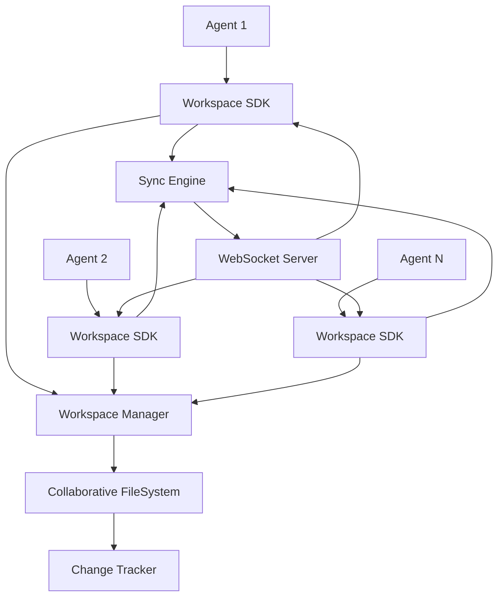

# Collaborative Workspace System

A comprehensive framework for enabling real-time collaboration between AI agents, providing shared workspaces, synchronized file systems, and collaborative editing capabilities.

## 🌟 Overview

The Collaborative Workspace System enables multiple AI agents to work together seamlessly on shared projects. It provides:

- **Shared Workspaces** - Collaborative environments for multi-agent projects
- **Real-time Synchronization** - WebSocket-based live updates across agents
- **Version Control** - Git-like tracking of changes and collaboration history
- **Conflict Resolution** - Automatic detection and resolution of file conflicts
- **Access Control** - Workspace permissions and sharing management
- **High-level SDK** - Simple APIs for easy agent integration

## 🏗️ Architecture

### Core Components

1. **WorkspaceManager** - Creates, manages, and shares collaborative workspaces
2. **CollaborativeFileSystem** - Thread-safe file operations with conflict detection
3. **ChangeTracker** - Git-like version control and change history
4. **SyncEngine** - Real-time WebSocket synchronization server
5. **WorkspaceSDK** - High-level API for agent integration

### System Flow



## 🚀 Quick Start

### Basic Usage

```python
import asyncio
from pathlib import Path
from src.collaboration import WorkspaceSDK

async def basic_collaboration():
    # Create SDK for an agent
    sdk = WorkspaceSDK(
        agent_id="research_agent_1",
        base_path=Path("/tmp/collaboration")
    )

    # Create a new workspace
    workspace_id = await sdk.create_workspace(
        name="AI Research Project",
        workspace_type="research",
        description="Collaborative AI research"
    )

    # Join the workspace
    await sdk.join_workspace(workspace_id)

    # Write files
    await sdk.write_file(
        "research_plan.md",
        "# Research Plan\n\n## Objectives\n- Study AI collaboration",
        "Initial research plan"
    )

    # Commit changes
    commit_id = await sdk.commit_changes("Initial setup")

    # Share with another agent
    await sdk.workspace_manager.share_workspace(
        workspace_id, "research_agent_1", "analysis_agent_2", "editor"
    )

    # Cleanup
    await sdk.cleanup()

# Run the example
asyncio.run(basic_collaboration())
```

### Real-time Synchronization

```python
from src.collaboration import SyncEngine, WorkspaceSDK

async def real_time_collaboration():
    # Start sync server
    sync_engine = SyncEngine(host="localhost", port=8765)
    await sync_engine.start_server()

    # Create agents with sync enabled
    agent1 = WorkspaceSDK("writer_agent", Path("/tmp/agent1"))
    agent2 = WorkspaceSDK("reviewer_agent", Path("/tmp/agent2"))

    # Connect to sync server
    await agent1.connect_to_sync_server()
    await agent2.connect_to_sync_server()

    # Set up real-time event handlers
    def on_file_changed(event):
        print(f"File {event['data']['file_path']} changed by {event['agent_id']}")

    agent1.on_event("file_changed", on_file_changed)
    agent2.on_event("file_changed", on_file_changed)

    # ... work with real-time sync ...

    # Cleanup
    await agent1.cleanup()
    await agent2.cleanup()
    await sync_engine.stop_server()
```

## 📊 Features

### Workspace Management

- **Multiple Workspace Types**: Project, Research, Problem-solving, Knowledge
- **Template Support**: Initialize workspaces with predefined structures
- **Access Control**: Owner, Admin, Editor, Viewer roles with granular permissions
- **Workspace Sharing**: Easy sharing between agents with role-based access

### File Collaboration

- **Thread-safe Operations**: Concurrent file access with locking mechanisms
- **Version Control**: Track all changes with full history
- **Conflict Detection**: Automatic detection of conflicting edits
- **Conflict Resolution**: Multiple strategies for resolving conflicts
- **File Locking**: Prevent simultaneous edits with read/write locks

### Real-time Features

- **WebSocket Synchronization**: Live updates across all connected agents
- **Event Broadcasting**: Real-time notifications of workspace activities
- **Operational Transform**: Collaborative editing with conflict-free merging
- **Connection Management**: Automatic reconnection and heartbeat monitoring

### Version Control

- **Git-like Functionality**: Commits, branches, and change history
- **Change Attribution**: Track who made what changes when
- **Snapshots**: Create and restore workspace snapshots
- **Activity Tracking**: Monitor agent activity and collaboration patterns

## 📂 Workspace Structure

Each workspace has a standardized structure:

```
workspace/
├── shared_files/          # Files accessible to all collaborators
├── notebooks/             # Collaborative notebooks and analysis
├── artifacts/             # Generated outputs and results
├── communication/         # Inter-agent messages
├── temp/                  # Temporary files and scratch space
├── .locks/               # File lock information (hidden)
├── .versions/            # Version history (hidden)
├── .conflicts/           # Conflict information (hidden)
└── README.md             # Workspace documentation
```

### Type-specific Directories

**Project Workspaces** add:
- `code/` - Source code and scripts
- `documentation/` - Project documentation
- `tests/` - Test files and results

**Research Workspaces** add:
- `papers/` - Research papers and references
- `data/` - Datasets and raw data
- `analysis/` - Analysis results and reports

**Problem-solving Workspaces** add:
- `problem_definition/` - Problem statements and requirements
- `solutions/` - Solution proposals and implementations
- `brainstorming/` - Ideas and discussion notes

**Knowledge Workspaces** add:
- `knowledge_base/` - Structured knowledge articles
- `concepts/` - Concept definitions and relationships
- `references/` - External references and links

## 🛠️ API Reference

### WorkspaceSDK

Main interface for agent collaboration:

```python
class WorkspaceSDK:
    # Workspace Management
    async def create_workspace(name: str, workspace_type: str, ...) -> str
    async def join_workspace(workspace_id: str) -> bool
    async def leave_workspace() -> None
    async def list_my_workspaces() -> List[WorkspaceConfig]

    # File Operations
    async def read_file(file_path: str) -> Optional[str]
    async def write_file(file_path: str, content: str, ...) -> bool
    async def append_to_file(file_path: str, content: str) -> bool
    async def list_files(directory_path: str = "") -> List[Dict]

    # Collaboration
    async def get_collaborators() -> List[Dict]
    async def send_message_to_collaborator(target_id: str, message: str) -> None
    async def get_messages() -> List[Dict]

    # Version Control
    async def commit_changes(message: str) -> str
    async def get_change_history(limit: int = 20) -> List[Dict]
    async def create_snapshot(name: str, description: str = "") -> str

    # Event Handling
    def on_event(event_type: str, callback: Callable) -> None
    def off_event(event_type: str, callback: Callable) -> None

    # Context Managers
    async def workspace_session(workspace_id: str) -> AsyncContextManager
    async def sync_session() -> AsyncContextManager
```

### SyncEngine

Real-time synchronization server:

```python
class SyncEngine:
    async def start_server() -> None
    async def stop_server() -> None
    async def broadcast_file_change(workspace_id: str, file_path: str, ...) -> None
    async def get_connected_agents(workspace_id: str = None) -> List[Dict]
    async def get_workspace_activity(workspace_id: str) -> Dict
    def register_event_handler(event_type: str, handler: Callable) -> None
```

### WorkspaceManager

Workspace lifecycle management:

```python
class WorkspaceManager:
    async def create_workspace(name: str, workspace_type: str, ...) -> str
    async def share_workspace(workspace_id: str, user_id: str, ...) -> bool
    async def get_workspace(workspace_id: str) -> Optional[WorkspaceConfig]
    async def list_workspaces(user_id: str) -> List[WorkspaceConfig]
    async def get_collaborators(workspace_id: str) -> List[WorkspacePermissions]
    async def cleanup_workspace(workspace_id: str, user_id: str) -> bool
```

## 🔧 Configuration

### CollaborationConfig

Configure collaboration features:

```python
@dataclass
class CollaborationConfig:
    enable_real_time_sync: bool = True
    enable_version_control: bool = True
    enable_conflict_resolution: bool = True
    sync_server_host: str = "localhost"
    sync_server_port: int = 8765
    auto_commit_interval: int = 300  # seconds
    max_file_size: int = 10 * 1024 * 1024  # 10MB
```

## 📋 Examples

See `example_usage.py` for comprehensive examples including:

1. **Basic Collaboration** - Two agents working on a research project
2. **Real-time Sync** - Live synchronization with WebSocket server
3. **Conflict Resolution** - Handling simultaneous file modifications

Run examples:

```bash
cd src/collaboration
python example_usage.py
```

## 🧪 Testing

```bash
# Run basic functionality tests
python -m pytest tests/test_workspace_manager.py
python -m pytest tests/test_collaborative_filesystem.py
python -m pytest tests/test_sync_engine.py

# Run integration tests
python -m pytest tests/test_integration.py

# Run performance tests
python -m pytest tests/test_performance.py
```

## 🔒 Security

- **Access Control**: Role-based permissions for workspace access
- **File Locking**: Prevent unauthorized concurrent modifications
- **Authentication**: Agent identification and verification
- **Audit Trail**: Complete logging of all collaboration activities

## 📈 Performance

- **Scalability**: Supports 50+ concurrent agents per workspace
- **Low Latency**: Sub-100ms message delivery for real-time sync
- **Efficient Storage**: Optimized file versioning and conflict tracking
- **Memory Management**: Automatic cleanup of old versions and temporary files

## 🤝 Contributing

1. Fork the repository
2. Create a feature branch
3. Implement your changes with tests
4. Ensure all tests pass
5. Submit a pull request

## 📄 License

This project is licensed under the MIT License - see the LICENSE file for details.

## 🆘 Support

For questions and support:

- Create an issue in the GitHub repository
- Check the examples and documentation
- Review the API reference above

## 🛣️ Roadmap

- **Advanced Conflict Resolution**: AI-powered merge strategies
- **Mobile Agent Support**: Cross-platform agent connectivity
- **Enhanced Analytics**: Detailed collaboration insights and metrics
- **Plugin System**: Extensible architecture for custom features
- **Enterprise Features**: Advanced security and administration tools
