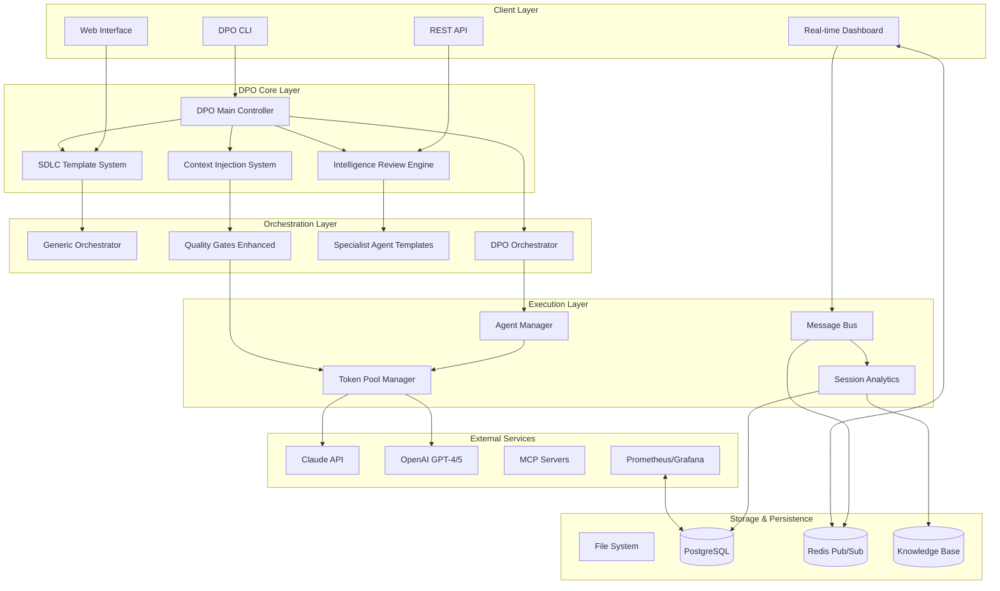
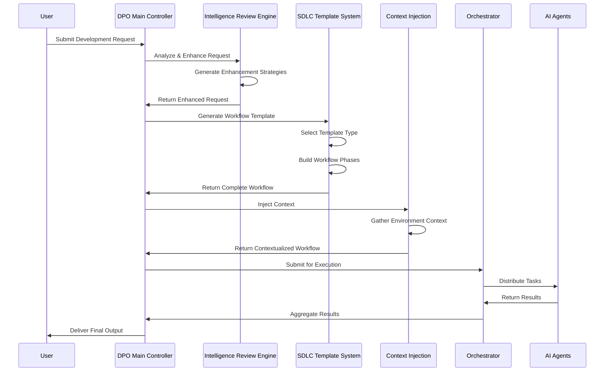
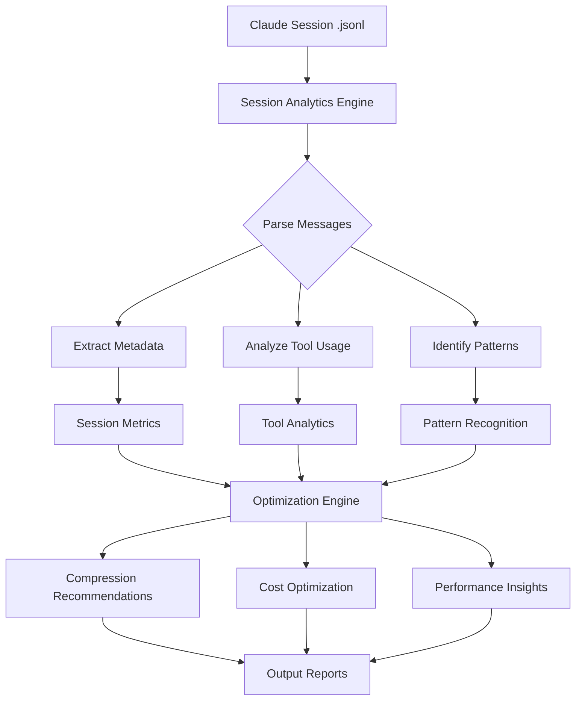
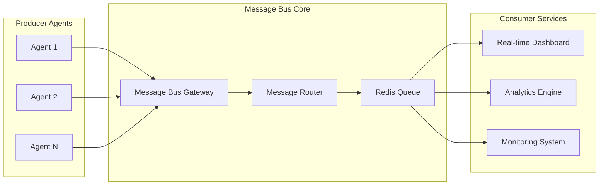

# Development Process Orchestrator - System Architecture

## Table of Contents
- [System Overview](#system-overview)
- [Component Architecture](#component-architecture)
- [Data Flow](#data-flow)
- [Design Patterns](#design-patterns)
- [Technology Stack](#technology-stack)
- [Database Design](#database-design)
- [Security Architecture](#security-architecture)
- [Scalability & Performance](#scalability--performance)
- [Integration Points](#integration-points)
- [Deployment Architecture](#deployment-architecture)
- [Decision Records](#decision-records)

## System Overview

The Development Process Orchestrator (DPO) is an enterprise-grade framework for AI-powered development workflow automation. It combines agent orchestration, intelligent request analysis, and automated SDLC workflow generation to create a comprehensive development process automation platform.

### Key Capabilities
- **AI-Powered Development Workflows**: Automated generation of complete SDLC workflows based on project requirements
- **Intelligent Request Analysis**: Advanced parsing and enhancement of development requests using specialized AI agents
- **Multi-Agent Orchestration**: Concurrent execution of 15+ specialized agents with intelligent task distribution
- **Multi-Provider AI Support**: Native integration with Claude (Anthropic), OpenAI GPT-4, and GPT-5 models
- **Session Analytics & Optimization**: Advanced parsing and optimization of Claude session logs with 2.23x-3.14x compression ratios
- **Production Monitoring**: Real-time WebSocket dashboards with metrics streaming and performance analytics
- **Enterprise Integration**: Context injection, message bus architecture, and comprehensive quality gates

### High-Level Architecture



## Component Architecture

### DPO Core Layer

#### 1. DPO Main Controller (`src/dpo_main_controller.py`)
**Responsibilities:**
- Central coordination of all DPO subsystems
- Request analysis and classification
- Workflow orchestration and status monitoring
- Inter-component communication management
- Configuration and error handling

**Key Features:**
- Unified development request processing pipeline
- Multi-component coordination architecture
- Advanced error handling and recovery mechanisms
- CLI and API interface management
- Status monitoring and reporting

#### 2. Intelligence Review Engine Enhanced (`src/intelligence_review_engine_enhanced.py`)
**Responsibilities:**
- Advanced request analysis and enhancement
- Multi-phase enhancement strategies
- Cross-category synthesis and optimization
- Impact scoring and dependency analysis
- Cost-benefit optimization

**Key Features:**
- Sophisticated enhancement algorithms
- Composite scoring for prioritization (impact, effort, innovation, risk)
- Innovation and risk assessment
- Dependency graph analysis
- Business impact evaluation

#### 3. SDLC Template System (`src/sdlc_template_system.py`)
**Responsibilities:**
- Automated workflow generation based on project types
- Template-driven development process creation
- Phase-based workflow structuring
- Quality gate integration
- Context requirement analysis

**Key Features:**
- Multiple project template types (documentation, analysis, development)
- Configurable complexity levels (simple, medium, complex)
- Parallel execution support
- Validation rule enforcement
- Expected output specification

#### 4. Context Injection System (`src/context_injection/`)
**Responsibilities:**
- Dynamic context management
- Environment-aware context provision
- Project-specific context integration
- Real-time context updates
- Context optimization

### Orchestration Layer

#### 5. Generic Orchestrator (`src/generic_orchestrator.py`)
**Responsibilities:**
- Task queue management and parallel execution
- Dependency resolution and scheduling
- Token pool management with multi-provider support
- Basic monitoring and logging
- Output collection and result aggregation

**Key Features:**
- Async/await architecture for concurrent execution
- Configurable parallelism limits (15+ agents)
- Advanced error handling and retry mechanisms
- Comprehensive logging with structured output
- Checkpoint/resume capabilities

#### 6. Specialist Agent Templates (`src/specialist_agent_templates.py`)
**Responsibilities:**
- Pre-configured agent templates for specialized tasks
- Domain expertise encapsulation
- Template-based agent generation
- Capability matching and selection
- Performance optimization patterns

**Key Features:**
- 28+ specialized agent templates
- Documentation, analysis, and development specialists
- Configurable complexity and scope
- Integration with orchestration layer
- Quality assurance templates

### Execution Layer

#### 7. Session Analytics Engine (`src/session_analytics_engine.py`)
**Responsibilities:**
- Claude session log parsing and analysis
- Conversation pattern recognition
- Tool usage analytics
- Performance optimization recommendations
- Cross-session pattern analysis

**Key Features:**
- .jsonl format compatibility
- 2.23x-3.14x compression ratios
- 60-80% cost savings analysis
- 5,000+ tokens/second processing
- Real-time analytics capabilities

#### 8. Message Bus Architecture (`src/message_bus/`)
**Responsibilities:**
- Inter-agent communication
- Real-time message routing
- Pub/sub pattern implementation
- Event-driven architecture support
- Performance monitoring

**Key Features:**
- Redis-backed message routing
- WebSocket real-time updates
- File-based and network-based modes
- Administrative interface
- Client SDK for integration

## Data Flow

### DPO Request Processing Flow



### Session Analytics Data Flow



### Message Bus Communication Pattern



## Design Patterns

### Architectural Patterns

#### 1. Plugin Architecture
- **Implementation**: Extensible processor framework in orchestration layer
- **Benefits**: Easy addition of new agent types and capabilities
- **Usage**: Provider plugins, quality gate plugins, enhancement plugins

#### 2. Event-Driven Architecture
- **Implementation**: Message bus with pub/sub pattern
- **Benefits**: Loose coupling, real-time updates, scalability
- **Usage**: Status updates, progress monitoring, alert systems

#### 3. Factory Pattern
- **Implementation**: Dynamic orchestrator and provider creation
- **Benefits**: Runtime configuration, multi-provider support
- **Usage**: Agent creation, workflow generation, template selection

#### 4. Strategy Pattern
- **Implementation**: Multiple execution modes and optimization strategies
- **Benefits**: Flexible execution, performance optimization
- **Usage**: Token pooling strategies, enhancement algorithms, compression methods

#### 5. Circuit Breaker Pattern
- **Implementation**: Fault tolerance and error recovery mechanisms
- **Benefits**: System resilience, graceful degradation
- **Usage**: API failure handling, agent timeout management

#### 6. Observer Pattern
- **Implementation**: Real-time monitoring and status updates
- **Benefits**: Reactive monitoring, event-driven updates
- **Usage**: Dashboard updates, progress tracking, alert systems

### Design Principles

#### Separation of Concerns
- **DPO Layer**: Request analysis and workflow coordination
- **Orchestration Layer**: Task execution and agent management
- **Execution Layer**: Resource management and communication
- **Storage Layer**: Data persistence and caching

#### Single Responsibility Principle
- Each component has a clearly defined responsibility
- Intelligence Review Engine focuses solely on request enhancement
- SDLC Template System handles only workflow generation
- Session Analytics Engine manages only log analysis

#### Dependency Inversion
- High-level modules don't depend on low-level modules
- Abstract interfaces define contracts
- Dependency injection for configuration

## Technology Stack

### Core Technologies

#### Programming Language
- **Python 3.8+**: Primary development language
- **Async/Await**: Concurrent execution support
- **Type Hints**: Enhanced code reliability

#### Web Framework & APIs
- **aiohttp 3.9.0+**: HTTP server for dashboard interface
- **websockets 12.0+**: Real-time WebSocket communication
- **REST APIs**: Standard HTTP API interfaces

#### Database & Storage
- **PostgreSQL**: Relational data storage for analytics
- **Redis 4.5.0+**: Pub/sub message bus and caching
- **File System**: Checkpoint storage and output management
- **JSON**: Configuration and data serialization

#### AI & ML Integration
- **Claude API (Anthropic)**: Primary AI provider
- **OpenAI GPT-4/GPT-5**: Secondary AI provider
- **Multi-provider architecture**: Extensible AI integration

#### Monitoring & Observability
- **Prometheus**: Metrics collection (optional)
- **Grafana**: Dashboard visualization
- **WebSocket streaming**: Real-time monitoring
- **Structured logging**: JSON-based log format

#### Development & Testing
- **pytest 7.0.0+**: Testing framework
- **pytest-asyncio**: Async testing support
- **Mock systems**: Complete test isolation
- **Performance benchmarking**: Built-in performance metrics

#### Deployment & Operations
- **Docker**: Containerization support
- **docker-compose**: Multi-service deployment
- **SystemD**: Service management
- **Health checks**: Built-in health monitoring

### Dependencies Overview

```python
# Core Dependencies
watchdog>=3.0.0        # File system monitoring
aiofiles>=23.0.0       # Async file operations
pydantic>=2.0.0        # Data validation
websockets>=12.0       # WebSocket server
aiohttp>=3.9.0         # HTTP server
psycopg2-binary>=2.9.0 # PostgreSQL adapter
redis>=4.5.0           # Redis client
psutil>=5.9.0          # System metrics
requests>=2.31.0       # HTTP client

# Testing
pytest>=7.0.0
pytest-asyncio>=0.21.0
```

## Database Design

### PostgreSQL Schema

#### Session Analytics Tables

```sql
-- Session metadata table
CREATE TABLE sessions (
    session_id UUID PRIMARY KEY,
    start_time TIMESTAMP WITH TIME ZONE,
    end_time TIMESTAMP WITH TIME ZONE,
    duration_seconds INTEGER,
    message_count INTEGER,
    tool_call_count INTEGER,
    file_operation_count INTEGER,
    total_tokens INTEGER,
    compression_ratio DECIMAL(5,2),
    cost_savings_percent DECIMAL(5,2),
    session_type VARCHAR(50),
    project_context TEXT,
    created_at TIMESTAMP WITH TIME ZONE DEFAULT NOW()
);

-- Tool usage analytics
CREATE TABLE tool_usage (
    id SERIAL PRIMARY KEY,
    session_id UUID REFERENCES sessions(session_id),
    tool_name VARCHAR(100),
    usage_count INTEGER,
    success_rate DECIMAL(5,2),
    avg_execution_time_ms INTEGER,
    error_count INTEGER,
    created_at TIMESTAMP WITH TIME ZONE DEFAULT NOW()
);

-- Pattern recognition results
CREATE TABLE session_patterns (
    id SERIAL PRIMARY KEY,
    session_id UUID REFERENCES sessions(session_id),
    pattern_type VARCHAR(50),
    pattern_data JSONB,
    confidence_score DECIMAL(5,2),
    created_at TIMESTAMP WITH TIME ZONE DEFAULT NOW()
);
```

#### Orchestration Tables

```sql
-- Workflow executions
CREATE TABLE workflow_executions (
    execution_id UUID PRIMARY KEY,
    workflow_type VARCHAR(50),
    status VARCHAR(20),
    start_time TIMESTAMP WITH TIME ZONE,
    end_time TIMESTAMP WITH TIME ZONE,
    agent_count INTEGER,
    total_tasks INTEGER,
    completed_tasks INTEGER,
    failed_tasks INTEGER,
    configuration JSONB,
    results JSONB,
    created_at TIMESTAMP WITH TIME ZONE DEFAULT NOW()
);

-- Agent performance metrics
CREATE TABLE agent_metrics (
    id SERIAL PRIMARY KEY,
    execution_id UUID REFERENCES workflow_executions(execution_id),
    agent_id VARCHAR(50),
    agent_type VARCHAR(50),
    task_count INTEGER,
    success_rate DECIMAL(5,2),
    avg_execution_time_ms INTEGER,
    total_tokens_used INTEGER,
    cost_dollars DECIMAL(10,4),
    created_at TIMESTAMP WITH TIME ZONE DEFAULT NOW()
);
```

### Redis Data Structures

#### Message Bus Queues
- `orchestrator:tasks`: Task distribution queue
- `orchestrator:results`: Result collection queue
- `orchestrator:status`: Status update broadcasts
- `analytics:events`: Analytics event stream

#### Caching Strategies
- Session analysis cache: `session:analysis:{session_id}`
- Tool usage cache: `tools:usage:{tool_name}`
- Pattern cache: `patterns:{pattern_type}`
- Configuration cache: `config:{component}`

## Security Architecture

### API Security
- **CORS Configuration**: Configurable origin restrictions
- **Rate Limiting**: 300 requests/minute with burst protection
- **Input Validation**: Pydantic-based request validation
- **Error Handling**: Sanitized error responses

### Data Security
- **Configuration Isolation**: Environment-based config separation
- **Credential Management**: External credential storage
- **Log Sanitization**: PII removal from logs
- **Access Control**: Role-based component access

### Network Security
- **TLS/SSL**: HTTPS enforcement in production
- **Internal Communication**: Encrypted inter-service communication
- **Firewall Configuration**: Port-based access control
- **Health Check Security**: Authenticated health endpoints

### Operational Security
- **Container Security**: Minimal container images
- **Resource Limits**: Memory and CPU constraints
- **Graceful Shutdown**: Secure service termination
- **Audit Logging**: Comprehensive operation logging

## Scalability & Performance

### Performance Characteristics

#### Throughput Metrics
- **Agent Concurrency**: 15+ parallel agents
- **Session Processing**: 5,000+ tokens/second
- **Compression Ratios**: 2.23x-3.14x session optimization
- **Cost Savings**: 55-68% cost reduction
- **Memory Efficiency**: <400MB RAM target
- **Task Execution**: <$2.00 per task

#### Response Time Targets
- **API Response**: <100ms for status queries
- **Dashboard Updates**: <50ms WebSocket latency
- **Session Analysis**: <30s for large sessions
- **Workflow Generation**: <5s for complex templates

### Scaling Strategies

#### Horizontal Scaling
- **Multi-instance Deployment**: Load balancer distribution
- **Agent Pool Scaling**: Dynamic agent allocation
- **Database Sharding**: Partitioned analytics data
- **Cache Clustering**: Redis cluster deployment

#### Vertical Scaling
- **Memory Optimization**: Efficient data structures
- **CPU Optimization**: Async processing patterns
- **I/O Optimization**: Batch operations and caching
- **Network Optimization**: Connection pooling

#### Performance Monitoring
- **Real-time Metrics**: WebSocket-based monitoring
- **Resource Tracking**: Memory and CPU utilization
- **Bottleneck Detection**: Performance profiling
- **SLA Compliance**: Automated performance validation

### Resource Management

#### Token Pool Management
- **Multi-provider Fallback**: 4-strategy fallback system
- **Rate Limiting**: Provider-specific limits
- **Cost Optimization**: Intelligent provider selection
- **Usage Tracking**: Real-time consumption monitoring

#### Memory Management
- **Session Streaming**: Large file processing
- **Result Caching**: Intelligent cache strategies
- **Garbage Collection**: Automatic cleanup
- **Resource Pooling**: Connection and object reuse

## Integration Points

### AI Provider APIs

#### Claude (Anthropic)
- **Primary Integration**: Native Claude API support
- **Session Analysis**: .jsonl format compatibility
- **Tool Integration**: MCP server support
- **Cost Optimization**: Usage analytics and optimization

#### OpenAI
- **Multi-model Support**: GPT-4, GPT-5 integration
- **Fallback Provider**: Secondary AI provider
- **Performance Comparison**: Provider benchmarking
- **Cost Analysis**: Provider cost comparison

### External Services

#### MCP (Model Context Protocol) Servers
- **Tool Integration**: External tool access
- **Context Enhancement**: Rich context provision
- **Capability Extension**: Pluggable functionality
- **Security Sandboxing**: Isolated execution

#### Monitoring Infrastructure
- **Prometheus Integration**: Metrics collection
- **Grafana Dashboards**: Visualization
- **Alert Systems**: Threshold-based alerts
- **Log Aggregation**: Centralized logging

### Internal APIs

#### REST API Endpoints
```python
# Core orchestration endpoints
POST /api/v1/workflows
GET /api/v1/workflows/{id}/status
POST /api/v1/analyze/session
GET /api/v1/metrics/performance

# DPO-specific endpoints
POST /api/v1/dpo/requests
GET /api/v1/dpo/templates
POST /api/v1/dpo/enhance
```

#### WebSocket Channels
```python
# Real-time updates
/ws/orchestrator/status
/ws/analytics/stream
/ws/dashboard/metrics
/ws/agent/progress
```

## Deployment Architecture

### Container Architecture

```yaml
# docker-compose.yml structure
services:
  agent-orchestrator:
    # Main application container
    environment:
      - MAX_PARALLEL=15
      - TOKEN_POOL_SIZE=20
    ports:
      - "8080:8080"
    healthcheck:
      test: ["CMD", "python", "-c", "health_check()"]

  orchestrator-monitor:
    # Prometheus metrics collection
    image: prom/prometheus:latest
    ports:
      - "9090:9090"

  orchestrator-dashboard:
    # Grafana visualization
    image: grafana/grafana:latest
    ports:
      - "3000:3000"
```

### Production Configuration

#### Performance Settings
```json
{
  "host": "0.0.0.0",
  "port": 8765,
  "max_connections": 500,
  "keepalive_timeout": 30,
  "client_timeout": 60,
  "graceful_shutdown_timeout": 30
}
```

#### Security Configuration
```json
{
  "security": {
    "allowed_origins": ["*.company.com"],
    "rate_limiting": {
      "requests_per_minute": 300,
      "burst_size": 50
    },
    "cors_enabled": true
  }
}
```

### Health Monitoring

#### Health Check Endpoints
- `/health`: Basic service health
- `/health/detailed`: Component-level health
- `/metrics`: Prometheus metrics
- `/status`: Real-time status

#### Service Management
```bash
# SystemD service integration
sudo systemctl enable orchestrator-dashboard
sudo systemctl start orchestrator-dashboard
sudo systemctl status orchestrator-dashboard
```

## Decision Records

### ADR-001: Multi-Provider AI Architecture
**Decision**: Implement abstracted AI provider interface with fallback mechanisms

**Context**: Need to support multiple AI providers for resilience and cost optimization

**Consequences**:
- ✅ Increased system resilience
- ✅ Cost optimization opportunities
- ✅ Vendor lock-in mitigation
- ⚠️ Increased complexity
- ⚠️ Provider feature parity challenges

### ADR-002: Event-Driven Message Bus
**Decision**: Redis-based pub/sub architecture for inter-component communication

**Context**: Need real-time updates and loose coupling between components

**Consequences**:
- ✅ Real-time capabilities
- ✅ Loose coupling
- ✅ Scalability benefits
- ⚠️ Additional infrastructure dependency
- ⚠️ Message ordering complexity

### ADR-003: Session Analytics Integration
**Decision**: Native Claude .jsonl parsing with compression optimization

**Context**: Enterprise need for session analysis and cost optimization

**Consequences**:
- ✅ 2.23x-3.14x compression ratios
- ✅ 55-68% cost savings
- ✅ Rich analytics capabilities
- ⚠️ Format-specific implementation
- ⚠️ Maintenance overhead

### ADR-004: DPO Architecture Pattern
**Decision**: Layered architecture with specialized components for development process automation

**Context**: Need for AI-powered development workflow automation

**Consequences**:
- ✅ Clear separation of concerns
- ✅ Extensible template system
- ✅ Intelligence-driven enhancements
- ⚠️ Increased system complexity
- ⚠️ Learning curve for new developers

### ADR-005: Checkpoint/Resume Mechanism
**Decision**: File-based checkpointing with automatic recovery

**Context**: Long-running workflows need resilience against failures

**Consequences**:
- ✅ Fault tolerance
- ✅ Resource efficiency
- ✅ User experience improvement
- ⚠️ Storage overhead
- ⚠️ State management complexity

### ADR-006: Intelligence Review Engine Enhancement
**Decision**: Multi-phase enhancement with composite scoring algorithms

**Context**: Need sophisticated analysis of development requests for optimal workflow generation

**Consequences**:
- ✅ Higher quality workflow recommendations
- ✅ Business impact assessment
- ✅ Risk and dependency analysis
- ⚠️ Computational overhead
- ⚠️ Complex scoring calibration

---

*This architecture documentation reflects the current state of the Development Process Orchestrator as of September 2025. For the latest updates and changes, refer to the project repository and recent commit history.*
