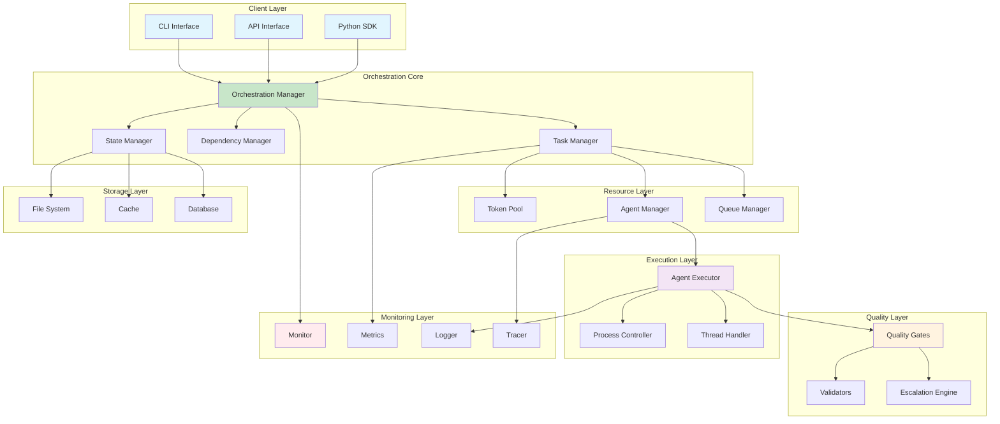
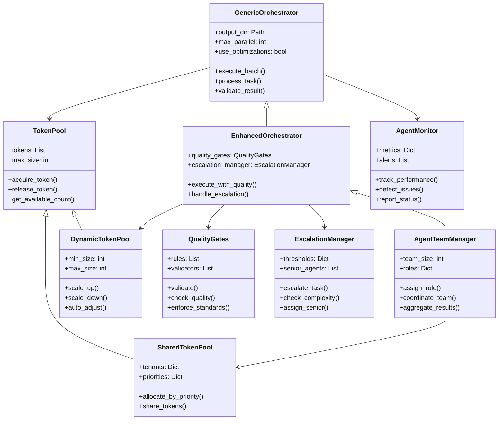

# Agent Orchestrator - Architecture Documentation

## Table of Contents

- [System Architecture](#system-architecture)
- [Component Design](#component-design)
- [Data Flow](#data-flow)
- [Communication Patterns](#communication-patterns)
- [State Management](#state-management)
- [Scalability Design](#scalability-design)

## System Architecture

### High-Level Architecture



### Component Hierarchy



## Component Design

### Core Components

```
generic_orchestrator.py
├── GenericOrchestrator (Main Controller)
│   ├── execute_agent()      # Single task execution
│   ├── execute_batch()      # Batch execution with dependencies
│   └── run()                # Main entry point
│
├── AgentTask (Data Model)
│   ├── task_id             # Unique identifier
│   ├── dependencies        # Task dependencies
│   └── status              # Execution status
│
├── TokenPool (Resource Management)
│   ├── acquire()           # Get next token
│   └── size()              # Available tokens
│
├── DependencyManager (Flow Control)
│   ├── can_run()           # Check if ready
│   ├── mark_running()      # Update status
│   └── mark_completed()    # Mark done
│
└── MessageBus (Communication)
    ├── send()              # Inter-agent messaging
    └── receive()           # Get messages
```

## Data Flow

### 1. Task Submission Flow

```
User Code
    │
    ├─> Generate Tasks (task_generator)
    │
    ├─> Submit to Orchestrator
    │
    ├─> Dependency Analysis
    │   ├─> Build dependency graph
    │   └─> Identify ready tasks
    │
    ├─> Task Queue
    │   ├─> Pending tasks
    │   ├─> Ready tasks
    │   └─> Blocked tasks
    │
    └─> Execution Pool
```

### 2. Execution Flow

```
Task Ready
    │
    ├─> Token Acquisition
    │   └─> Round-robin from pool
    │
    ├─> Pre-execution Hook
    │   └─> Custom preprocessing
    │
    ├─> Command Construction
    │   ├─> Base command
    │   ├─> Session ID (UUID)
    │   ├─> Output directory
    │   └─> Prompt
    │
    ├─> Subprocess Execution
    │   ├─> Environment setup
    │   ├─> Claude CLI invocation
    │   └─> Output capture
    │
    ├─> Result Processing
    │   ├─> JSON parsing
    │   ├─> Status update
    │   └─> Error handling
    │
    ├─> Post-execution Hook
    │   └─> Custom postprocessing
    │
    └─> State Persistence
        └─> Save to output/tasks/
```

### 3. Dependency Resolution

```
                 Task A
                /      \
               /        \
            Task B    Task C
               \        /
                \      /
                 Task D

Execution Order:
1. Task A (no dependencies)
2. Task B, Task C (parallel, both depend on A)
3. Task D (waits for both B and C)
```

## Parallelism Model

### Token-Based Parallelism

```
Tokens Available: 3
Max Parallel: 5
Actual Parallel: min(3, 5) = 3

Time →
T1: [Agent 1]━━━━━━━━━━┓
T2: [Agent 2]━━━━━━┓   ┃
T3: [Agent 3]━━━┓   ┃   ┃
                ┃   ┃   ┃
T1: ............┗━━━┃━━━┃━> [Agent 4]
T2: ................┗━━━┃━━━━━━━━━━━> [Agent 5]
T3: ....................┗━━━━━━━━━━━━━━━━━━━━> [Agent 6]
```

### Dependency-Aware Scheduling

```python
while tasks_remaining:
    ready_tasks = get_ready_tasks()  # Tasks with satisfied dependencies
    available_tokens = token_pool.available()

    batch_size = min(
        len(ready_tasks),
        available_tokens,
        max_parallel_setting
    )

    execute_batch(ready_tasks[:batch_size])
```

## File System Structure

```
project/
├── src/
│   └── generic_orchestrator.py    # Core framework
│
├── output/                         # Runtime outputs
│   ├── tasks/                     # Task results (JSON)
│   │   ├── task_id_1.json
│   │   ├── task_id_2.json
│   │   └── ...
│   │
│   └── logs/                      # Execution logs
│       └── orchestrator.log
│
└── ~/.claude/                      # Claude session data
    └── projects/
        └── [project]/
            └── [session_id].jsonl  # Session transcript
```

## State Management

### Task Lifecycle

```
         ┌──────────┐
         │  Pending │ ◄─── Initial state
         └─────┬────┘
               │
               ▼
     ┌──────────────────┐
     │ Dependency Check │
     └────┬─────────┬───┘
          │         │
     Ready│         │Blocked
          │         │
          ▼         ▼
    ┌─────────┐  (wait)
    │ Running │
    └──┬───┬──┘
       │   │
Success│   │Failure
       │   │
       ▼   ▼
 ┌──────────┐  ┌────────┐
 │Completed │  │ Failed │
 └──────────┘  └────────┘
```

### Persistence Strategy

1. **Task State**: Saved to JSON after each status change
2. **Results**: Written to disk immediately upon completion
3. **Metrics**: Aggregated in memory, saved at end
4. **Messages**: File-based for durability

## Security Considerations

### Token Management

```python
# Tokens never logged
logger.info(f"Token pool initialized with {len(tokens)} tokens")
# NOT: logger.info(f"Tokens: {tokens}")

# Environment isolation
env = os.environ.copy()
env['CLAUDE_CODE_TOKEN'] = token
# Original environment unchanged
```

### File System Isolation

```python
# Each task gets unique session
session_id = str(uuid.uuid4())

# Output isolation
output_dir = Path("output") / run_id / task_id

# No path traversal
output_dir = output_dir.resolve()
assert output_dir.is_relative_to(base_output_dir)
```

## Performance Optimizations

### 1. Minimal MCP Configuration
```json
{"mcpServers": {}}
```
Reduces startup time by ~10 seconds per agent.

### 2. Command Optimization
```python
"--strict-mcp-config"      # Skip MCP discovery
"--permission-mode acceptEdits"  # No prompts
"--output-format json"     # Structured output
```

### 3. Parallel Execution
```python
# Execute independent tasks simultaneously
batch_results = await asyncio.gather(
    *[execute_agent(task) for task in ready_tasks]
)
```

### 4. Resource Pooling
- Token reuse via round-robin
- Subprocess pooling (future enhancement)
- Connection pooling (future enhancement)

## Extension Points

### Hooks System

```python
# Pre-execution: Modify task before execution
orchestrator.pre_execute_hook = async def(task): ...

# Task builder: Customize prompt generation
orchestrator.task_builder_hook = async def(task): ...

# Post-execution: Process results
orchestrator.post_execute_hook = async def(task): ...
```

### Custom Task Types

```python
class CustomTask(AgentTask):
    retry_count: int = 0
    max_retries: int = 3
    timeout: float = 300.0

    def should_retry(self) -> bool:
        return self.status == "failed" and self.retry_count < self.max_retries
```

### Alternative Executors

```python
class MockExecutor:
    """For testing without Claude"""
    async def execute(self, task: AgentTask) -> Dict:
        await asyncio.sleep(1)  # Simulate work
        return {"status": "completed", "result": "mock"}

# Inject custom executor
orchestrator.executor = MockExecutor()
```

## Scalability Limits

### Current Limits

| Dimension | Soft Limit | Hard Limit | Bottleneck |
|-----------|------------|------------|------------|
| Tasks | 1,000 | 10,000 | Memory |
| Parallel | 10 | 50 | Token count |
| Depth | 10 | 100 | Stack depth |
| Output | 1 MB | 10 MB | Disk I/O |

### Scaling Strategies

1. **Horizontal**: Multiple orchestrator instances
2. **Vertical**: Increase memory/CPU
3. **Batching**: Process in chunks
4. **Streaming**: Stream large outputs to disk
5. **Distributed**: Queue-based architecture (future)

## Future Architecture

### Planned Enhancements

```
┌──────────────────┐
│   Web Dashboard  │ ◄── Real-time monitoring
└────────┬─────────┘
         │
┌────────▼─────────┐
│   REST API       │ ◄── Remote orchestration
└────────┬─────────┘
         │
┌────────▼─────────┐
│  Task Queue      │ ◄── Redis/RabbitMQ
└────────┬─────────┘
         │
┌────────▼─────────┐
│  Worker Pool     │ ◄── Distributed workers
└──────────────────┘
```

### Plugin Architecture

```python
class OrchestratorPlugin:
    async def on_start(self, orchestrator): pass
    async def on_task_start(self, task): pass
    async def on_task_complete(self, task): pass
    async def on_error(self, task, error): pass
    async def on_finish(self, results): pass

# Register plugins
orchestrator.register_plugin(LoggingPlugin())
orchestrator.register_plugin(MetricsPlugin())
orchestrator.register_plugin(NotificationPlugin())
```
