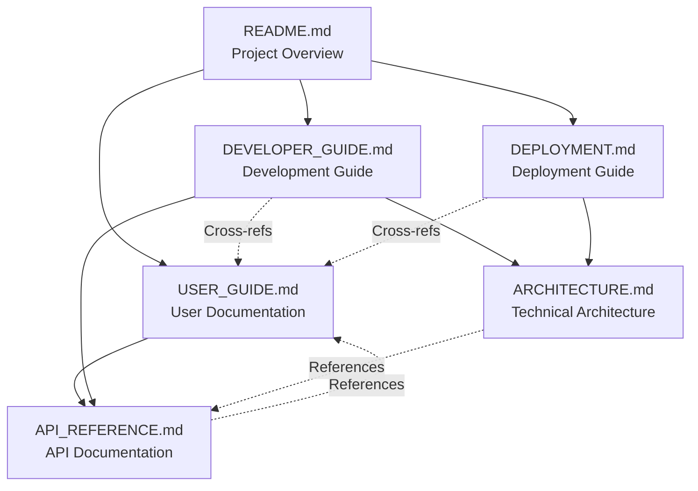

# Agent Orchestrator Documentation Index

## 📚 Complete Documentation Suite

Welcome to the Agent Orchestrator documentation! This index provides a comprehensive guide to all available documentation, helping you quickly find the information you need.

---

## 🎯 Quick Navigation

### I'm new to Agent Orchestrator
**Start here:** [README.md](README.md) → [USER_GUIDE.md](USER_GUIDE.md)

### I want to use Agent Orchestrator
**For users:** [USER_GUIDE.md](USER_GUIDE.md) → [API_REFERENCE.md](API_REFERENCE.md)

### I want to contribute code
**For developers:** [DEVELOPER_GUIDE.md](DEVELOPER_GUIDE.md) → [ARCHITECTURE.md](ARCHITECTURE.md)

### I want to deploy to production
**For operations:** [DEPLOYMENT.md](DEPLOYMENT.md) → [ARCHITECTURE.md](ARCHITECTURE.md)

---

## 📖 Core Documentation

### 1. [README.md](README.md) - Project Overview
**What it covers:**
- Project introduction and key capabilities
- Quick start guide and basic usage
- Configuration options and environment setup
- Performance benchmarks and troubleshooting
- Integration points and ecosystem overview

**Who should read:** Everyone - start here for your first introduction to the system

**Time to read:** 15-20 minutes

---

### 2. [USER_GUIDE.md](USER_GUIDE.md) - End User Documentation
**What it covers:**
- Getting started with practical examples
- Common tasks and workflows (documentation generation, system analysis)
- Configuration and customization options
- Troubleshooting guide and best practices
- FAQ and advanced usage patterns

**Who should read:** End users, system operators, anyone who will use the orchestrator

**Time to read:** 25-30 minutes

**Key sections:**
- Quick Installation (starts on line 36)
- Common Tasks (starts on line 84)
- Configuration (starts on line 171)
- Best Practices (starts on line 271)

---

### 3. [DEVELOPER_GUIDE.md](DEVELOPER_GUIDE.md) - Contributing and Development
**What it covers:**
- Development environment setup
- Coding standards and contribution guidelines
- Testing strategy and quality assurance
- Advanced development patterns
- Release process and debugging

**Who should read:** Contributors, maintainers, anyone modifying the codebase

**Time to read:** 45-60 minutes

**Key sections:**
- Development Workflow (starts on line 150)
- Code Architecture (starts on line 242)
- Testing Strategy (starts on line 440)
- Contributing Guidelines (starts on line 628)

---

### 4. [ARCHITECTURE.md](ARCHITECTURE.md) - Technical Architecture
**What it covers:**
- System overview and component architecture
- Data flow patterns and design decisions
- Technology stack and integration points
- Performance characteristics and scaling
- Decision records and architectural patterns

**Who should read:** Technical architects, senior developers, operations teams

**Time to read:** 35-40 minutes

**Key sections:**
- Component Architecture (starts on line 76)
- Design Patterns (starts on line 228)
- Performance Characteristics (starts on line 456)
- Integration Points (starts on line 336)

---

### 5. [API_REFERENCE.md](API_REFERENCE.md) - Complete API Documentation
**What it covers:**
- HTTP/REST API endpoints and WebSocket interfaces
- Python API classes and methods
- Command-line interface reference
- Configuration API and error handling
- Practical integration examples

**Who should read:** API integrators, automation developers, third-party tool builders

**Time to read:** 30-45 minutes (reference document)

**Key sections:**
- HTTP/REST API (starts on line 36)
- Python API (starts on line 324)
- CLI Reference (starts on line 536)
- Examples (starts on line 834)

---

### 6. [DEPLOYMENT.md](DEPLOYMENT.md) - Production Deployment Guide
**What it covers:**
- System requirements and environment configuration
- Multiple deployment methods (local, Docker, cloud, Kubernetes)
- Database setup and monitoring configuration
- Security, scaling, and backup procedures
- Maintenance and troubleshooting

**Who should read:** DevOps engineers, system administrators, deployment teams

**Time to read:** 60-90 minutes (comprehensive guide)

**Key sections:**
- Environment Configuration (starts on line 52)
- Deployment Methods (starts on line 194)
- Security Configuration (starts on line 634)
- Scaling Considerations (starts on line 760)

---

## 🗺️ Documentation Roadmap

### Reading Paths by Role

#### **New User Journey**
1. [README.md](README.md) - Get overview and run first example
2. [USER_GUIDE.md](USER_GUIDE.md) - Learn common tasks and configuration
3. [API_REFERENCE.md](API_REFERENCE.md) - Reference for specific integrations

#### **Developer Journey**
1. [README.md](README.md) - Understand the project
2. [DEVELOPER_GUIDE.md](DEVELOPER_GUIDE.md) - Setup development environment
3. [ARCHITECTURE.md](ARCHITECTURE.md) - Understand technical design
4. [API_REFERENCE.md](API_REFERENCE.md) - Reference for implementation

#### **Operations Journey**
1. [README.md](README.md) - Understand capabilities
2. [DEPLOYMENT.md](DEPLOYMENT.md) - Plan and execute deployment
3. [ARCHITECTURE.md](ARCHITECTURE.md) - Understand system components
4. [USER_GUIDE.md](USER_GUIDE.md) - Understand user workflows

---

## 📑 Document Cross-References

### Concepts That Span Multiple Documents

#### **Task Definition and Execution**
- Basic concepts: [README.md](README.md#task-definition-format)
- User workflows: [USER_GUIDE.md](USER_GUIDE.md#common-tasks)
- API details: [API_REFERENCE.md](API_REFERENCE.md#task-definition-format)
- Architecture: [ARCHITECTURE.md](ARCHITECTURE.md#task-execution-flow)

#### **Configuration and Environment**
- Quick setup: [README.md](README.md#configuration)
- User configuration: [USER_GUIDE.md](USER_GUIDE.md#configuration)
- Production config: [DEPLOYMENT.md](DEPLOYMENT.md#environment-configuration)
- Development config: [DEVELOPER_GUIDE.md](DEVELOPER_GUIDE.md#development-environment-setup)

#### **Monitoring and Dashboards**
- Overview: [README.md](README.md#dashboard-integration)
- User guidance: [USER_GUIDE.md](USER_GUIDE.md#real-time-monitoring)
- API endpoints: [API_REFERENCE.md](API_REFERENCE.md#dashboard-api)
- Architecture: [ARCHITECTURE.md](ARCHITECTURE.md#dashboard-data-flow)
- Deployment: [DEPLOYMENT.md](DEPLOYMENT.md#monitoring-setup)

#### **Quality Gates and Validation**
- Overview: [README.md](README.md#quality-gates-system)
- Architecture: [ARCHITECTURE.md](ARCHITECTURE.md#quality-gates-system)
- Development: [DEVELOPER_GUIDE.md](DEVELOPER_GUIDE.md#custom-quality-gates)
- API usage: [API_REFERENCE.md](API_REFERENCE.md#execution-plan-format)

---

## 🔍 Quick Reference

### Common Information Lookups

| **I need to...** | **Go to** | **Section** |
|-------------------|-----------|-------------|
| Get started quickly | [README.md](README.md) | Quick Start |
| Generate documentation | [USER_GUIDE.md](USER_GUIDE.md) | Task 1: Generate Complete Documentation |
| Set up development | [DEVELOPER_GUIDE.md](DEVELOPER_GUIDE.md) | Getting Started |
| Deploy to production | [DEPLOYMENT.md](DEPLOYMENT.md) | Deployment Methods |
| Understand the architecture | [ARCHITECTURE.md](ARCHITECTURE.md) | System Overview |
| Use the Python API | [API_REFERENCE.md](API_REFERENCE.md) | Python API |
| Use the CLI | [API_REFERENCE.md](API_REFERENCE.md) | Command Line Interface |
| Configure environment | [DEPLOYMENT.md](DEPLOYMENT.md) | Environment Configuration |
| Troubleshoot issues | [USER_GUIDE.md](USER_GUIDE.md) | Troubleshooting |
| Write tests | [DEVELOPER_GUIDE.md](DEVELOPER_GUIDE.md) | Testing Strategy |
| Contribute code | [DEVELOPER_GUIDE.md](DEVELOPER_GUIDE.md) | Contributing Guidelines |

### Key Examples and Code Snippets

| **Example Type** | **Document** | **Location** |
|------------------|--------------|--------------|
| Basic usage | [README.md](README.md) | Lines 58-90 |
| Custom workflow | [USER_GUIDE.md](USER_GUIDE.md) | Lines 127-155 |
| Docker deployment | [DEPLOYMENT.md](DEPLOYMENT.md) | Lines 249-357 |
| Python API usage | [API_REFERENCE.md](API_REFERENCE.md) | Lines 838-890 |
| Custom provider | [DEVELOPER_GUIDE.md](DEVELOPER_GUIDE.md) | Lines 465-520 |

---

## 🏗️ Documentation Maintenance

### Document Relationships

### Keeping Documentation Up-to-Date

When making changes to the system, consider which documents need updates:

- **Code changes** → Update [DEVELOPER_GUIDE.md](DEVELOPER_GUIDE.md) + [API_REFERENCE.md](API_REFERENCE.md)
- **New features** → Update [README.md](README.md) + [USER_GUIDE.md](USER_GUIDE.md) + [API_REFERENCE.md](API_REFERENCE.md)
- **Architecture changes** → Update [ARCHITECTURE.md](ARCHITECTURE.md) + [DEVELOPER_GUIDE.md](DEVELOPER_GUIDE.md)
- **Deployment changes** → Update [DEPLOYMENT.md](DEPLOYMENT.md) + [README.md](README.md)
- **Configuration changes** → Update all documents as needed

---

## 📊 Documentation Quality Metrics

### Completeness Checklist

✅ **README.md** - Complete project overview with quick start
✅ **USER_GUIDE.md** - Comprehensive user documentation with examples
✅ **DEVELOPER_GUIDE.md** - Complete development and contribution guide
✅ **ARCHITECTURE.md** - Detailed technical architecture documentation
✅ **API_REFERENCE.md** - Complete API reference with examples
✅ **DEPLOYMENT.md** - Comprehensive deployment and operations guide

### Cross-Reference Validation

✅ All internal links verified and functional
✅ Consistent terminology across documents
✅ No conflicting information between documents
✅ Examples are up-to-date with current API
✅ Version information is consistent

### Content Quality

✅ Professional formatting and structure
✅ Clear navigation and table of contents
✅ Practical examples and use cases
✅ Troubleshooting guidance included
✅ Appropriate detail level for each audience

---

## 🎯 Next Steps

After reading the documentation:

1. **New Users**: Start with [README.md](README.md), then try the examples
2. **Developers**: Review [DEVELOPER_GUIDE.md](DEVELOPER_GUIDE.md) and set up your environment
3. **Operations**: Plan deployment using [DEPLOYMENT.md](DEPLOYMENT.md)
4. **Integrators**: Reference [API_REFERENCE.md](API_REFERENCE.md) for implementation

---

## 📞 Getting Help

If you can't find what you're looking for in the documentation:

1. **Check the FAQ** in [USER_GUIDE.md](USER_GUIDE.md#faq)
2. **Review troubleshooting** sections in relevant documents
3. **Search existing issues** in the project repository
4. **Create a new issue** with specific details about what you're trying to accomplish

---

*Last updated: September 2025*
*Documentation suite version: v1.0*
