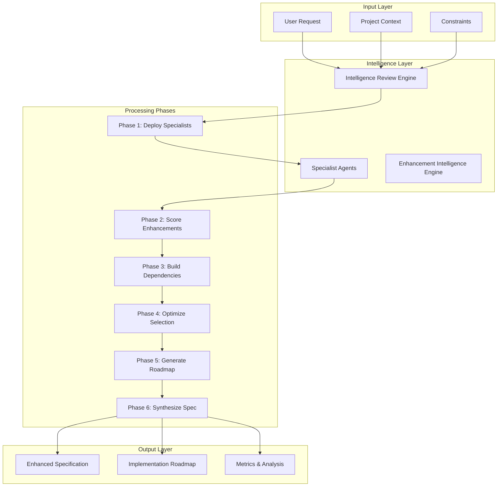

# Intelligence Review Engine Documentation

## Overview

The Intelligence Review Engine is a sophisticated system that enhances basic development requests with cutting-edge technical intelligence. It coordinates specialist agents to research and improve requests across multiple dimensions including performance, architecture, integration, innovation, and development acceleration.

## Table of Contents

1. [Architecture](#architecture)
2. [Core Components](#core-components)
3. [Specialist Agents](#specialist-agents)
4. [Enhancement Process](#enhancement-process)
5. [Integration with DPO](#integration-with-dpo)
6. [Usage Guide](#usage-guide)
7. [API Reference](#api-reference)
8. [Configuration](#configuration)
9. [Examples](#examples)

## Architecture

The Intelligence Review Engine follows a multi-phase enhancement process:



## Core Components

### 1. Intelligence Review Engine (`intelligence_review_engine.py`)

The base engine that coordinates specialist agents and manages the enhancement process.

**Key Features:**
- Parallel specialist agent deployment
- Result parsing and aggregation
- Enhanced specification synthesis
- Session management and persistence

**Main Classes:**
- `IntelligenceReviewEngine`: Core orchestration engine
- `EnhancementCategory`: Category definition and management
- `EnhancementResult`: Result container with serialization

### 2. Enhanced Intelligence Engine (`intelligence_review_engine_enhanced.py`)

Advanced version with sophisticated algorithms for enhancement optimization.

**Key Features:**
- Multi-dimensional scoring (impact, effort, innovation, risk)
- Dependency graph construction
- Constraint-based optimization
- Cost-benefit analysis
- Implementation phase assignment

**Main Classes:**
- `EnhancementIntelligenceEngine`: Advanced enhancement engine
- `EnhancementScore`: Multi-dimensional scoring model
- `EnhancementNode`: Graph node for dependency tracking

### 3. Specialist Agent Templates (`specialist_agent_templates.py`)

Comprehensive templates for different types of specialist agents.

**Available Specialists:**
- Performance Optimizer
- Solution Architect
- Integration Specialist
- Innovation Analyst
- Development Accelerator
- Research Genius

### 4. DPO Integration (`dpo_intelligence_integration.py`)

Seamless integration with the Development Process Orchestrator.

**Key Features:**
- Request enhancement before workflow generation
- Intelligent agent assignment
- Quality gate definition
- Timeline estimation

## Specialist Agents

### Performance Optimizer
**Focus:** Speed, efficiency, and resource optimization
**Analyzes:**
- Algorithm optimizations
- Memory management
- Parallel processing opportunities
- Database optimization
- Caching strategies
- Network optimization

### Solution Architect
**Focus:** System design patterns and architectural decisions
**Analyzes:**
- Design patterns
- Microservices vs monolith
- Event-driven architecture
- API design
- Data architecture
- Scalability patterns

### Integration Specialist
**Focus:** Ecosystem connections and third-party integrations
**Analyzes:**
- Framework integrations
- Cloud service connections
- Monitoring tools
- CI/CD pipelines
- Authentication services
- Payment systems

### Innovation Analyst
**Focus:** Cutting-edge technologies and features
**Analyzes:**
- AI/ML capabilities
- Real-time features
- Progressive Web App capabilities
- Edge computing
- Voice interfaces
- Advanced security features

### Development Accelerator
**Focus:** Tools and techniques for faster development
**Analyzes:**
- Code generation tools
- Scaffolding and templates
- Component libraries
- Testing automation
- DevOps tools
- Documentation generators

### Research Genius
**Focus:** Latest research and industry best practices
**Analyzes:**
- Academic papers
- Industry blogs
- Open source projects
- Technical standards
- Case studies

## Enhancement Process

### Phase 1: Specialist Deployment
All specialist agents are deployed in parallel to analyze the request from their unique perspectives.

### Phase 2: Enhancement Scoring
Each enhancement is scored across multiple dimensions:
- **Impact Score** (0-1): Business value and user benefit
- **Effort Score** (0-1): Implementation complexity
- **Innovation Score** (0-1): Technical advancement level
- **Risk Score** (0-1): Implementation risk
- **Dependency Score** (0-1): How foundational for other enhancements

### Phase 3: Dependency Analysis
Build a dependency graph to understand relationships between enhancements.

### Phase 4: Optimization
Select optimal enhancements based on:
- Composite scores
- Constraint satisfaction
- Dependency requirements
- Budget limitations

### Phase 5: Roadmap Generation
Create implementation phases using topological sorting of dependencies.

### Phase 6: Specification Synthesis
Generate comprehensive enhanced specification with all improvements integrated.

## Integration with DPO

The Intelligence Review Engine seamlessly integrates with the Development Process Orchestrator:

1. **Request Reception**: DPO receives user request
2. **Intelligence Enhancement**: Request sent to Intelligence Review Engine
3. **Enhancement Application**: Improvements integrated into workflow
4. **Agent Assignment**: Specialist agents assigned to relevant phases
5. **Quality Gates**: Enhanced criteria based on improvements
6. **Timeline Adjustment**: Duration estimates based on enhancements

## Usage Guide

### Basic Usage

```python
from src.intelligence_review_engine import IntelligenceReviewEngine

# Initialize engine
engine = IntelligenceReviewEngine(
    parallel_agents=5,
    output_dir='output/intelligence_review'
)

# Enhance a request
result = await engine.enhance_request(
    original_request="Build a real-time chat application",
    project_context={
        'target_users': '10,000 concurrent',
        'deployment': 'AWS'
    }
)

# Access results
print(result.get_summary())
print(result.enhanced_specification)
```

### Advanced Usage with Constraints

```python
from src.intelligence_review_engine_enhanced import EnhancementIntelligenceEngine

# Initialize advanced engine
engine = EnhancementIntelligenceEngine(
    parallel_agents=6,
    output_dir='output/enhanced_intelligence'
)

# Define constraints and goals
constraints = {
    'budget_units': 100,
    'timeline': 'aggressive',
    'max_enhancements': 15
}

optimization_goals = [
    'maximize_performance',
    'minimize_development_time',
    'ensure_scalability'
]

# Run enhancement
result = await engine.enhance_with_intelligence(
    original_request=request,
    project_context=context,
    optimization_goals=optimization_goals,
    constraints=constraints
)
```

### DPO Integration

```python
from src.dpo_intelligence_integration import DPOIntelligenceIntegration, DPORequest

# Create DPO request
request = DPORequest(
    request_id="REQ_001",
    user_request="Build an e-commerce platform",
    project_type="web_app",
    complexity_level="complex",
    project_context={...},
    constraints={...}
)

# Process with intelligence
integration = DPOIntelligenceIntegration()
workflow = await integration.process_dpo_request(request)
```

## API Reference

### IntelligenceReviewEngine

```python
class IntelligenceReviewEngine:
    def __init__(self, orchestrator=None, parallel_agents=5, output_dir=None)

    async def enhance_request(
        self,
        original_request: str,
        project_context: Dict = None,
        selected_categories: List[str] = None
    ) -> EnhancementResult
```

### EnhancementIntelligenceEngine

```python
class EnhancementIntelligenceEngine:
    def __init__(self, orchestrator=None, parallel_agents=6, output_dir=None)

    async def enhance_with_intelligence(
        self,
        original_request: str,
        project_context: Dict = None,
        optimization_goals: List[str] = None,
        constraints: Dict = None
    ) -> Dict[str, Any]
```

### DPOIntelligenceIntegration

```python
class DPOIntelligenceIntegration:
    def __init__(self, orchestrator=None, output_dir=None)

    async def process_dpo_request(
        self,
        request: DPORequest
    ) -> EnhancedDPOWorkflow
```

## Configuration

### Enhancement Categories

Configure which enhancement categories to process:

```python
selected_categories = [
    'performance_opportunities',
    'architecture_improvements',
    'ecosystem_integrations',
    'cutting_edge_features',
    'implementation_optimizations'
]
```

### Constraints

Define project constraints:

```python
constraints = {
    'budget_units': 100,        # Budget limitation
    'timeline': 'aggressive',   # aggressive/normal/relaxed
    'max_enhancements': 20,     # Maximum enhancements to select
    'team_expertise': ['python', 'react', 'aws']  # Available skills
}
```

### Optimization Goals

Specify optimization priorities:

```python
optimization_goals = [
    'maximize_performance',      # Focus on speed
    'minimize_development_time', # Quick implementation
    'ensure_scalability',       # Handle growth
    'prioritize_innovation',    # Cutting-edge features
    'optimize_cost'            # Cost-effective solutions
]
```

## Examples

### Example 1: E-commerce Platform Enhancement

```python
request = """
Build a scalable e-commerce platform with real-time inventory,
personalized recommendations, and multi-channel sales.
"""

context = {
    'expected_users': '100,000 monthly',
    'product_catalog': '50,000 SKUs',
    'deployment': 'AWS',
    'team_size': '5 developers'
}

result = await engine.enhance_request(request, context)
```

**Output Highlights:**
- Performance: Redis caching, CDN integration, database sharding
- Architecture: Microservices, event-driven inventory updates
- Integrations: Stripe payments, SendGrid emails, Segment analytics
- Innovations: AI recommendations, real-time personalization
- Development: Next.js template, Prisma ORM, GitHub Actions CI/CD

### Example 2: Real-time Collaboration Platform

```python
request = """
Create a collaboration platform with video chat, screen sharing,
and document editing for remote teams.
"""

constraints = {
    'timeline': 'aggressive',
    'budget_units': 80
}

goals = ['real_time_performance', 'user_experience']

result = await engine.enhance_with_intelligence(
    request, constraints=constraints, optimization_goals=goals
)
```

**Output Highlights:**
- Quick Wins: WebRTC integration, Socket.io setup
- Major Projects: Collaborative editing engine, video infrastructure
- Integrations: Twilio Video, Firebase Realtime DB
- Performance: Edge servers, adaptive bitrate streaming

## Output Format

The Intelligence Review Engine generates comprehensive output:

### Enhanced Specification
- Original request summary
- Core implementation approach
- Performance optimizations
- Architecture patterns
- Integration points
- Advanced features
- Implementation phases
- Success metrics

### Implementation Roadmap
- Phased approach with dependencies
- Timeline estimates
- Resource requirements
- Milestone definitions
- Risk mitigation strategies

### Metrics and Analysis
- Enhancement scoring breakdown
- Cost-benefit analysis
- Risk assessment
- Quick wins identification
- Innovation highlights
- Technology recommendations

## Best Practices

1. **Provide Detailed Context**: More context leads to better enhancements
2. **Set Clear Constraints**: Define budget, timeline, and team limitations
3. **Specify Goals**: Indicate optimization priorities
4. **Review Dependencies**: Understand enhancement relationships
5. **Iterate on Results**: Use output to refine requirements
6. **Focus on Quick Wins**: Implement high-impact, low-effort items first
7. **Monitor Metrics**: Track enhancement effectiveness

## Troubleshooting

### Common Issues

**Issue:** Specialist agents timing out
**Solution:** Reduce parallel agents or increase timeout settings

**Issue:** Low enhancement scores
**Solution:** Provide more specific project context and goals

**Issue:** Dependency conflicts
**Solution:** Review dependency graph and adjust selections

**Issue:** Budget exceeded
**Solution:** Adjust constraint parameters or reduce max_enhancements

## Performance Considerations

- **Parallel Execution**: 5-6 agents optimal for most systems
- **Memory Usage**: ~500MB per specialist agent
- **Processing Time**: 15-30 seconds for typical requests
- **Output Size**: 50-200KB for complete results

## Future Enhancements

Planned improvements for the Intelligence Review Engine:

1. **Machine Learning Integration**: Learn from past enhancement successes
2. **Custom Specialist Training**: Domain-specific specialist agents
3. **Real-time Collaboration**: Multiple users enhancing together
4. **Visual Enhancement Editor**: GUI for enhancement selection
5. **Performance Profiling**: Detailed performance impact predictions
6. **Cost Estimation**: Accurate development cost predictions
7. **A/B Testing Support**: Enhancement variant testing
8. **Continuous Enhancement**: Ongoing improvement suggestions

## Support

For issues, questions, or contributions:
- GitHub Issues: [agent-orchestrator/issues](https://github.com/agent-orchestrator/issues)
- Documentation: This file and inline code documentation
- Examples: See `/examples` directory for more use cases

---

*Intelligence Review Engine - Transforming basic requests into production-ready specifications through cutting-edge technical intelligence.*
