# HECATON System Architecture Diagrams

## Overview

This document provides comprehensive Mermaid diagrams visualizing all aspects of the HECATON autonomous self-improving multi-agent orchestration system. These diagrams cover the complete architecture, workflows, data flows, and system interactions.

## Table of Contents

1. [System Architecture Overview](#1-system-architecture-overview)
2. [Phase Evolution Workflow](#2-phase-evolution-workflow)
3. [Self-Improvement Cycle](#3-self-improvement-cycle)
4. [LangGraph Parallel Execution Architecture](#4-langgraph-parallel-execution-architecture)
5. [Resource Management System](#5-resource-management-system)
6. [Agent Communication Flow](#6-agent-communication-flow)
7. [Performance Monitoring System](#7-performance-monitoring-system)
8. [Data Flow Architecture](#8-data-flow-architecture)
9. [Error Handling and Recovery](#9-error-handling-and-recovery)
10. [Agent Specialization Matrix](#10-agent-specialization-matrix)
11. [Configuration and Environment Management](#11-configuration-and-environment-management)
12. [System Integration and Dependencies](#12-system-integration-and-dependencies)

---

## 1. System Architecture Overview

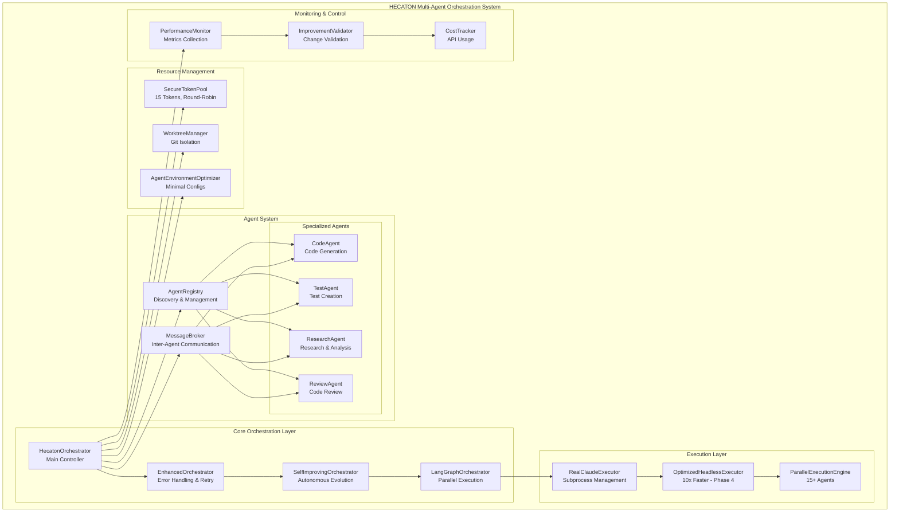

---

## 2. Phase Evolution Workflow

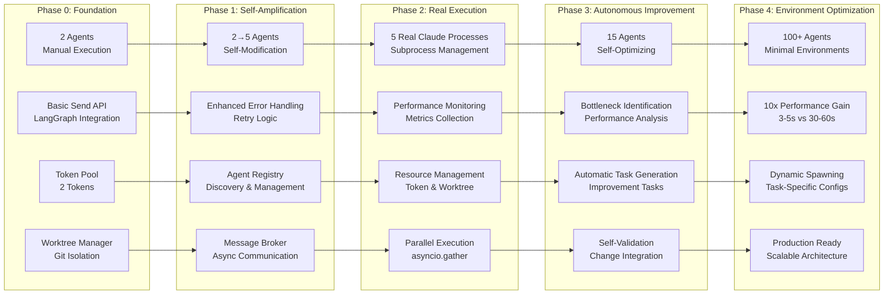

---

## 3. Self-Improvement Cycle

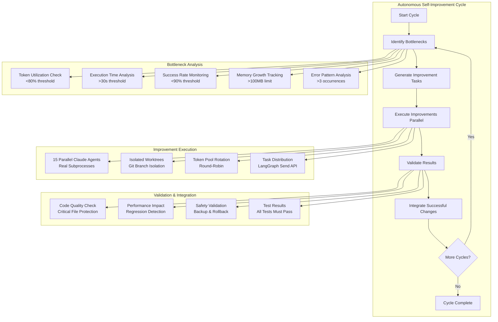

---

## 4. LangGraph Parallel Execution Architecture

```mermaid
graph TB
    subgraph "LangGraph StateGraph Workflow"
        START([START]) --> IB[identify_bottlenecks]
        IB --> DI[distribute_improvements]
        DI --> CR[_create_send_objects]
        CR --> EI[execute_improvement]
        EI --> VR[validate_results]
        VR --> END([END])
    end

    subgraph "Send API Parallel Execution"
        CR --> S1[Send Object 1<br/>Parallel Path 1]
        CR --> S2[Send Object 2<br/>Parallel Path 2]
        CR --> S3[Send Object 3<br/>Parallel Path 3]
        CR --> S4[Send Object N<br/>Parallel Path N]

        S1 --> A1[Agent 1<br/>Isolated State]
        S2 --> A2[Agent 2<br/>Isolated State]
        S3 --> A3[Agent 3<br/>Isolated State]
        S4 --> AN[Agent N<br/>Isolated State]

        A1 --> VR
        A2 --> VR
        A3 --> VR
        AN --> VR
    end

    subgraph "Agent State Management"
        AS[AgentState<br/>TypedDict]
        AS --> TID[task_id: str]
        AS --> AG[agents: Dict[str, Any]]
        AS --> RS[results: Dict[str, Any]]
        AS --> PH[phase: str]
        AS --> BN[bottlenecks: List[str]]
        AS --> IM[improvements: Dict[str, str]]
    end

    subgraph "Parallel Execution Pattern"
        PE[OAMAT-SD Pattern]
        PE --> AC[add_conditional_edges]
        PE --> SO[Send Objects]
        PE --> IS[Isolated States]
        PE --> AM[Automatic Merging]
    end
```

---

## 5. Resource Management System

```mermaid
graph TB
    subgraph "Secure Token Pool"
        STP[SecureTokenPool<br/>Thread-Safe]
        STP --> T1[Token 1<br/>CLAUDE_CODE_TOKEN1]
        STP --> T2[Token 2<br/>CLAUDE_CODE_TOKEN2]
        STP --> T3[Token 3<br/>CLAUDE_CODE_TOKEN3]
        STP --> TN[Token N<br/>CLAUDE_CODE_TOKEN15]

        T1 --> RR1[Round-Robin Rotation<br/>Thread Lock]
        T2 --> RR2[Usage Statistics<br/>Hash-Based Logging]
        T3 --> RR3[Token Validation<br/>Length & Format]
        TN --> RR4[Secure Storage<br/>Environment/Config]
    end

    subgraph "Worktree Management"
        WM[WorktreeManager<br/>External Paths]
        WM --> WT1[Worktree 1<br/>agent_1_20250115_143022]
        WM --> WT2[Worktree 2<br/>agent_2_20250115_143023]
        WM --> WT3[Worktree 3<br/>agent_3_20250115_143024]
        WM --> WTN[Worktree N<br/>agent_N_timestamp]

        WT1 --> BR1[Branch: hecaton/20250115_143022/agent_1]
        WT2 --> BR2[Branch: hecaton/20250115_143023/agent_2]
        WT3 --> BR3[Branch: hecaton/20250115_143024/agent_3]
        WTN --> BRN[Branch: hecaton/timestamp/agent_N]

        BR1 --> GC1[git worktree add<br/>External Directory]
        BR2 --> GC2[git branch<br/>Not checkout -b]
        BR3 --> GC3[Automatic Cleanup<br/>Resource Management]
        BRN --> GCN[Isolation Per Agent<br/>No Conflicts]
    end

    subgraph "Agent Environment Optimization"
        AEO[AgentEnvironmentOptimizer<br/>Phase 4]
        AEO --> CP1[Code Profile<br/>Minimal MCP, sonnet model]
        AEO --> CP2[Test Profile<br/>Testing tools, pytest]
        AEO --> CP3[Research Profile<br/>Web search, firecrawl]
        AEO --> CP4[Review Profile<br/>Analysis tools, review]

        CP1 --> ENV1[Optimized Commands<br/>--strict-mcp-config]
        CP2 --> ENV2[Task-Specific Prompts<br/>Focused Instructions]
        CP3 --> ENV3[Minimal Dependencies<br/>Only Required Tools]
        CP4 --> ENV4[Performance Estimates<br/>3-5s vs 30-60s]
    end
```

---

## 6. Agent Communication Flow

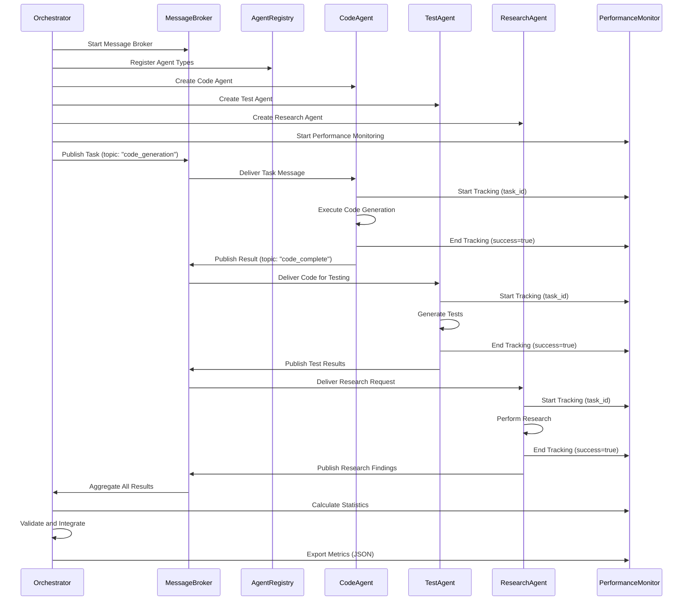

---

## 7. Performance Monitoring System

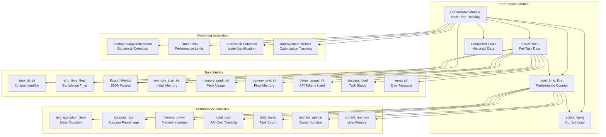

---

## 8. Data Flow Architecture

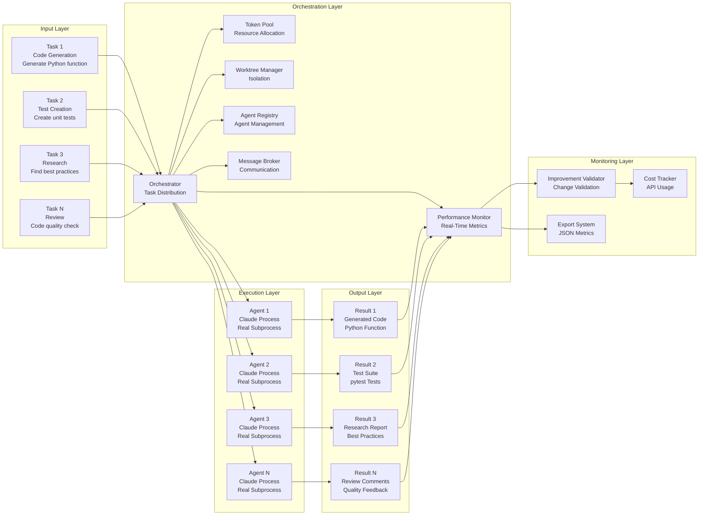

---

## 9. Error Handling and Recovery

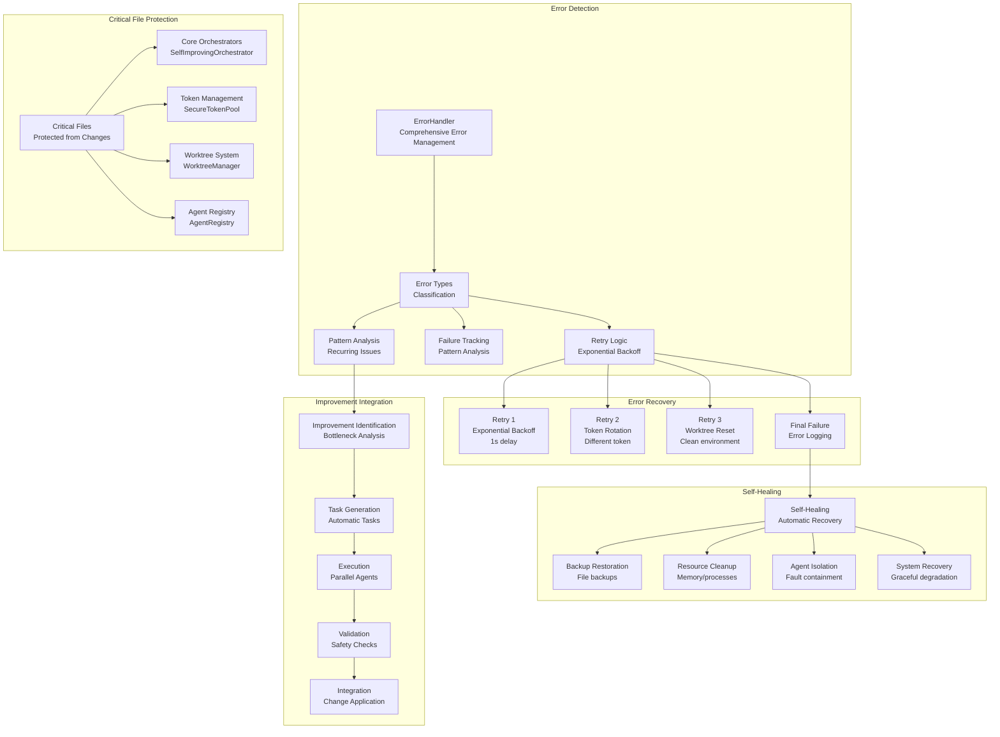

---

## 10. Agent Specialization Matrix

```mermaid
graph TB
    subgraph "Agent Types"
        subgraph "Code Generation"
            CA[CodeAgent<br/>Specialized Code Generation]
            CA --> CG1[Function Generation<br/>Python, JavaScript, TypeScript]
            CA --> CG2[Class Creation<br/>OOP Patterns]
            CA --> CG3[Code Refactoring<br/>Improve Existing Code]
            CA --> CG4[Documentation<br/>Docstrings, Comments]
            CA --> CG5[Code Optimization<br/>Performance Improvements]
        end

        subgraph "Testing"
            TA[TestAgent<br/>Comprehensive Testing]
            TA --> TG1[Unit Test Generation<br/>pytest, unittest]
            TA --> TG2[Integration Tests<br/>End-to-end Testing]
            TA --> TG3[Test Data Creation<br/>Mock Data Generation]
            TA --> TG4[Coverage Analysis<br/>Test Coverage]
            TA --> TG5[Test Reports<br/>Detailed Results]
        end

        subgraph "Research"
            RA[ResearchAgent<br/>Information Gathering]
            RA --> RA1[Code Analysis<br/>Static Analysis]
            RA --> RA2[Documentation Generation<br/>README, API docs]
            RA --> RA3[API Documentation<br/>OpenAPI, Swagger]
            RA --> RA4[Metadata Extraction<br/>Code Insights]
            RA --> RA5[Changelog Creation<br/>Version History]
        end

        subgraph "Review"
            RVA[ReviewAgent<br/>Quality Assurance]
            RVA --> RV1[Code Review<br/>Best Practices]
            RVA --> RV2[Quality Assessment<br/>Code Quality]
            RVA --> RV3[Security Analysis<br/>Vulnerability Check]
            RVA --> RV4[Performance Review<br/>Optimization]
            RVA --> RV5[Best Practices Check<br/>Standards Compliance]
        end
    end

    subgraph "Capabilities"
        CA --> C1[Python, JavaScript, TypeScript<br/>Multiple Languages]
        TA --> C2[pytest, unittest, coverage<br/>Testing Frameworks]
        RA --> C3[Web search, documentation tools<br/>Research Tools]
        RVA --> C4[Static analysis, linting<br/>Quality Tools]
    end

    subgraph "Agent Profiles"
        AP1[Code Profile<br/>Minimal MCP, sonnet model]
        AP2[Test Profile<br/>Testing tools, pytest]
        AP3[Research Profile<br/>Web search, firecrawl]
        AP4[Review Profile<br/>Analysis tools, review]
    end
```

---

## 11. Configuration and Environment Management

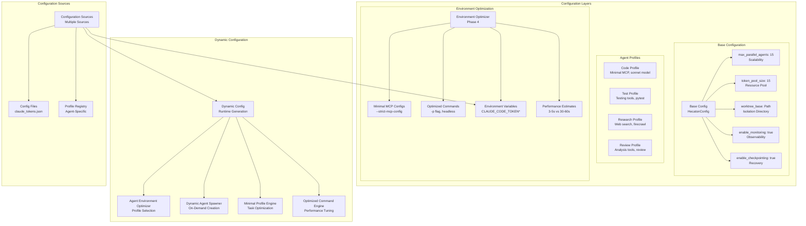

---

## 12. System Integration and Dependencies

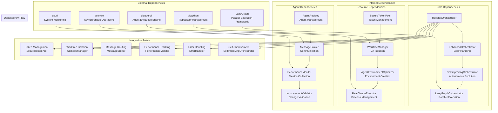

---

## Summary

These diagrams provide a comprehensive visualization of the HECATON system architecture, covering:

### Key Architectural Features:
- **Autonomous Self-Improvement**: System can identify bottlenecks and optimize itself
- **Parallel Execution**: 15+ real Claude processes running simultaneously
- **Resource Management**: Secure token pools and isolated worktrees
- **Performance Monitoring**: Real-time metrics and cost tracking
- **Error Recovery**: Self-healing mechanisms and fault tolerance
- **Agent Specialization**: Different agent types for specific tasks
- **Environment Optimization**: Minimal, task-specific configurations

### Technical Highlights:
- **LangGraph Send API**: True parallel execution without asyncio.gather
- **Git Worktree Isolation**: Each agent gets isolated workspace
- **Thread-Safe Token Pool**: Round-robin rotation with usage statistics
- **Performance Optimization**: 10x speed improvement in Phase 4
- **Self-Validation**: Automatic testing and rollback capabilities

### Evolution Path:
- **Phase 0**: 2-agent foundation with basic parallel execution
- **Phase 1**: Self-amplification to 5 agents
- **Phase 2**: Real Claude subprocess management
- **Phase 3**: Autonomous self-improvement with 15 agents
- **Phase 4**: Environment optimization for 100+ agents

The HECATON system represents a sophisticated autonomous multi-agent orchestration framework that continuously evolves and optimizes itself while maintaining high performance and reliability standards.
