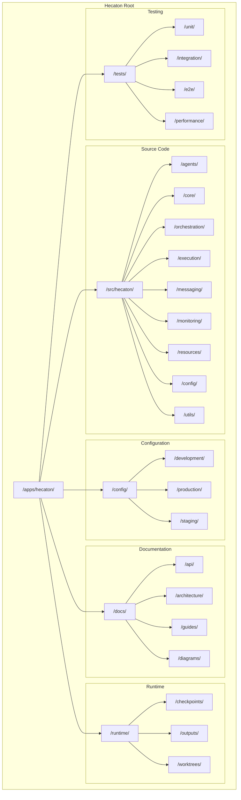
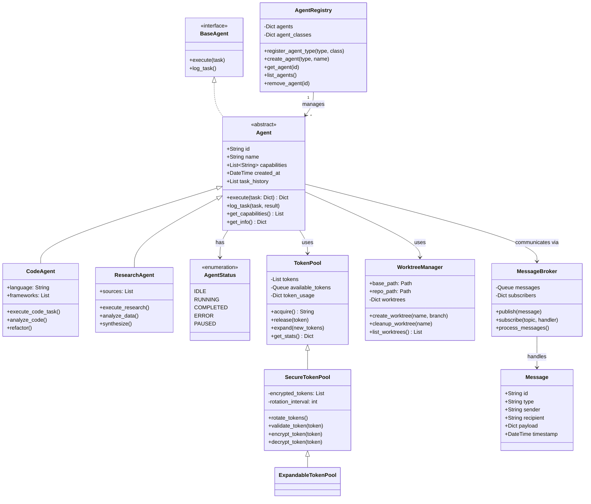
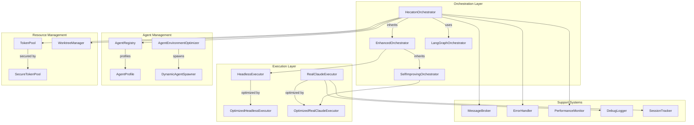
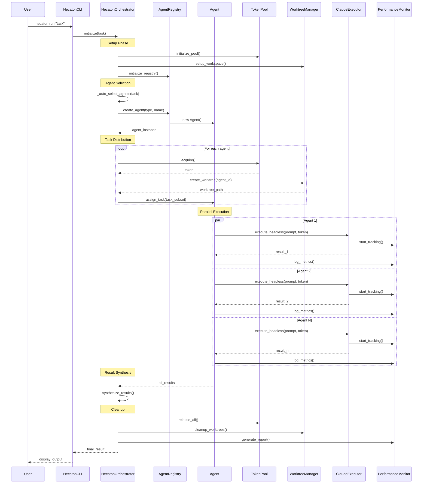
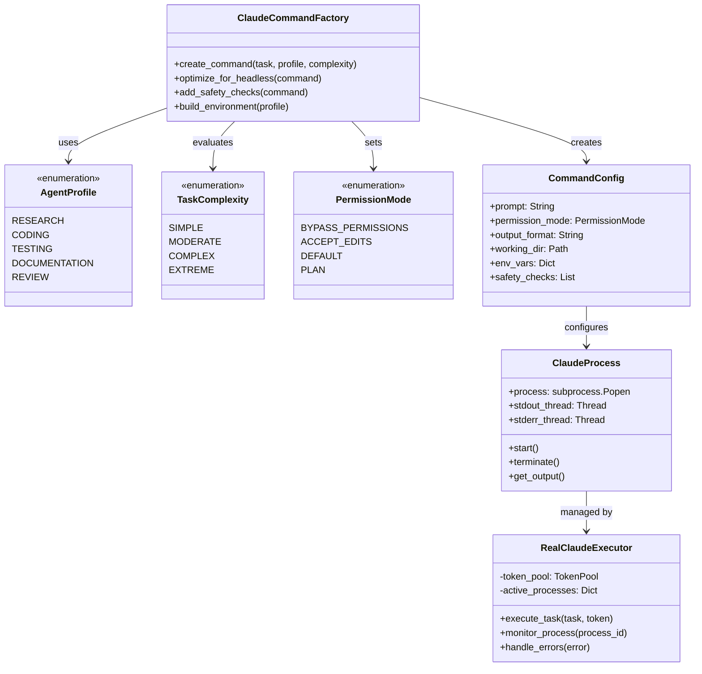
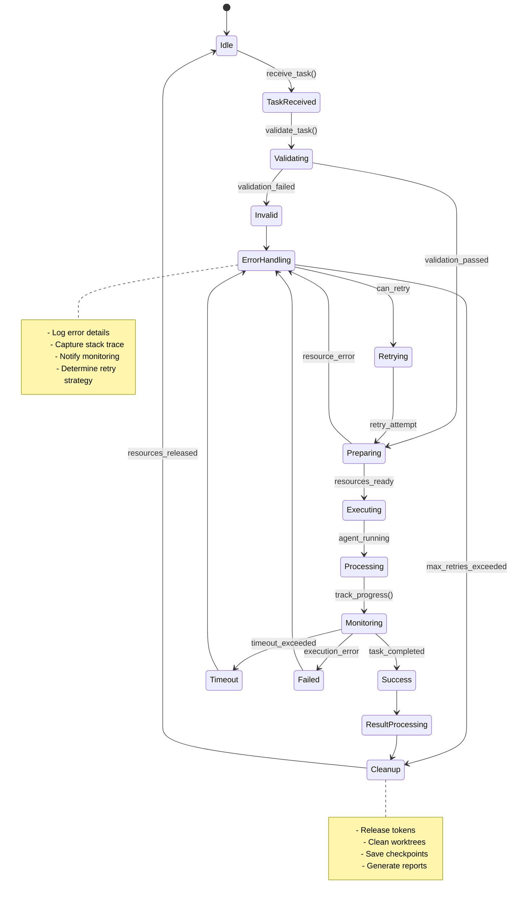
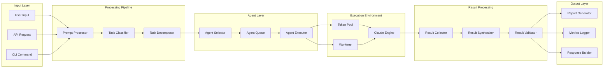
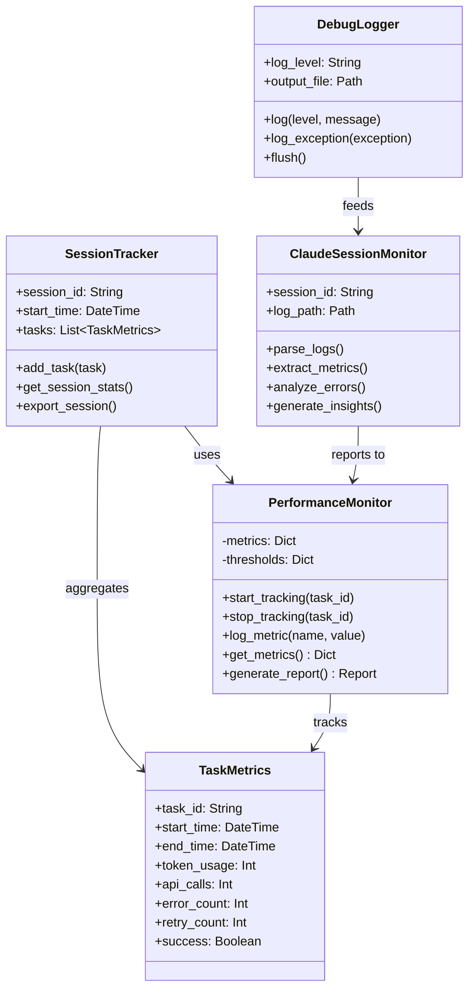
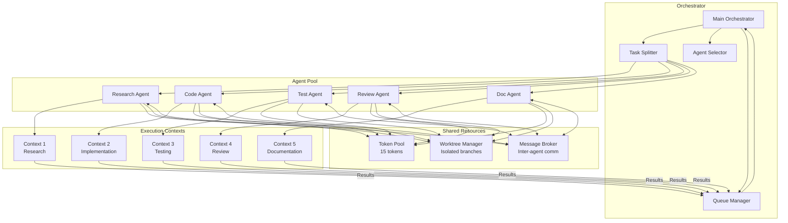

# Hecaton System Architecture Diagrams

## 1. Directory Structure Overview

## 2. Core Models and Relationships

## 3. Orchestrator Architecture

## 4. Functional Code Map - Agent Lifecycle

## 5. Command Factory Pattern

## 6. Error Handling and Recovery Flow

## 7. Data Flow Architecture

## 8. Performance Monitoring System

## 9. Multi-Agent Coordination Pattern

## Usage Notes

These diagrams represent the Hecaton multi-agent orchestration system architecture:

1. **Directory Structure**: Shows the complete project organization
2. **Core Models**: Class relationships and inheritance hierarchy
3. **Orchestrator Architecture**: Component interactions and dependencies
4. **Agent Lifecycle**: Sequence of operations from task receipt to completion
5. **Command Factory**: Pattern for creating optimized Claude commands
6. **Error Handling**: State machine for error recovery and retries
7. **Data Flow**: Pipeline from input to output
8. **Performance Monitoring**: Metrics collection and analysis system
9. **Multi-Agent Coordination**: Parallel execution with shared resources

Each diagram can be rendered using any Mermaid-compatible viewer or documentation system.
