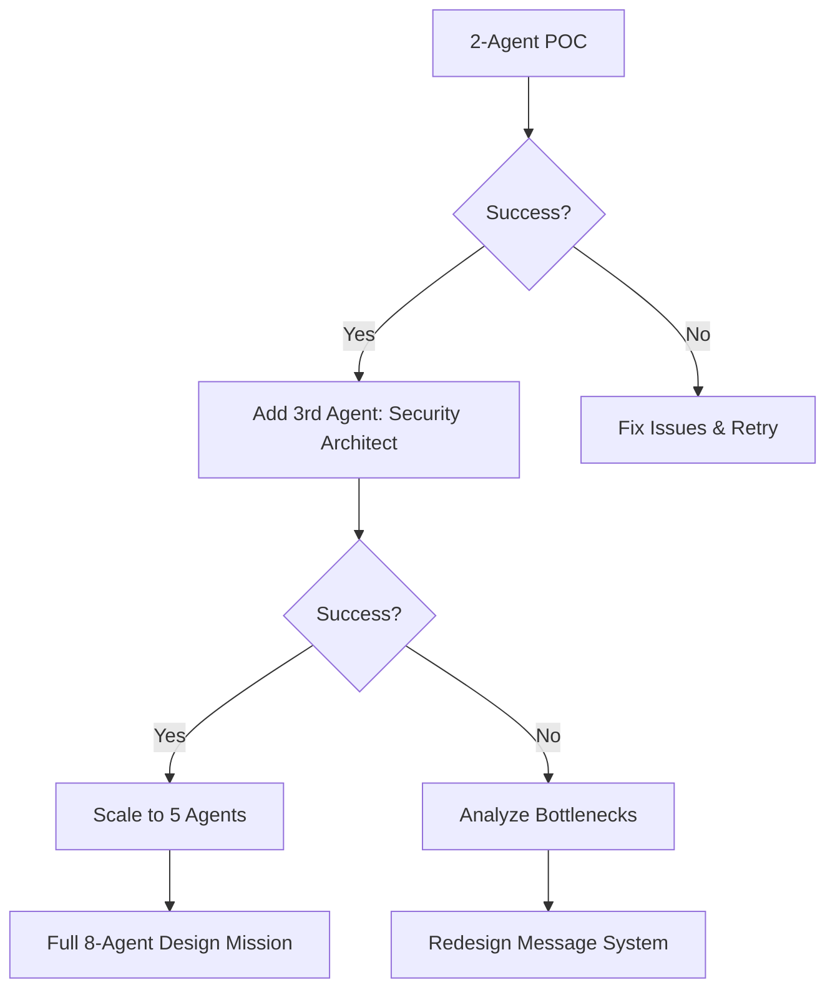

# POC: 2-Agent Requirements Gathering for Communication System

## Overview
Test the swarm's ability to collaborate by having 2 agents define requirements for their own inter-agent communication system.

## Phase 1: Infrastructure Setup (30 min)

### 1.1 Workspace Preparation
```bash
# Create dedicated workspace for agent collaboration
/home/opsvi/master_root/apps/multi-agent-monitor/
├── missions/
│   ├── poc_workspace/
│   │   ├── inputs/          # Task descriptions
│   │   ├── outputs/         # Agent deliverables
│   │   ├── messages/        # Inter-agent messages
│   │   └── logs/            # Execution logs
```

### 1.2 Simple Message Bus (File-Based)
```python
# missions/poc_workspace/message_bus.py
class SimpleMessageBus:
    """File-based message passing for POC"""

    def send_message(agent_from, agent_to, message):
        # Write to messages/{timestamp}_{from}_{to}.json

    def check_messages(agent_id):
        # Read messages addressed to agent

    def broadcast(agent_from, message):
        # Send to all agents
```

### 1.3 Agent Launch Script
```python
# missions/launch_poc.py
async def launch_requirements_poc():
    # 1. Create workspace
    # 2. Write task descriptions
    # 3. Launch 2 agents sequentially
    # 4. Monitor outputs
    # 5. Collect results
```

## Phase 2: Agent Execution (1 hour)

### 2.1 Agent 1: Requirements Analyst
**Task:**
```markdown
You are designing requirements for an inter-agent communication system.
Consider:
- 15 agents may run simultaneously
- Agents are in separate Claude sessions
- Need real-time coordination
- Human monitoring required

Create requirements document covering:
1. Functional requirements
2. Performance requirements
3. Security requirements
4. Monitoring requirements

Output to: outputs/requirements_functional.md
Check for messages from other agents in: messages/
```

**Expected Output:**
- Functional requirements document
- Questions for business analyst
- Initial message protocol ideas

### 2.2 Agent 2: Business Analyst
**Task:**
```markdown
Review the functional requirements from Agent 1.
Add business context:
- User workflows
- Success metrics
- Failure scenarios
- Priority levels

Collaborate via messages/ folder.
Output to: outputs/requirements_business.md
```

**Expected Output:**
- Business requirements
- Use case scenarios
- Response to Agent 1's questions

## Phase 3: Monitoring & Metrics (During Execution)

### 3.1 What We're Measuring
```yaml
metrics:
  collaboration:
    - message_count: Number of inter-agent messages
    - response_time: How quickly agents check/respond
    - iteration_count: How many back-and-forth cycles

  output_quality:
    - completeness: All sections covered?
    - consistency: Agents agree on approach?
    - innovation: Novel solutions proposed?

  technical:
    - token_usage: Per agent and total
    - execution_time: Per phase
    - error_rate: Failures/retries
```

### 3.2 Real-Time Monitoring
```python
# Monitor script running in parallel
while agents_running:
    - Check message folder for new messages
    - Log token usage
    - Track file changes
    - Display status dashboard
```

## Phase 4: Validation Criteria

### 4.1 Success Indicators
✅ Both agents complete their tasks
✅ At least 1 message exchange occurs
✅ Requirements document is coherent
✅ No safety violations
✅ Outputs are structured/parseable

### 4.2 Failure Modes to Test
- What if Agent 1 doesn't leave messages?
- What if Agent 2 can't find Agent 1's output?
- How do they handle conflicting requirements?
- Can they recover from partial failures?

## Phase 5: Scaling Decision Tree



## Implementation Timeline

### Day 1 (Today)
- **Hour 1**: Set up infrastructure
- **Hour 2**: Launch 2-agent POC
- **Hour 3**: Analyze results

### Day 2
- **Morning**: Fix issues from POC
- **Afternoon**: 3-5 agent test

### Day 3
- **Full Day**: 8-agent design mission

## Risk Mitigation

### Technical Risks
| Risk | Mitigation |
|------|------------|
| Agents can't find files | Clear path instructions, validation |
| Message timing issues | Polling interval, retry logic |
| Token exhaustion | Limits per agent, chunking |
| Conflicting outputs | Merge strategy, lead agent |

### Safety Measures
- Dry run mode first
- Git checkpoint before execution
- Read-only access to codebase
- Output to isolated workspace
- Human review gates

## Launch Commands

```bash
# 1. Dry run (simulate without agents)
python missions/launch_poc.py --dry-run

# 2. Single agent test
python missions/launch_poc.py --agents requirements-analyst --test

# 3. Full 2-agent POC
python missions/launch_poc.py --agents requirements-analyst business-analyst

# 4. Monitor in separate terminal
python missions/monitor_poc.py --real-time
```

## Expected Outcomes

### Immediate (After POC)
- Proof that agents can collaborate via files
- Understanding of message patterns
- Performance baseline (tokens, time)
- List of issues to fix

### Next Phase (After Scaling)
- Validated multi-agent coordination
- Emergent collaboration patterns
- Requirements for production system
- Go/no-go for full swarm activation

## Decision Point
After POC, we'll know:
1. Can agents effectively collaborate?
2. Is file-based messaging sufficient?
3. What infrastructure do we need?
4. Are we ready for 15-agent swarm?

## Alternative Approaches (If POC Fails)

1. **Orchestrator Pattern**: Central coordinator assigns tasks
2. **Pipeline Pattern**: Sequential handoffs only
3. **Paired Programming**: 2 agents max at once
4. **Human-in-Loop**: Manual message passing

## Success Metrics Summary

**Minimum Viable Success:**
- 2 agents complete tasks
- 1+ message exchanged
- Coherent output produced
- No safety violations

**Good Success:**
- Multiple message exchanges
- Agents build on each other's work
- Clear requirements document
- <30 min execution time

**Excellent Success:**
- Agents self-organize
- Innovative solutions emerge
- Ready for immediate scaling
- <15 min execution time
