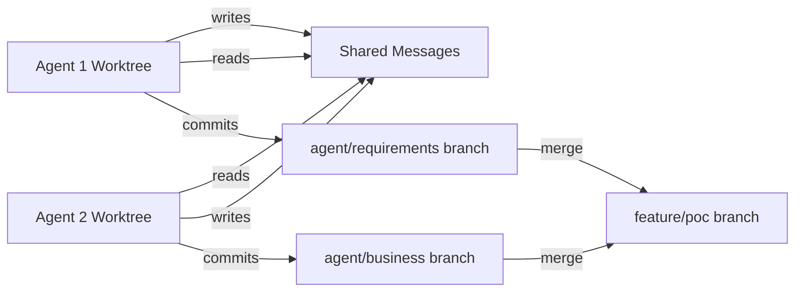

# Enhanced POC: Using Git Worktrees for Agent Isolation

## Why Git Worktrees?

Anthropic recommends git worktrees for multiple Claude Code agents because:
- Each agent gets isolated working directory
- Agents can work on same codebase simultaneously
- No file conflicts or race conditions
- Clean branch management per agent
- Easy to merge or discard agent work

## Revised Architecture

### Workspace Structure with Worktrees
```
/home/opsvi/master_root/  (main repository)
│
├── apps/multi-agent-monitor/  (primary working tree)
│
└── agent_worktrees/  (separate directory for agent worktrees)
    ├── agent_1_requirements/  (worktree for requirements-analyst)
    │   └── apps/multi-agent-monitor/
    │       └── missions/poc_workspace/
    │
    └── agent_2_business/  (worktree for business-analyst)
        └── apps/multi-agent-monitor/
            └── missions/poc_workspace/
```

## Setup Commands

### 1. Create Base Branches
```bash
# From main repository
cd /home/opsvi/master_root

# Create feature branch for POC
git checkout -b feature/agent-communication-poc

# Create agent-specific branches
git branch agent/requirements-analyst feature/agent-communication-poc
git branch agent/business-analyst feature/agent-communication-poc
```

### 2. Set Up Worktrees
```bash
# Create worktree directory
mkdir -p /home/opsvi/agent_worktrees

# Create worktree for Agent 1
git worktree add /home/opsvi/agent_worktrees/agent_1_requirements agent/requirements-analyst

# Create worktree for Agent 2
git worktree add /home/opsvi/agent_worktrees/agent_2_business agent/business-analyst
```

### 3. Shared Communication Space
```bash
# Create shared directory outside git for message passing
mkdir -p /home/opsvi/agent_shared/
├── messages/       # Inter-agent messages
├── status/         # Agent status files
└── outputs/        # Collected outputs
```

## Modified Agent Launch Process

### For Each Agent:
1. **Navigate to their worktree**
   ```bash
   cd /home/opsvi/agent_worktrees/agent_1_requirements
   ```

2. **Pull latest shared state** (if needed)
   ```bash
   git pull origin feature/agent-communication-poc
   ```

3. **Execute agent task**
   - Agent works in isolated worktree
   - Reads from shared message directory
   - Writes outputs to both local and shared

4. **Commit agent's work**
   ```bash
   git add -A
   git commit -m "requirements-analyst: Define functional requirements"
   ```

5. **Push to agent branch**
   ```bash
   git push origin agent/requirements-analyst
   ```

## Benefits for Our POC

### 1. True Parallel Execution
- Agent 1 and Agent 2 can literally run at same time
- No file locking issues
- No merge conflicts during work

### 2. Clean Collaboration Pattern


### 3. Safety & Rollback
- Each agent's work is isolated
- Easy to discard problematic agent work
- Main branch never touched directly

## Implementation Changes

### Updated launch_poc.py
```python
class RequirementsPOCWithWorktrees:
    def __init__(self):
        self.main_repo = Path("/home/opsvi/master_root")
        self.worktrees_dir = Path("/home/opsvi/agent_worktrees")
        self.shared_dir = Path("/home/opsvi/agent_shared")

    def setup_worktrees(self):
        """Set up git worktrees for each agent"""
        agents = [
            ("requirements-analyst", "agent_1_requirements"),
            ("business-analyst", "agent_2_business")
        ]

        for agent_name, worktree_name in agents:
            branch = f"agent/{agent_name}"
            worktree_path = self.worktrees_dir / worktree_name

            if not worktree_path.exists():
                # Create worktree
                cmd = f"git worktree add {worktree_path} {branch}"
                subprocess.run(cmd, shell=True, cwd=self.main_repo)

    def launch_agent_in_worktree(self, agent_type, worktree_path):
        """Launch agent with its own worktree"""
        # Agent operates in isolated environment
        # Can commit without affecting other agents
```

## Scaling Strategy with Worktrees

### 2 Agents (Current POC)
```bash
git worktree list
/home/opsvi/master_root                     (main)
/home/opsvi/agent_worktrees/agent_1_requirements  (agent/requirements-analyst)
/home/opsvi/agent_worktrees/agent_2_business      (agent/business-analyst)
```

### 5 Agents (Next Phase)
```bash
# Add more worktrees
git worktree add ../agent_worktrees/agent_3_security agent/security-architect
git worktree add ../agent_worktrees/agent_4_api agent/api-specialist
git worktree add ../agent_worktrees/agent_5_database agent/database-specialist
```

### 15 Agents (Full Swarm)
- Each agent gets dedicated worktree
- Organized by team/function
- Parallel execution without conflicts

## Monitoring with Worktrees

### Status Dashboard
```python
def monitor_worktrees():
    """Monitor all active agent worktrees"""

    status = {}
    for worktree in Path("/home/opsvi/agent_worktrees").iterdir():
        # Check git status in each worktree
        result = subprocess.run(
            ["git", "status", "--porcelain"],
            cwd=worktree,
            capture_output=True
        )

        status[worktree.name] = {
            "modified_files": len(result.stdout.decode().splitlines()),
            "last_commit": get_last_commit(worktree),
            "messages_sent": count_messages_from(worktree.name)
        }

    return status
```

## Cleanup Process

### After POC Completion
```bash
# Merge successful agent work
git checkout feature/agent-communication-poc
git merge agent/requirements-analyst
git merge agent/business-analyst

# Remove worktrees
git worktree remove /home/opsvi/agent_worktrees/agent_1_requirements
git worktree remove /home/opsvi/agent_worktrees/agent_2_business

# Delete agent branches
git branch -d agent/requirements-analyst
git branch -d agent/business-analyst
```

## Decision: Should We Use Worktrees?

### ✅ YES - Strong Recommendation

**Pros:**
1. **Anthropic-recommended** pattern for multi-agent Claude Code
2. **True parallelization** - agents work simultaneously
3. **No conflicts** - each agent isolated
4. **Clean git history** - one branch per agent
5. **Easy rollback** - discard worktree if agent fails
6. **Scalable** - works for 2 or 200 agents

**Cons:**
1. Slightly more setup complexity
2. Need disk space for multiple worktrees
3. Agents need to know about shared message space

## Next Steps

1. **Modify launch_poc.py** to use worktrees
2. **Test with 2 agents** in parallel (not sequential)
3. **Monitor git operations** in each worktree
4. **Document patterns** that emerge
5. **Scale to 5 agents** if successful
