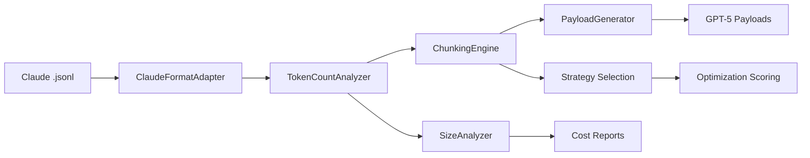
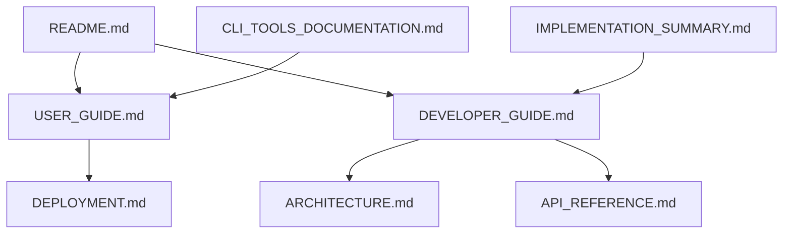

# Session Optimizer Developer Guide

> **Complete development integration guide for the GPT-5 Session Optimizer system**

This guide provides comprehensive information for developers working with the Session Optimizer codebase, from initial setup through advanced customization and contribution workflows.

## Table of Contents

1. [Quick Developer Setup](#quick-developer-setup)
2. [Project Structure](#project-structure)
3. [Core Architecture](#core-architecture)
4. [Development Workflow](#development-workflow)
5. [Testing Framework](#testing-framework)
6. [Integration Points](#integration-points)
7. [Customization Guide](#customization-guide)
8. [Performance Considerations](#performance-considerations)
9. [Contributing Guidelines](#contributing-guidelines)
10. [Documentation Integration](#documentation-integration)

## Quick Developer Setup

### Prerequisites
- Python 3.9+
- tiktoken for GPT-5 token analysis
- Development environment (VS Code/PyCharm recommended)

### 1-Minute Setup
```bash
# Navigate to project
cd /home/opsvi/master_root/apps/session-optimizer

# Install dependencies
pip install tiktoken

# Verify installation
python gpt5_cli.py status

# Run integration tests
python integration_test_simplified.py
```

**Expected Output**: All components should show ✅ status with performance benchmarks.

## Project Structure

### Directory Organization
```
session-optimizer/
├── docs/                    # Complete documentation suite
│   ├── README.md           # Project overview and quick start
│   ├── ARCHITECTURE.md     # System design and components
│   ├── API_REFERENCE.md    # Complete API documentation
│   ├── USER_GUIDE.md       # End-user instructions
│   ├── DEPLOYMENT.md       # Production deployment guide
│   └── DEVELOPER_GUIDE.md  # This file - development integration
├── src/                    # Core system components
│   ├── gpt5_payload_system.py        # Main orchestration system
│   ├── token_count_analyzer.py       # GPT-5 token analysis
│   ├── chunking_engine.py            # Multi-strategy chunking
│   ├── payload_generator.py          # GPT-5 payload creation
│   ├── size_analyzer.py              # Cost analysis and optimization
│   ├── claude_format_adapter.py      # Claude .jsonl processing
│   └── enhanced_claude_format_adapter.py  # Advanced format support
├── CLI Tools/              # Command-line interfaces
│   ├── gpt5_cli.py         # Main CLI tool
│   ├── payload_cli.py      # Payload generation CLI
│   └── size_reporter.py    # Session analysis CLI
├── Analysis Tools/         # Session analysis and debugging
│   ├── claude_session_analyzer.py    # Session structure analysis
│   ├── session_analytics_engine.py   # Advanced analytics
│   └── debug_adapter.py              # Development debugging
└── test_sessions/          # Test data and validation
    ├── *.jsonl            # Sample Claude sessions
    └── validation/        # Test validation results
```

### Key Files by Purpose

**Core System**:
- `src/gpt5_payload_system.py` - Main system orchestrator
- `src/chunking_engine.py` - Multi-strategy chunking (conversation, tool_usage, adaptive)
- `src/payload_generator.py` - GPT-5 optimized payload creation

**Analysis & Optimization**:
- `src/token_count_analyzer.py` - Token counting and cost estimation
- `src/size_analyzer.py` - Comprehensive cost analysis and ROI calculations

**CLI Interfaces**:
- `gpt5_cli.py` - Primary command-line interface (recommended for most tasks)
- `payload_cli.py` - Specialized payload generation with batch processing
- `size_reporter.py` - Session analysis and reporting

## Core Architecture

### System Flow


### Key Components Integration

**1. GPT5PayloadSystem** (`src/gpt5_payload_system.py:1`)
- Central orchestrator integrating all components
- Handles session processing from .jsonl to optimized payloads
- Provides unified API for all operations

**2. ChunkingEngine** (`src/chunking_engine.py:1`)
- **Conversation Strategy**: 2.36x compression for dialog flows
- **Tool Usage Strategy**: 3.14x compression for automation sequences
- **Adaptive Strategy**: 2.23x compression with balanced approach

**3. PayloadGenerator** (`src/payload_generator.py:1`)
- Creates GPT-5 optimized message formats
- Supports conversational, technical, and summary templates
- Quality scoring and compression tracking

## Development Workflow

### Local Development Cycle

#### 1. Feature Development
```bash
# Create feature branch (if using git)
git checkout -b feature/new-chunking-strategy

# Make changes to core components
# Test changes locally
python integration_test_simplified.py

# Validate with sample data
python gpt5_cli.py optimize test_sessions/sample.jsonl --verbose
```

#### 2. Testing Pipeline
```bash
# Unit tests for core components
python test_gpt5_system.py

# Integration validation
python integration_test_simplified.py

# CLI tool testing
python test_cli_tools.py

# Performance benchmarking
python test_enhanced_integration.py
```

#### 3. Documentation Updates
```bash
# Update relevant documentation
# - docs/API_REFERENCE.md for API changes
# - docs/USER_GUIDE.md for user-facing changes
# - docs/ARCHITECTURE.md for system changes

# Validate documentation consistency
python -c "import src.gpt5_payload_system; help(src.gpt5_payload_system)"
```

### Code Style and Standards

**Import Organization**:
```python
# Standard library
import json
import time
from typing import Dict, List, Optional

# Third-party
import tiktoken

# Local imports
from .token_count_analyzer import TokenCountAnalyzer
from .chunking_engine import ChunkingEngine
```

**Error Handling**:
```python
try:
    result = process_session(session_file)
    return result
except FileNotFoundError:
    print(f"❌ Session file not found: {session_file}")
    return None
except Exception as e:
    print(f"❌ Processing failed: {str(e)}")
    return None
```

## Testing Framework

### Test Categories

#### 1. Unit Tests (`test_gpt5_system.py`)
- Component isolation testing
- Token counting accuracy
- Chunking strategy validation
- Payload generation quality

#### 2. Integration Tests (`integration_test_simplified.py`)
- End-to-end workflow validation
- Performance benchmarking
- Memory efficiency testing
- CLI tool integration

#### 3. Performance Tests (`test_enhanced_integration.py`)
- Large session handling (4.5M+ tokens)
- Parallel processing validation
- Memory usage profiling
- Compression ratio verification

### Running Tests

**Quick Validation**:
```bash
python integration_test_simplified.py
```

**Comprehensive Testing**:
```bash
# All core functionality
python test_gpt5_system.py

# CLI tools
python test_cli_tools.py

# Performance benchmarks
python test_enhanced_integration.py
```

**Custom Test Session**:
```bash
# Test with your own session
python gpt5_cli.py optimize your_session.jsonl --strategy adaptive --verbose
```

## Integration Points

### Adding New Chunking Strategies

**1. Extend ChunkingEngine** (`src/chunking_engine.py:45`)
```python
def custom_chunking_strategy(self, messages, max_chunk_size=4000):
    """
    Implement your custom chunking logic

    Args:
        messages: List of Claude session messages
        max_chunk_size: Maximum tokens per chunk

    Returns:
        List of message chunks with metadata
    """
    chunks = []
    # Your implementation here
    return chunks
```

**2. Register Strategy**:
```python
# In ChunkingEngine.__init__
self.strategies['custom'] = self.custom_chunking_strategy
```

**3. Add CLI Support**:
```bash
python gpt5_cli.py optimize session.jsonl --strategy custom
```

### Adding New Output Formats

**1. Extend PayloadGenerator** (`src/payload_generator.py:78`)
```python
def generate_custom_format(self, chunks, session_metadata):
    """Create custom format payload"""
    # Implementation
    return formatted_payload
```

**2. Update CLI Options**:
```python
# In payload_cli.py argument parser
parser.add_argument('--format', choices=['json', 'text', 'html', 'custom'])
```

### Custom Analysis Metrics

**1. Extend SizeAnalyzer** (`src/size_analyzer.py:156`)
```python
def custom_metric_analysis(self, session_data):
    """Add custom analysis metrics"""
    # Your analysis logic
    return custom_metrics
```

## Performance Considerations

### Memory Management
- **Streaming Processing**: Large sessions (>1M tokens) use streaming
- **Chunk Buffering**: Configurable memory limits for chunking
- **Token Caching**: tiktoken results cached for efficiency

### Optimization Guidelines

**Large Session Handling**:
```python
# Use streaming for sessions >1M tokens
payload_system = GPT5PayloadSystem()
result = payload_system.process_session_streaming(large_session_file)
```

**Parallel Processing**:
```bash
# Batch processing with parallel workers
python payload_cli.py batch sessions/ --parallel --workers 8
```

**Memory-Efficient Analysis**:
```python
# For size analysis of large batches
analyzer = SizeAnalyzer()
result = analyzer.analyze_batch_streaming(session_files)
```

## Contributing Guidelines

### Code Contributions

1. **Feature Requests**: Create issue with use case and expected behavior
2. **Bug Reports**: Include session file (if possible) and error output
3. **Pull Requests**: Include tests and documentation updates

### Testing Requirements
- All new features must include unit tests
- Integration tests for system changes
- Performance benchmarks for optimization features

### Documentation Standards
- Update API_REFERENCE.md for public API changes
- Add examples to USER_GUIDE.md for new features
- Update ARCHITECTURE.md for system changes

## Documentation Integration

### Document Relationships



### Cross-References Guide

**For Users Starting Out**: README.md → USER_GUIDE.md → specific CLI commands
**For Developers**: DEVELOPER_GUIDE.md → ARCHITECTURE.md → API_REFERENCE.md → source code
**For Deployment**: USER_GUIDE.md → DEPLOYMENT.md → production setup

### Documentation Maintenance

**Update Triggers**:
- API changes → Update API_REFERENCE.md
- New features → Update USER_GUIDE.md and README.md
- Architecture changes → Update ARCHITECTURE.md and DEVELOPER_GUIDE.md
- Performance improvements → Update benchmarks in all docs

**Consistency Checks**:
```bash
# Verify all examples work
python -c "exec(open('docs/API_REFERENCE.md').read())"  # Extract and test examples

# Check cross-references
grep -r "docs/" docs/  # Find all internal references
```

## Quick Reference

### Essential Commands
```bash
# System status check
python gpt5_cli.py status

# Optimize single session
python gpt5_cli.py optimize session.jsonl

# Batch processing
python payload_cli.py batch sessions/ --parallel

# Size analysis
python size_reporter.py analyze session.jsonl --format html

# Integration test
python integration_test_simplified.py
```

### Key Metrics to Monitor
- **Compression Ratios**: Target 2.23x-3.14x
- **Processing Speed**: >5,000 tokens/second
- **Memory Usage**: <2GB for sessions up to 1M tokens
- **Cost Savings**: 60-80% potential reduction

### Support Resources
- **Documentation**: Complete suite in `docs/` directory
- **Test Sessions**: Sample data in `test_sessions/`
- **Integration Tests**: Validation scripts in root directory
- **Performance Benchmarks**: Included in test suite

---

*This guide integrates all components of the Session Optimizer documentation suite. For specific usage instructions, see [USER_GUIDE.md](USER_GUIDE.md). For system architecture details, see [ARCHITECTURE.md](ARCHITECTURE.md). For complete API documentation, see [API_REFERENCE.md](API_REFERENCE.md).*
