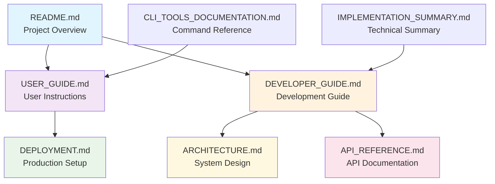

# Session Optimizer Documentation Index

> **Complete navigation guide for the Session Optimizer documentation suite**

This index provides comprehensive navigation through all documentation, organized by use case and expertise level.

## Quick Navigation

### 🚀 Getting Started (5 minutes)
1. **[README.md](README.md)** - Project overview and quick start
2. **[USER_GUIDE.md](USER_GUIDE.md#getting-started)** - First session optimization
3. **System Status Check**: `python gpt5_cli.py status`

### 👤 For End Users
| Document | Purpose | Key Sections |
|----------|---------|--------------|
| **[README.md](README.md)** | Project overview and quick examples | Quick Start, Key Features, Installation |
| **[USER_GUIDE.md](USER_GUIDE.md)** | Complete user instructions | Common Tasks, Configuration, Best Practices |
| **CLI Tools Documentation** | Command-line tool reference | Available in root directory |

### 👨‍💻 For Developers
| Document | Purpose | Key Sections |
|----------|---------|--------------|
| **[DEVELOPER_GUIDE.md](DEVELOPER_GUIDE.md)** | Development integration guide | Setup, Architecture, Testing, Contributing |
| **[ARCHITECTURE.md](ARCHITECTURE.md)** | System design and components | High-Level Architecture, Component Details |
| **[API_REFERENCE.md](API_REFERENCE.md)** | Complete API documentation | CLI API, Python Library API, Examples |

### 🚀 For DevOps/Deployment
| Document | Purpose | Key Sections |
|----------|---------|--------------|
| **[DEPLOYMENT.md](DEPLOYMENT.md)** | Production deployment guide | Requirements, Configuration, Monitoring |
| **[ARCHITECTURE.md](ARCHITECTURE.md#performance-characteristics)** | Performance and scaling | Performance Metrics, Scalability |

## Documentation Flow by Use Case

### New User Journey
```
README.md (Overview)
    ↓
USER_GUIDE.md (Getting Started)
    ↓
USER_GUIDE.md (Common Tasks)
    ↓
USER_GUIDE.md (Configuration & Best Practices)
```

### Developer Onboarding
```
DEVELOPER_GUIDE.md (Quick Setup)
    ↓
ARCHITECTURE.md (System Understanding)
    ↓
API_REFERENCE.md (Implementation Details)
    ↓
DEVELOPER_GUIDE.md (Contributing Guidelines)
```

### Production Deployment
```
USER_GUIDE.md (System Requirements)
    ↓
DEPLOYMENT.md (Environment Setup)
    ↓
DEPLOYMENT.md (Configuration & Security)
    ↓
DEPLOYMENT.md (Monitoring & Maintenance)
```

## Document Relationship Map



## Content Summary by Document

### [README.md](README.md)
**Purpose**: Project introduction and quick start
**Target Audience**: All users
**Key Content**:
- System overview and benefits (2.23x-3.14x compression, 60-80% cost savings)
- Quick start commands
- Core features and capabilities
- Installation instructions
- Basic usage examples

**Quick Reference**: Essential commands, key metrics, core features

### [USER_GUIDE.md](USER_GUIDE.md)
**Purpose**: Complete user instructions
**Target Audience**: End users, system administrators
**Key Content**:
- Getting started tutorial
- Common tasks and workflows
- Configuration options
- Understanding results and reports
- Troubleshooting guide
- Best practices and optimization tips
- FAQ section

**Quick Reference**: Command examples, configuration templates, troubleshooting checklist

### [DEVELOPER_GUIDE.md](DEVELOPER_GUIDE.md)
**Purpose**: Development integration and contribution guide
**Target Audience**: Developers, contributors
**Key Content**:
- Developer setup (1-minute quickstart)
- Project structure and architecture integration
- Development workflow and testing
- Integration points and customization
- Contributing guidelines
- Performance considerations
- Code standards and best practices

**Quick Reference**: Setup commands, project structure, integration patterns

### [ARCHITECTURE.md](ARCHITECTURE.md)
**Purpose**: System design and technical architecture
**Target Audience**: Developers, architects, technical stakeholders
**Key Content**:
- High-level system architecture
- Component descriptions and relationships
- Data flow and processing pipeline
- Performance characteristics and benchmarks
- Scalability considerations
- Design patterns and principles

**Quick Reference**: Architecture diagrams, component overview, performance metrics

### [API_REFERENCE.md](API_REFERENCE.md)
**Purpose**: Complete API documentation
**Target Audience**: Developers, integrators
**Key Content**:
- CLI API documentation (all commands and options)
- Python library API (classes, methods, parameters)
- Data structures and formats
- Error handling and status codes
- Usage examples and code samples
- Configuration reference

**Quick Reference**: Command syntax, API methods, configuration options

### [DEPLOYMENT.md](DEPLOYMENT.md)
**Purpose**: Production deployment and operations
**Target Audience**: DevOps, system administrators, production users
**Key Content**:
- System requirements (minimum and recommended)
- Environment configuration
- Local development and cloud deployment
- Docker containerization
- CI/CD integration
- Monitoring and health checks
- Security configuration
- Backup and recovery procedures
- Scaling considerations
- Maintenance tasks and troubleshooting

**Quick Reference**: Deployment checklists, configuration templates, monitoring commands

## Cross-Reference Index

### Commands and Tools
- **System Status**: `python gpt5_cli.py status` → [USER_GUIDE.md](USER_GUIDE.md#getting-started)
- **Single Session**: `python gpt5_cli.py optimize` → [USER_GUIDE.md](USER_GUIDE.md#optimize-your-first-session)
- **Batch Processing**: `python payload_cli.py batch` → [API_REFERENCE.md](API_REFERENCE.md#batch-command)
- **Size Analysis**: `python size_reporter.py analyze` → CLI_TOOLS_DOCUMENTATION.md

### Key Concepts
- **Chunking Strategies** → [ARCHITECTURE.md](ARCHITECTURE.md#chunking-engine), [USER_GUIDE.md](USER_GUIDE.md#chunking-strategies)
- **Compression Ratios** → [README.md](README.md#key-features), [USER_GUIDE.md](USER_GUIDE.md#understanding-results)
- **Cost Savings** → [USER_GUIDE.md](USER_GUIDE.md#cost-analysis), [ARCHITECTURE.md](ARCHITECTURE.md#cost-analysis-system)
- **Token Analysis** → [API_REFERENCE.md](API_REFERENCE.md#token-analysis), [DEVELOPER_GUIDE.md](DEVELOPER_GUIDE.md#core-architecture)

### Configuration and Setup
- **Installation** → [README.md](README.md#installation), [DEPLOYMENT.md](DEPLOYMENT.md#local-development-setup)
- **Requirements** → [README.md](README.md#requirements), [DEPLOYMENT.md](DEPLOYMENT.md#system-requirements)
- **Configuration** → [USER_GUIDE.md](USER_GUIDE.md#configuration), [API_REFERENCE.md](API_REFERENCE.md#configuration)

### Troubleshooting and Support
- **Common Issues** → [USER_GUIDE.md](USER_GUIDE.md#troubleshooting), [DEPLOYMENT.md](DEPLOYMENT.md#troubleshooting)
- **Performance Issues** → [DEVELOPER_GUIDE.md](DEVELOPER_GUIDE.md#performance-considerations), [DEPLOYMENT.md](DEPLOYMENT.md#scaling-considerations)
- **Error Messages** → [API_REFERENCE.md](API_REFERENCE.md#error-handling), [USER_GUIDE.md](USER_GUIDE.md#troubleshooting)

## Documentation Standards and Consistency

### Terminology Standards
- **Session**: Claude Code .jsonl conversation file
- **Payload**: GPT-5 optimized message format
- **Chunking**: Breaking sessions into optimized segments
- **Strategy**: Chunking algorithm (conversation, tool_usage, adaptive)
- **Compression Ratio**: Original tokens ÷ optimized tokens

### Format Conventions
- **Commands**: `python script.py command --option`
- **File Paths**: Relative to project root unless specified
- **Metrics**: Always include units (tokens, %, seconds)
- **Status Indicators**: ✅ Success, ❌ Error, ⚠️ Warning, 📊 Metrics

### Cross-Reference Format
- **Internal Links**: [Document Title](document.md#section)
- **External References**: Include full path when referencing code
- **Command References**: Link to relevant documentation section

## Maintenance Guidelines

### Regular Updates
- **Performance Metrics**: Update after optimization improvements
- **Command Examples**: Verify all examples work with current version
- **Cross-References**: Check all internal links remain valid
- **Version Information**: Update version-specific information

### Content Validation
- **Technical Accuracy**: All code examples should execute successfully
- **Link Validation**: All internal references should resolve correctly
- **Consistency**: Terminology and format should be consistent across docs
- **Completeness**: All features should be documented with examples

### User Feedback Integration
- **FAQ Updates**: Add common questions from user feedback
- **Troubleshooting**: Expand based on reported issues
- **Best Practices**: Update based on real-world usage patterns
- **Performance Data**: Update benchmarks based on actual usage

## Search and Navigation Tips

### Finding Information Quickly
1. **Start with README.md** for project overview
2. **Use Table of Contents** in each document for section navigation
3. **Check Cross-References** for related information
4. **Use browser search** (Ctrl+F) within documents
5. **Follow Document Flow** based on your use case

### Common Search Patterns
- **"How to [task]"** → USER_GUIDE.md
- **"[command] syntax"** → API_REFERENCE.md
- **"System architecture"** → ARCHITECTURE.md
- **"Development setup"** → DEVELOPER_GUIDE.md
- **"Production deployment"** → DEPLOYMENT.md

---

*This index is maintained as part of the documentation suite. For updates or corrections, please follow the contributing guidelines in [DEVELOPER_GUIDE.md](DEVELOPER_GUIDE.md#contributing-guidelines).*
