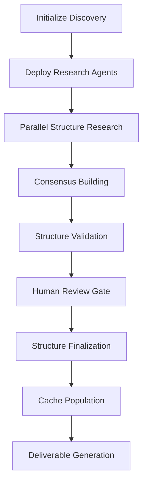

# Stage 1: Discovery Phase - Auto-Coding Solution

## Overview

The Discovery Phase represents the foundational stage of the WBS (Work Breakdown Structure) documentation system for auto-coding solutions. This stage employs adaptive intelligence to research, analyze, and define the complete structure of an auto-coding implementation without forcing predetermined boundaries.

## Objectives

### Primary Objectives
1. **Adaptive Structure Discovery**: Research and identify the natural breakdown of the auto-coding solution based on actual requirements and complexity
2. **Knowledge Base Creation**: Establish a comprehensive research foundation that prevents redundancy in subsequent phases
3. **Intelligent Boundary Definition**: Determine logical boundaries between stages, steps, and operational elements
4. **Quality Foundation**: Create a solid base for cascading documentation phases

### Secondary Objectives
- Minimize human intervention through intelligent automation
- Establish parallel processing patterns for efficiency
- Create reusable structure definitions
- Enable iterative refinement of discovered patterns

## Deliverables

### Core Deliverables

#### 1. Discovered Structure Definition (`structure.json`)
```json
{
  "stages": [
    {
      "id": "stage_1",
      "title": "Requirements & Analysis",
      "description": "Foundation phase for solution definition",
      "estimated_steps": "3-5",
      "complexity": "medium"
    }
  ],
  "total_elements": "<adaptive_count>",
  "timestamp": "<discovery_time>",
  "confidence_score": 0.85
}
```

#### 2. Research Cache (`research_cache/`)
- Stakeholder analysis findings
- Technology landscape research
- Constraint identification
- Best practices compilation
- Risk assessment data

#### 3. Stage Boundary Definitions
- Clear demarcation criteria for each discovered stage
- Dependency mapping between stages
- Resource allocation estimates
- Timeline projections

#### 4. Discovery Report (`discovery_report.md`)
- Research methodology used
- Key findings and insights
- Structure rationale
- Alternative approaches considered
- Confidence metrics

### Supporting Deliverables

#### 5. Agent Task Definitions
- Task specifications for subsequent phases
- Context propagation rules
- Quality criteria for each level
- Success validation methods

#### 6. Human Review Package
- Structure visualization
- Review checkpoints definition
- Approval workflows
- Modification procedures

## Success Criteria

### Quantitative Success Criteria

| Metric | Target | Measurement Method |
|--------|--------|-------------------|
| Discovery Completeness | ≥85% | Coverage analysis of identified elements |
| Structure Confidence | ≥80% | Agent consensus scoring |
| Processing Time | ≤5 minutes | Elapsed time measurement |
| Resource Utilization | ≥12/15 agents | Parallel processing efficiency |

### Qualitative Success Criteria

#### 1. Structure Quality
- **Logical Coherence**: Each discovered stage represents a distinct, necessary phase
- **Appropriate Granularity**: Neither too high-level nor overly detailed
- **Practical Implementability**: Stages can be realistically executed in sequence
- **Stakeholder Alignment**: Structure reflects actual business and technical needs

#### 2. Documentation Quality
- **Clarity**: All elements clearly defined and understandable
- **Completeness**: No significant gaps in coverage
- **Consistency**: Uniform terminology and formatting throughout
- **Actionability**: Sufficient detail for subsequent implementation phases

#### 3. Process Efficiency
- **Parallel Processing**: Maximum utilization of available agent resources
- **Minimal Redundancy**: Effective research caching prevents duplicate work
- **Quality Gates**: Strategic human review points without bottlenecks
- **Adaptability**: System adjusts to discovered complexity naturally

### Technical Success Criteria

#### 4. System Performance
- **Agent Coordination**: Seamless parallel execution without conflicts
- **Data Integrity**: Consistent structure across all generated artifacts
- **Error Handling**: Graceful handling of discovery anomalies
- **Scalability**: System handles varying complexity levels efficiently

#### 5. Integration Readiness
- **API Compatibility**: Outputs compatible with downstream processes
- **Format Standardization**: Consistent data formats across deliverables
- **Version Control**: Proper tracking of discovery iterations
- **Audit Trail**: Complete log of discovery decisions and rationale

## Process Architecture

### Discovery Workflow



### Agent Orchestration Pattern

- **15 Parallel Agents**: Maximum throughput with current token pool
- **Research Specialization**: Agents focus on specific aspects (technical, business, operational)
- **Consensus Mechanism**: Multi-agent validation of discovered structures
- **Dynamic Load Balancing**: Automatic task redistribution based on complexity

### Quality Assurance Framework

1. **Multi-Agent Consensus**: Structure elements require agreement from multiple agents
2. **Confidence Scoring**: Each discovery element includes confidence metrics
3. **Iterative Refinement**: Continuous improvement based on validation results
4. **Human Validation Gates**: Strategic checkpoints for quality control

## Risk Mitigation

### Discovery Risks & Mitigations

| Risk | Impact | Probability | Mitigation Strategy |
|------|--------|-------------|-------------------|
| Incomplete Structure Discovery | High | Low | Multi-agent consensus + validation loops |
| Over-Complexity | Medium | Medium | Complexity bounds + simplification rules |
| Agent Coordination Failures | High | Low | Robust orchestration + fallback mechanisms |
| Research Cache Corruption | Medium | Low | Versioned storage + backup procedures |

## Integration Points

### Upstream Dependencies
- Initial problem definition
- Stakeholder requirements
- Technical constraints
- Resource availability

### Downstream Interfaces
- Stage 2: Cascading Documentation System
- Human Review Interface
- Structure Modification Workflows
- Implementation Planning Tools

## Performance Characteristics

### Expected Performance Profile
- **Discovery Phase Duration**: 2-5 minutes
- **Parallel Agent Utilization**: 80-90% efficiency
- **Structure Confidence**: 80-95% depending on problem complexity
- **Cache Hit Rate**: 60-80% for similar problem domains

### Scalability Considerations
- Handles 5-50 stage discoveries efficiently
- Adapts to varying complexity levels automatically
- Maintains performance with increased parallel agent count
- Supports iterative refinement without full rediscovery

## Configuration Parameters

### Adjustable Settings
- `max_parallel_agents`: Default 15, adjustable based on token availability
- `discovery_timeout`: Default 5 minutes, extendable for complex problems
- `consensus_threshold`: Default 80%, adjustable for quality vs. speed
- `human_review_required`: Default true, can be disabled for automated runs

## Success Validation

The Discovery Phase is considered successful when:

1. ✅ **Structure Definition Complete**: All major stages identified and defined
2. ✅ **Quality Gates Passed**: Human review approves discovered structure
3. ✅ **Cache Populated**: Research findings stored for subsequent phases
4. ✅ **Integration Ready**: Outputs compatible with cascading documentation system
5. ✅ **Performance Targets Met**: Completion within time and resource budgets

## Next Phase Handoff

Upon successful completion, the Discovery Phase provides:
- Validated structure definition for cascading documentation
- Populated research cache for efficient subsequent processing
- Configured agent task definitions for Stage 2 implementation
- Quality criteria and success metrics for downstream validation

---

*This documentation represents the foundational stage of the adaptive WBS documentation system, enabling intelligent auto-coding solution development through structured discovery and validation processes.*
