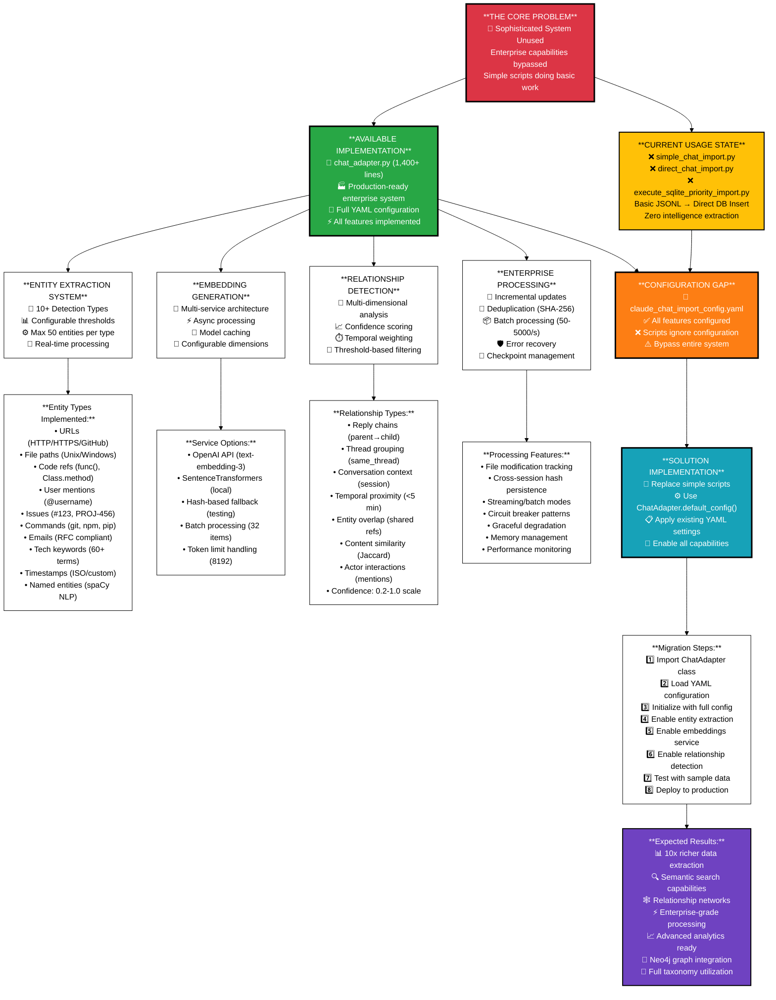

# Claude Chat Log Taxonomy - Implementation vs Usage Analysis (Optimized Layout)

Generated: 2025-09-05 02:45:00

## ChatAdapter Implementation Gap Analysis - Vertical Information Architecture

## Vertical Information Architecture Benefits

### **Problem → Implementation → Solution Flow**
This vertical layout clearly shows the progression from problem identification through available capabilities to implementation solution.

### **Information Density Maximization**
Each node contains multiple layers of specific details rather than spreading information horizontally across many small nodes.

### **Hierarchical Relationship Clarity**
The top-down flow makes it immediately clear which capabilities are available, what's currently missing, and how to bridge the gap.

### **Actionable Implementation Path**
The bottom section provides a concrete migration plan with specific numbered steps and expected outcomes.

**File Location**: `/home/opsvi/master_root/diagrammaster/output/conversations/2025-09-04/chat-taxonomy-analysis-v2.md`
