# Claude Chat Log Taxonomy - Implementation vs Usage Analysis

Generated: 2025-09-05 02:39:00

## ChatAdapter Implementation Gap Analysis

```mermaid
%%{init: {'theme':'base', 'themeVariables': {'primaryColor':'#FFFFFF', 'primaryTextColor':'#000000', 'primaryBorderColor':'#000000', 'lineColor':'#000000', 'secondaryColor':'#1B365D', 'secondaryTextColor':'#FFFFFF'}}}%%
flowchart TD
    %% Current Simple Usage
    CURRENT_SIMPLE["**CURRENT SIMPLE USAGE**<br/>simple_chat_import.py<br/>- Basic JSONL parsing<br/>- No entity extraction<br/>- No embeddings<br/>- No relationships<br/>- Direct DB insert"]

    %% Sophisticated Implementation
    SOPHISTICATED["**SOPHISTICATED IMPLEMENTATION**<br/>ChatAdapter (1,400+ lines)<br/>✅ Production ready<br/>✅ Comprehensive tests<br/>✅ Full documentation"]

    %% Entity Extraction System
    ENTITIES{{"**ENTITY EXTRACTION SYSTEM**<br/>✅ 10+ Entity Types Implemented<br/>All configurable via YAML"}}

    URL_DETECT["**URL Detection**<br/>✅ HTTP/HTTPS URLs<br/>✅ GitHub links<br/>✅ Domain extraction<br/>Pattern: 'https?://[^\\s]+...'"]

    FILE_DETECT["**File Path Detection**<br/>✅ Unix/Windows paths<br/>✅ Relative/absolute paths<br/>✅ Extensions filtering<br/>Multiple regex patterns"]

    CODE_DETECT["**Code References**<br/>✅ Function calls (func())<br/>✅ Class names (ClassName)<br/>✅ Method calls (obj.method)<br/>✅ Inline code (`code`)"]

    MENTION_DETECT["**User Mentions**<br/>✅ @username patterns<br/>✅ Actor relationships<br/>Pattern: '@[a-zA-Z0-9_-]+'"]

    ISSUE_DETECT["**Issue/Ticket Refs**<br/>✅ GitHub issues (#123)<br/>✅ JIRA tickets (PROJ-456)<br/>✅ Bug references<br/>Multiple patterns"]

    CMD_DETECT["**Command Detection**<br/>✅ Shell commands<br/>✅ Git commands<br/>✅ NPM/PIP commands<br/>✅ Sudo operations"]

    EMAIL_DETECT["**Email Detection**<br/>✅ Full email validation<br/>Pattern: '[A-Za-z0-9._%+-]+@...'<br/>RFC compliant"]

    TECH_DETECT["**Technology Keywords**<br/>✅ 60+ tech terms<br/>✅ Languages & frameworks<br/>✅ Tools & platforms<br/>Configurable list"]

    TIME_DETECT["**Timestamp Detection**<br/>✅ ISO 8601 format<br/>✅ Various date formats<br/>✅ Time parsing<br/>Multiple patterns"]

    NER_DETECT["**Named Entity Recognition**<br/>✅ spaCy integration<br/>✅ Persons, organizations<br/>✅ Locations, dates<br/>Optional (performance)"]

    %% Advanced Features
    EMBEDDINGS{{"**EMBEDDING GENERATION**<br/>✅ Multi-Service Support"}}

    OPENAI_EMB["**OpenAI Embeddings**<br/>✅ text-embedding-3-small<br/>✅ text-embedding-3-large<br/>✅ API key management<br/>✅ Token limits (8192)"]

    LOCAL_EMB["**SentenceTransformers**<br/>✅ all-MiniLM-L6-v2<br/>✅ Model caching<br/>✅ Batch processing<br/>✅ Offline capability"]

    SIMPLE_EMB["**Hash-based Fallback**<br/>✅ Testing/development<br/>✅ 384 dimensions<br/>✅ SHA-256 based<br/>No external deps"]

    %% Relationship Detection
    RELATIONSHIPS{{"**RELATIONSHIP DETECTION**<br/>✅ Multi-dimensional Analysis"}}

    REPLY_REL["**Reply Relationships**<br/>✅ Parent-child detection<br/>✅ Thread relationships<br/>✅ Conversation grouping<br/>Confidence scored"]

    ENTITY_REL["**Entity Relationships**<br/>✅ Shared entity detection<br/>✅ Weighted scoring<br/>✅ Overlap thresholds<br/>Type-specific weights"]

    CONTENT_REL["**Content Similarity**<br/>✅ Jaccard similarity<br/>✅ Keyword matching<br/>✅ Configurable thresholds<br/>Similarity > 0.2"]

    ACTOR_REL["**Actor Interactions**<br/>✅ Same actor patterns<br/>✅ Mention detection<br/>✅ Temporal proximity<br/>Time-weighted confidence"]

    %% Advanced Processing
    PROCESSING{{"**ADVANCED PROCESSING**<br/>✅ Enterprise-grade Features"}}

    DEDUP["**Deduplication**<br/>✅ SHA-256 content hashing<br/>✅ Cross-session persistence<br/>✅ Checkpoint management<br/>Max 10,000 hashes"]

    INCREMENTAL["**Incremental Processing**<br/>✅ Timestamp filtering<br/>✅ File modification tracking<br/>✅ Checkpoint recovery<br/>Since/until parameters"]

    BATCH_PROC["**Batch Processing**<br/>✅ Streaming mode<br/>✅ Configurable batch sizes<br/>✅ Memory management<br/>50-5000 messages/sec"]

    ERROR_HANDLE["**Error Handling**<br/>✅ Circuit breaker pattern<br/>✅ Exponential backoff<br/>✅ Graceful degradation<br/>Continue on failures"]

    %% Configuration Gap
    CONFIG_GAP{{"**CONFIGURATION GAP**<br/>❌ Sophisticated features NOT USED"}}

    YAML_CONFIG["**YAML Configuration**<br/>✅ claude_chat_import_config.yaml<br/>✅ All features configured<br/>❌ BUT IGNORED by scripts"]

    SIMPLE_SCRIPTS["**Simple Scripts Used**<br/>❌ simple_chat_import.py<br/>❌ direct_chat_import.py<br/>❌ execute_sqlite_priority_import.py<br/>Bypass ChatAdapter entirely"]

    %% The Gap Analysis
    GAP_ANALYSIS{{"**THE ACTUAL GAP**<br/>🔍 Implementation vs Usage"}}

    IMPLEMENTED["**WHAT'S IMPLEMENTED**<br/>✅ Sophisticated ChatAdapter<br/>✅ 10+ entity extraction types<br/>✅ Multi-service embeddings<br/>✅ Advanced relationships<br/>✅ Production-ready features<br/>✅ Comprehensive configuration<br/>✅ Full test coverage"]

    CURRENTLY_USED["**WHAT'S CURRENTLY USED**<br/>❌ Simple manual scripts<br/>❌ Basic JSON parsing only<br/>❌ No entity extraction<br/>❌ No embeddings<br/>❌ No relationships<br/>❌ No advanced features<br/>❌ Direct database inserts"]

    %% Solution
    SOLUTION{{"**SOLUTION NEEDED**<br/>🛠️ Bridge the Usage Gap"}}

    USE_ADAPTER["**Use ChatAdapter Properly**<br/>✅ Replace simple scripts<br/>✅ Use existing YAML config<br/>✅ Enable all features<br/>✅ Get full capability"]

    MIGRATE_SCRIPTS["**Migration Path**<br/>1️⃣ Update import scripts<br/>2️⃣ Use ChatAdapter.default_config()<br/>3️⃣ Apply YAML configuration<br/>4️⃣ Enable entity extraction<br/>5️⃣ Enable embeddings<br/>6️⃣ Enable relationships"]

    %% Flow connections
    CURRENT_SIMPLE --> CONFIG_GAP
    SOPHISTICATED --> ENTITIES
    SOPHISTICATED --> EMBEDDINGS
    SOPHISTICATED --> RELATIONSHIPS
    SOPHISTICATED --> PROCESSING

    ENTITIES --> URL_DETECT
    ENTITIES --> FILE_DETECT
    ENTITIES --> CODE_DETECT
    ENTITIES --> MENTION_DETECT
    ENTITIES --> ISSUE_DETECT
    ENTITIES --> CMD_DETECT
    ENTITIES --> EMAIL_DETECT
    ENTITIES --> TECH_DETECT
    ENTITIES --> TIME_DETECT
    ENTITIES --> NER_DETECT

    EMBEDDINGS --> OPENAI_EMB
    EMBEDDINGS --> LOCAL_EMB
    EMBEDDINGS --> SIMPLE_EMB

    RELATIONSHIPS --> REPLY_REL
    RELATIONSHIPS --> ENTITY_REL
    RELATIONSHIPS --> CONTENT_REL
    RELATIONSHIPS --> ACTOR_REL

    PROCESSING --> DEDUP
    PROCESSING --> INCREMENTAL
    PROCESSING --> BATCH_PROC
    PROCESSING --> ERROR_HANDLE

    CONFIG_GAP --> YAML_CONFIG
    CONFIG_GAP --> SIMPLE_SCRIPTS
    CONFIG_GAP --> GAP_ANALYSIS

    GAP_ANALYSIS --> IMPLEMENTED
    GAP_ANALYSIS --> CURRENTLY_USED
    GAP_ANALYSIS --> SOLUTION

    SOLUTION --> USE_ADAPTER
    SOLUTION --> MIGRATE_SCRIPTS

    %% Style the nodes
    classDef implemented fill:#28A745,color:#000000,stroke:#000000
    classDef notUsed fill:#DC3545,color:#FFFFFF,stroke:#000000
    classDef gap fill:#FFC107,color:#000000,stroke:#000000
    classDef solution fill:#17A2B8,color:#FFFFFF,stroke:#000000

    class SOPHISTICATED,ENTITIES,EMBEDDINGS,RELATIONSHIPS,PROCESSING,IMPLEMENTED,URL_DETECT,FILE_DETECT,CODE_DETECT,MENTION_DETECT,ISSUE_DETECT,CMD_DETECT,EMAIL_DETECT,TECH_DETECT,TIME_DETECT,NER_DETECT,OPENAI_EMB,LOCAL_EMB,SIMPLE_EMB,REPLY_REL,ENTITY_REL,CONTENT_REL,ACTOR_REL,DEDUP,INCREMENTAL,BATCH_PROC,ERROR_HANDLE,YAML_CONFIG implemented

    class CURRENT_SIMPLE,SIMPLE_SCRIPTS,CURRENTLY_USED notUsed

    class CONFIG_GAP,GAP_ANALYSIS gap

    class SOLUTION,USE_ADAPTER,MIGRATE_SCRIPTS solution
```

## Key Findings

### What IS Implemented (Production-Ready)
- **10+ Entity Types**: URLs, file paths, code references, mentions, issues, commands, emails, tech keywords, timestamps, named entities
- **Multi-Service Embeddings**: OpenAI API, SentenceTransformers, hash-based fallback
- **Advanced Relationships**: Reply chains, entity overlap, content similarity, actor interactions
- **Enterprise Features**: Deduplication, incremental processing, batch modes, error handling
- **Full Configuration**: Comprehensive YAML config system with all features enabled

### What's Currently Used (Basic)
- Simple JSONL parsing scripts that bypass ChatAdapter entirely
- No entity extraction, embeddings, or relationship detection
- Direct database inserts without sophisticated processing
- Missing all advanced capabilities despite them being implemented

### The Solution
Replace simple import scripts with proper ChatAdapter configuration to unlock the enterprise-grade chat intelligence system that already exists.

**File Location**: `/home/opsvi/master_root/diagrammaster/output/conversations/2025-09-04/chat-taxonomy-analysis.md`
