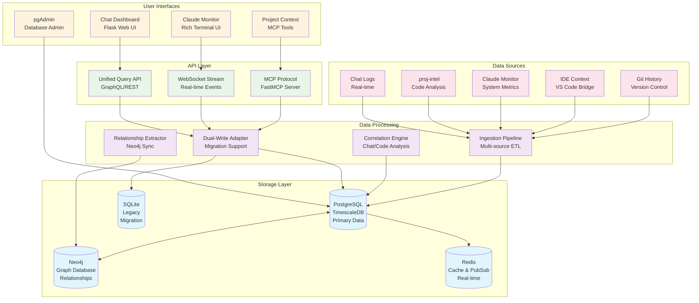
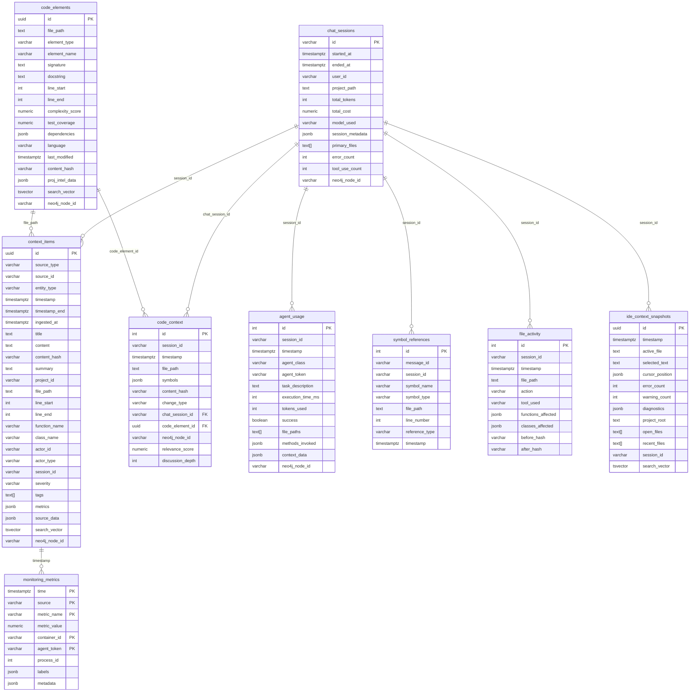
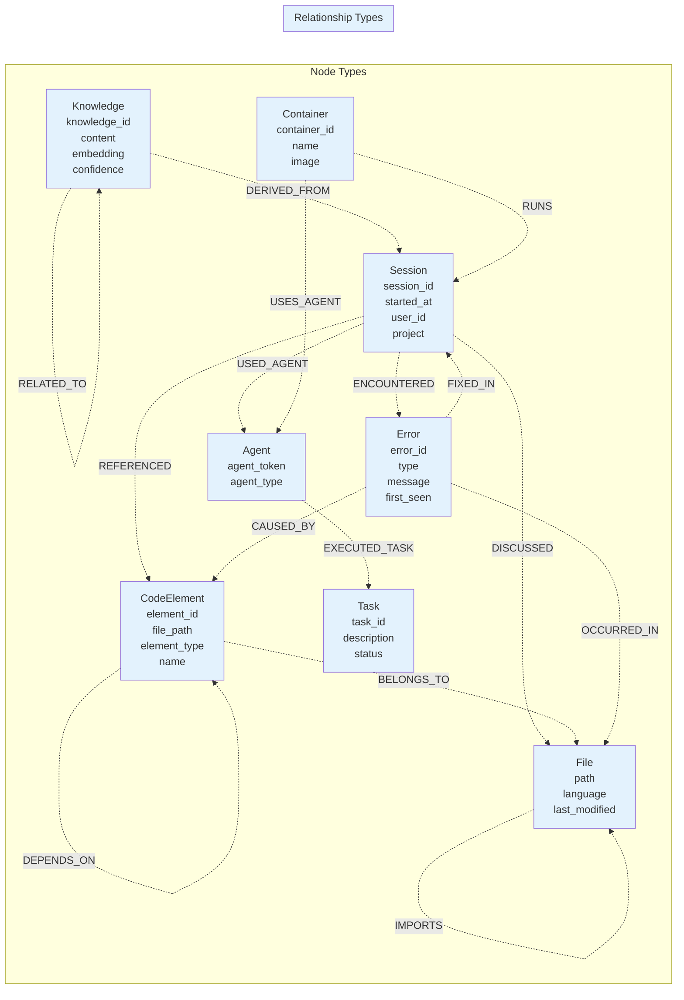
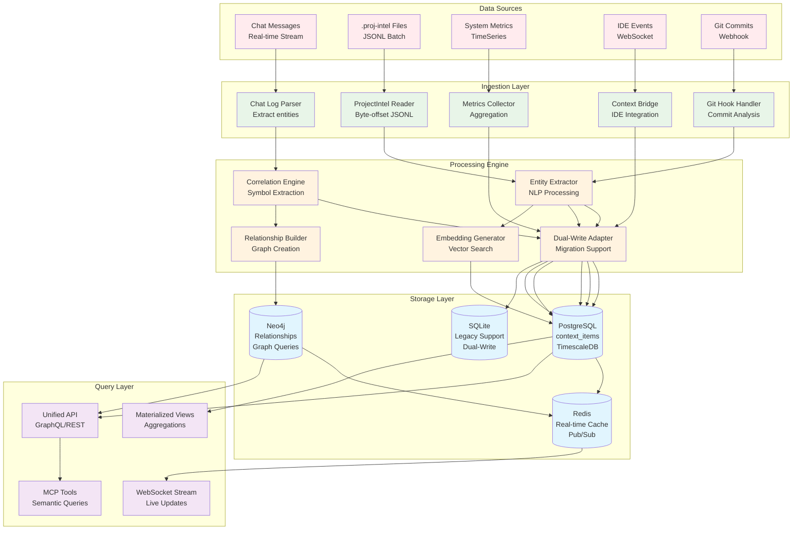
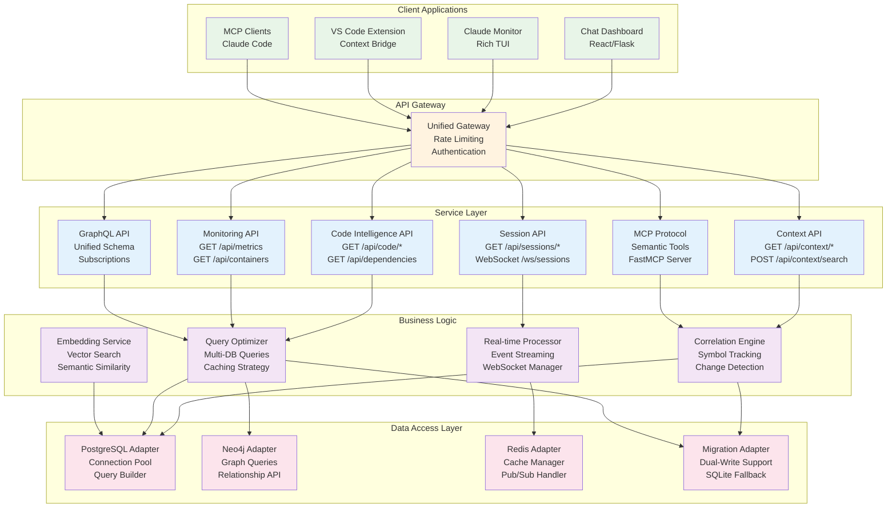
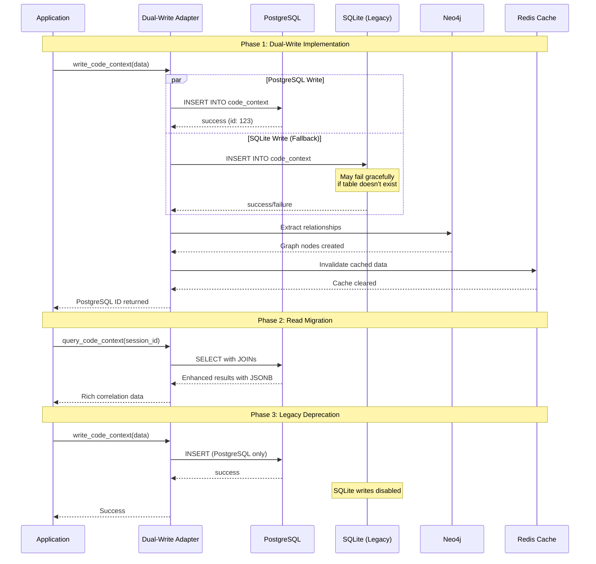
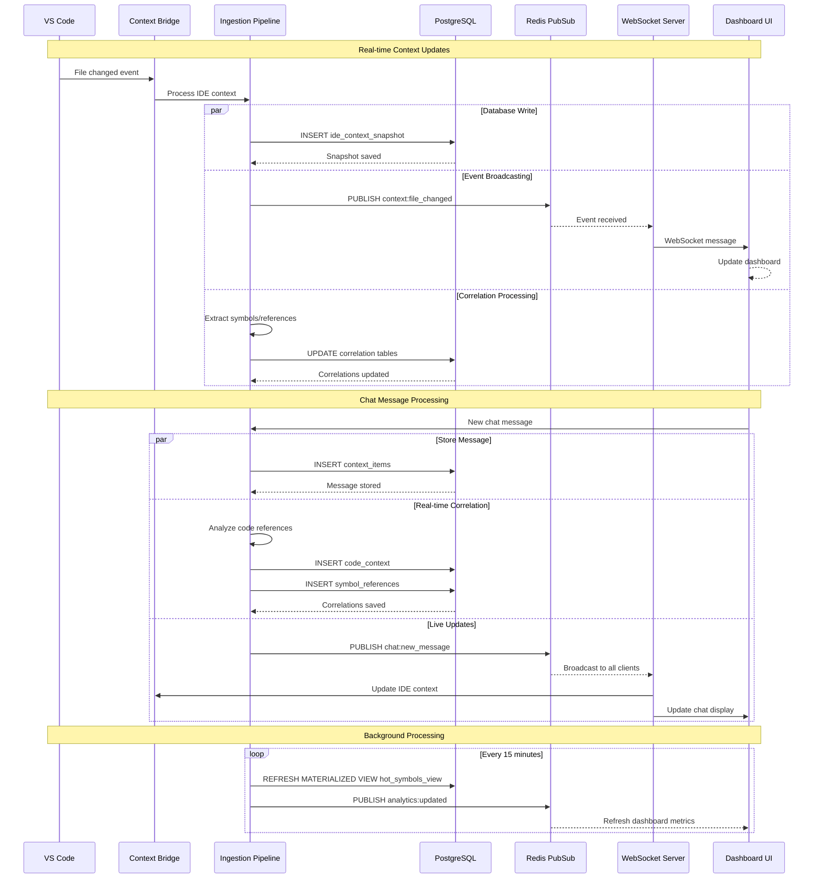

# Unified Context System - Database Architecture & Data Models

<!-- cspell:words varchar timestamptz tsvector hypertables hypertable asyncpg -->

## Overview
This document provides comprehensive Mermaid diagrams describing the database architecture, data models, relationships, and interfaces for the Unified Context System. The system integrates PostgreSQL (with TimescaleDB), Neo4j, and Redis to provide a complete development intelligence platform.

---

## 1. High-Level System Architecture



---

## 2. PostgreSQL Database Schema & Relationships



---

## 3. Neo4j Graph Database Schema



---

## 4. Data Flow & Ingestion Pipelines



---

## 5. API Interfaces & Service Architecture



---

## 6. Migration & Dual-Write Strategy



---

## 7. Performance Optimization & Indexing Strategy

```mermaid
graph TB
    subgraph "TimescaleDB Hypertables"
        HT1[context_items<br/>Partitioned by timestamp<br/>1-day chunks]
        HT2[monitoring_metrics<br/>Partitioned by time<br/>1-hour chunks]
        HT3[ide_context_snapshots<br/>Partitioned by timestamp<br/>1-hour chunks]
    end

    subgraph "PostgreSQL Indexes"
        IDX1[B-Tree Indexes<br/>• timestamp DESC<br/>• session_id<br/>• file_path]
        IDX2[GIN Indexes<br/>• JSONB fields<br/>• Text arrays<br/>• Full-text search]
        IDX3[Partial Indexes<br/>• WHERE file_path IS NOT NULL<br/>• WHERE source_type = 'chat']
    end

    subgraph "Materialized Views"
        MV1[hourly_token_usage<br/>Aggregated metrics<br/>Refresh every hour]
        MV2[daily_file_activity<br/>File touch patterns<br/>Refresh daily]
        MV3[hot_symbols_view<br/>Popular symbols<br/>Refresh every 15min]
    end

    subgraph "Neo4j Optimization"
        N4J1[Node Indexes<br/>• knowledge_id<br/>• session_id<br/>• file_path]
        N4J2[Composite Indexes<br/>• (type, name)<br/>• (session, timestamp)]
        N4J3[Full-text Indexes<br/>• content search<br/>• code search]
    end

    subgraph "Redis Caching Strategy"
        CACHE1[Query Result Cache<br/>TTL: 5 minutes<br/>LRU eviction]
        CACHE2[Session State Cache<br/>TTL: 1 hour<br/>Real-time updates]
        CACHE3[Hot Data Cache<br/>Frequently accessed<br/>symbols, files, contexts]
    end

    subgraph "Connection Pooling"
        POOL1[PostgreSQL Pool<br/>Min: 5, Max: 20<br/>asyncpg for async ops]
        POOL2[Neo4j Pool<br/>Min: 2, Max: 10<br/>Bolt protocol]
        POOL3[Redis Pool<br/>Connection per worker<br/>Pub/Sub dedicated]
    end

    %% Performance Flow
    HT1 --> IDX1
    HT2 --> IDX1
    HT3 --> IDX1

    IDX1 --> MV1
    IDX2 --> MV2
    IDX3 --> MV3

    MV1 --> CACHE1
    MV2 --> CACHE1
    MV3 --> CACHE2

    N4J1 --> CACHE3
    N4J2 --> CACHE3
    N4J3 --> CACHE3

    POOL1 --> CACHE1
    POOL2 --> CACHE2
    POOL3 --> CACHE3

    %% Styling
    classDef hypertable fill:#e1f5fe
    classDef index fill:#e8f5e8
    classDef view fill:#fff3e0
    classDef neo4j fill:#f3e5f5
    classDef cache fill:#fce4ec
    classDef pool fill:#e0f2f1

    class HT1,HT2,HT3 hypertable
    class IDX1,IDX2,IDX3 index
    class MV1,MV2,MV3 view
    class N4J1,N4J2,N4J3 neo4j
    class CACHE1,CACHE2,CACHE3 cache
    class POOL1,POOL2,POOL3 pool
```

---

## 8. Real-time Event Processing



---

## Summary

This comprehensive database architecture provides:

1. **Unified Data Storage**: PostgreSQL as single source of truth with TimescaleDB for time-series
2. **Graph Relationships**: Neo4j for complex correlations and impact analysis
3. **Real-time Processing**: Redis pub/sub for live updates and caching
4. **Migration Support**: Dual-write pattern for seamless SQLite transition
5. **Performance Optimization**: Hypertables, materialized views, and strategic indexing
6. **API Flexibility**: REST, GraphQL, WebSocket, and MCP protocol support
7. **Correlation Intelligence**: Advanced chat/code correlation with JSONB queries

The system is designed for high performance, scalability, and rich analytical capabilities across all development intelligence sources.
