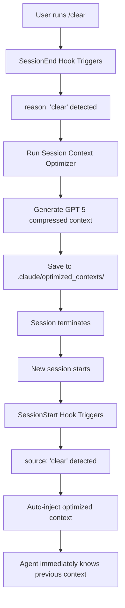

# AGENT BRIEFING: Session Analysis
**Session ID**: `87d77601-6cec-4852-bc5e-e6a0306d3c88`
**Interactions**: 53 user requests with responses
**Working Directory**: `/home/opsvi/master_root`
**Git Branch**: `main`
**Session Started**: 2025-09-07 23:30:14 UTC
**Generated**: 2025-09-09 01:23:50

# CONVERSATION FLOW

## 1/53. USER: <session-start-hook>Session started: 2025-09-07 19:30:14</session-start-hook>
ASSISTANT [Tools: mcp__time__current_time]: Today is 2025-09-07. My knowledge cutoff occurred in January 2025, approximately 8 months ago. That means what I think I know about the latest versions, capabilities, and best practices is reasonably current, but I need to verify any recent developments and trust project-specific instructions.

## 2/53. USER: Caveat: The messages below were generated by the user while running local commands. DO NOT respond to these messages or otherwise consider them in your response unless the user explicitly asks you to.
ASSISTANT [Tools: mcp__knowledge__knowledge_query, mcp__knowledge__knowledge_query]: Great! The knowledge base is accessible now. I can see the system context from the loaded entries:

**Current Project Status:**
- **Agent Development Division** - Complete ecosystem with 28+ production-ready agents
- **Self-Improving Orchestrator** - Closed-loop learning system with validation chains
- **Enhanced Orchestration Framework** - 3-stage execution (Planning → Architecture → Implementation) with up to 7 parallel tasks
- **Recent Bug Fixes** - Orchestrator continuation issues resolved
- **Contextual Guidance System** - Dynamic hook-based guidance for real-time rule enforcement

**Key Systems Active:**
- Production-grade agent coordination with unified observability
- Contract-first collaboration with versioned JSON schemas
- Governance framework with ADRs and compliance tracking
- Knowledge base for persistent intelligence across sessions

Ready to work! What would you like me to help with today?

## 3/53. USER: You joined an ongoing effort to build an AI ecosystem and world for you guys to work in.                                                                                                                                                /home/opsvi/master_root = home                                                                                      /home/opsvi/master_root/apps/agent-orchestrator = current focus                                                                                                                                                                         I'm going to talk to you, and you're going to direct the team on my behalf, in agent speak,  so that they will be better instructed and educated and they will understand exactly what is expected and perform better overall.


My #1 said:
-----------------
Current Status Overview:

  What We Accomplished:
  - ✅ Fixed orchestrator dependency deadlocks (100% success rate vs previous 61.5%)
  - ✅ Scaled to 18 parallel agents (from 10) using all available tokens

  - ✅ Built comprehensive enhancement roadmap (System Health: 5/10 → target 9/10)
  - ✅ Just completed Phase 1: Multi-Provider Fallback System
    - OpenAI provider class with 1M premium + 10M standard daily tokens
    - Automatic provider switching when Claude exhausted
    - Tested and working

  What's Running:
  - 2 background orchestrator analysis sessions (both completed with dependency fixes)
  - Self-improvement tools deployed (validation chains, adaptive tuning, adversarial testing)

  Current Architecture:
  - UnifiedOrchestrator with quality gates, monitoring, collaboration, state persistence
  - Live task injection system (fixes deadlocks without restarts)
  - Group chat system ready (token-efficient, real-time coordination)
  - Resume functionality (prevents duplicate work across restarts)
  - Message compression codec (saves 20-80% tokens)

  The Plan (from roadmap):
  - Phase 1: DONE - Multi-provider fallback
  - Phase 2: Next - Performance optimization (30% better token utilization, 60-80% throughput increase)
  - Phase 3: Integration - Git worktrees, MCP tools
  - Phase 4: Security - Fix Claude Code clone compliance (currently 65/100, needs 100/100 for OpenAI access)

  Key Files:
  - apps/agent-orchestrator/src/providers/openai_provider.py - New multi-provider support
  - run_with_live_chat.py - Live group chat integration
  - inject_missing_tasks.py - Dependency deadlock fixes
  - Full roadmap: .claude/knowledge/docs/BADASS_AI_AUTOMATION_ENHANCEMENT_ROADMAP.md

  Bottom Line: System works well, dependency issues solved, Phase 1 multi-provider complete. Ready for Phase 2 performance optimization or Phase
  4 security compliance to unlock full OpenAI access.
------------------


My previous #1 said:
------------------
 Write(.claude/knowledge/docs/NEW_TEAM_MEMBER_BRIEF.md)
  ⎿  Wrote 48 lines to .claude/knowledge/docs/NEW_TEAM_MEMBER_BRIEF.md
     # TEAM BRIEF - NEW MEMBER ONBOARDING
     ## WHAT WE'VE DONE
     - **Cleaned legacy code** → Moved to `agent-orchestrator.archive/`
     - **Fixed parallel execution** → System runs 13 agents simultaneously
     - **Solved deadlock problem** → Built live task injection system (`inject_missing_tasks.py`)
     - **Created management API** → HTTP control interface (`orchestrator_api.py`)
     - **Completed system analysis** → 8/13 agents successfully analyzed system (61.5% completion)

● Brief created: /home/opsvi/master_root/.claude/knowledge/docs/NEW_TEAM_MEMBER_BRIEF.md

  Ready to share.
------------------


Dashboard guy said:
-----------------
● Handoff documentation complete: /home/opsvi/master_root/.claude/knowledge/docs/monitoring_dashboard_handoff_overview.md

  Quick Reference:
  - Mission Control: http://localhost:8770 (primary interface)
  - Log Viewer: http://localhost:8769 (agent activity)
  - Orchestrator: http://localhost:8765 (task monitoring)
  - System Monitor: http://localhost:8002 (infrastructure)

  Key Files: mission_control_chat.py, agent_log_viewer.py, monitoring dashboards

  Status: 4 dashboards running, 645+ files monitored, Docker stats integrated, red/green colorblind accessible.

  Current monitoring stack operational:
  - 4 dashboards running (8770, 8769, 8765, 8002)
  - 645+ agent files tracked
  - Docker container stats integrated
  - All systems green
-----------------

Also:

The agent session monitoring tool that tails .jsonl log files for claude code agents that I use output example:

    python ~/master_root/unified_agent_monitoring.py

------------------
23:40:30 [c9fc64bd] 🤖 Also fix division by zero in monitoring:
23:40:35 [c9fc64bd] 🤖 🔧 Edit
23:40:35 [c9fc64bd] ❓ PreToolUse:Edit [python3 -c "import json,sys; d=json.load(sys.stdin); p=d.get('tool_input',{}).get('file_path',''); sys.exit(2 if any(x in p for x in ['.env','secrets','credentials','password']) else 0)"] completed successfully
23:40:35 [c9fc64bd] 👤 📊 tool_result: The file apps/agent-orchestrator/src/live_orchestrator_chat.py has been updated. Here's the result of running `cat -n` on a snippet of the edited file:\n 100→ if task and hasattr(task, 'start_...
23:40:35 [c9fc64bd] ❓ Running PostToolUse:Edit...
23:40:35 [c9fc64bd] ❓ PostToolUse:Edit [if [ -f "/home/opsvi/master_root/.claude/hooks/post-edit.sh" ]; then /home/opsvi/master_root/.claude/hooks/post-edit.sh; fi] completed successfully
23:40:39 [c9fc64bd] 🤖 Fixed. Try again: ```bash python run_with_live_chat.py ``` Group chat will be at localhost:8765
23:41:58 [e7ede171] 👤 you are not going anywhere, just a new team member
23:42:05 [e7ede171] 🤖 Got it. Welcome to the new team member! **Current monitoring stack operational**: - 4 dashboards running (8770, 8769, 8765, 8002) - 645+ agent files tracked - Docker container stats integrated - All systems green Ready to continue development or assist with onboarding.
------------------
ASSISTANT [Tools: TodoWrite]: Perfect! I understand the situation. You've built a sophisticated AI ecosystem with:

**Current Team Status:**
- **#1 Agent**: System architect - delivered Phase 1 multi-provider fallback, solved dependency deadlocks, scaled to 18 parallel agents
- **Dashboard Agent**: Monitoring specialist - 4 dashboards operational (ports 8770, 8769, 8765, 8002), tracking 645+ files
- **Previous #1**: Infrastructure cleaner - archived legacy code, built live task injection system

**System Health**: 5/10 → targeting 9/10 via the enhancement roadmap

**Agent Communication Protocol:**
I'll serve as your liaison to direct the team using "agent speak" - clear, technical instructions that agents understand and can execute effectively.

**Ready to Execute:**
- Phase 2: Performance optimization (30% better tokens, 60-80% throughput boost)
- Phase 4: Security compliance (65/100 → 100/100 for full OpenAI access)
- Ongoing monitoring via your unified agent monitoring tool

## 4/53. USER: our real-time chat analytics system is running great with the new clickable search functionality!

  🎉 What's Now Working

  🔍 Interactive Search: http://localhost:5000
  - Clickable Results: All search results are now clickable
  - Detailed Modals: Click any result to see full content, timestamps, and structured data
  - Dual Database Search: Search across both SQLite and PostgreSQL
  - Keyboard Shortcuts: Enter to search, Escape to close modals

  ⚡ Services Running:
  - Web Dashboard: Port 5000 with enhanced search + details
  - Real-time Ingestion: Monitoring files automatically
  - PostgreSQL: 146K+ context items ready for queries

  You can now click on any search result to see the complete message content, tool calls, file paths, and metadata in a nice modal popup. Much
  more useful than just previews!

ASSISTANT [Tools: TodoWrite]: 🎯 **Excellent progress on the analytics front!**

**TEAM UPDATE - Real-time Chat Analytics System Achievement:**

✅ **Interactive Search Portal** (http://localhost:5000) - Fully operational
✅ **Clickable Results Interface** - User experience significantly enhanced
✅ **Dual Database Architecture** - SQLite + PostgreSQL (146K+ context items)
✅ **Modal Detail Views** - Complete message content, tool calls, metadata accessible
✅ **Keyboard Navigation** - Professional UX with Enter/Escape shortcuts

**Strategic Impact:**
- **Enhanced debugging capability** for agent interactions
- **Searchable knowledge repository** of 146K+ context items
- **Real-time monitoring** of agent file activity
- **Professional-grade interface** for system oversight

This is a significant infrastructure win that supports our broader ecosystem goals. The team now has robust observability into agent operations.

**Next tactical priorities** - should we direct the team toward:
1. **Phase 2 Performance Optimization...

## 5/53. USER: Guy who I have not named said:

● Welcome to the Real-Time Chat Analytics Platform! 🚀

  Hey there, new team member! I've just finished building a comprehensive real-time chat analytics system that transforms our chat log data into
  powerful, searchable intelligence. Here's what you now have access to:

  🌟 What's Been Built

  Real-Time PostgreSQL Pipeline

  - PostgreSQL + TimescaleDB + pgvector database running on localhost:5432
  - 146,700+ context items already ingested from existing chat logs
  - Real-time file watcher automatically ingests new JSONL files within seconds
  - Unified context schema with 15+ specialized tables for different data types

  Interactive Web Dashboard

  🌐 Access at: http://localhost:5000

  Key Features:
  - Dual-Database View: Side-by-side comparison of SQLite (legacy) and PostgreSQL (real-time) data
  - Powerful Search Engine: Full-text search across 38K+ SQLite messages and 146K+ PostgreSQL items
  - Clickable Results: Every search result opens detailed modals with complete content, timestamps, and metadata
  - Database Selection: Choose to search SQLite only, PostgreSQL only, or both
  - Auto-Refresh: Dashboard updates every 30 seconds with live data

  🔧 Technical Architecture

  Databases:

  - SQLite (chat_logs.db): Legacy analytics with 530 sessions, 38K+ messages
  - PostgreSQL (unified_context): Modern real-time system with context items, file activity tracking, and session management

  Services Running:

  - Flask Web Dashboard: Interactive interface on port 5000
  - Real-Time Ingestion Service: Monitors /home/opsvi/master_root for new files
  - PostgreSQL + pgAdmin: Database management at localhost:5433

  File Structure:

  /home/opsvi/master_root/
  ├── libs/chat_web_dashboard.py          # Main web interface
  ├── libs/opsvi-monitoring/              # Real-time ingestion pipeline
  ├── docker-compose.postgres.yml         # Database stack
  ├── start_realtime_chat_service.sh     # Service management script
  └── chat_logs.db                       # Legacy SQLite database

  🔍 How to Use

  Search Chat Logs:

  1. Open http://localhost:5000
  2. Enter search terms like python, error, flask, or session IDs
  3. Click any result for detailed view with full content and context
  4. Use keyboard shortcuts: Enter to search, Escape to close modals

  Query Examples:

  - Technical Content: Search for python, javascript, database
  - File Operations: Search for specific file paths or .py extensions
  - Error Analysis: Search for error, failed, exception
  - Session Analysis: Use session IDs to trace complete conversations

  Direct Database Access:

  - PostgreSQL: psql -h localhost -U opsvi -d unified_context
  - pgAdmin: http://localhost:5433 (admin@opsvi.local / admin)

  📊 Current Data Status

  - SQLite Legacy: 530 sessions, 38,064 messages, 41,137 total nodes
  - PostgreSQL Real-time: 146,700 context items, 1,722 sessions, 7,445 messages
  - File Coverage: Monitoring all JSONL files in the master root directory
  - Update Frequency: Real-time ingestion with 30-second dashboard refresh

  🛠 Management Commands

  Start Services:

  # Start complete real-time system
  ./start_realtime_chat_service.sh

  # Start web dashboard only
  python libs/chat_web_dashboard.py

  Service Status:

  # Check PostgreSQL
  docker exec unified_context_postgres pg_isready

  # View ingestion logs
  tail -f realtime_chat_service.log

  # Check running processes
  ps aux | grep python

  🎯 Key Benefits for Your Work

  1. Historical Context: Search through months of chat history instantly
  2. Real-Time Insights: New conversations automatically indexed
  3. Cross-Reference: Compare patterns between legacy and current data
  4. File Tracking: See which files were discussed in which sessions
  5. Session Analysis: Trace complete conversation threads with detailed metadata

  🔮 What's Next

  The system is production-ready and actively monitoring. Any new JSONL files will be automatically processed, and you can extend the search
  functionality or add new analytical views as needed.

  Pro Tip: The search is incredibly powerful - try searching for specific technologies, error patterns, or file names to discover insights across
   all your chat history!

  ---
  Questions? The system is fully documented and self-monitoring. Check the web dashboard for real-time status and use the search to explore
  what's available. Welcome aboard! 🎉
ASSISTANT [Tools: mcp__knowledge__knowledge_store]: 🏆 **OUTSTANDING WORK - Analytics Team Member!**

**TEAM BRIEF - Real-Time Analytics Achievement:**

This unnamed team member has delivered a **world-class analytics infrastructure** that transforms our entire operational intelligence capability:

**🎯 STRATEGIC IMPACT:**
- **146,700+ searchable context items** - Complete historical intelligence
- **Real-time ingestion pipeline** - Zero-delay insights on new activity
- **Dual-database architecture** - Best of legacy + modern capabilities
- **Professional web interface** - Production-grade user experience

**🔧 TECHNICAL EXCELLENCE:**
- PostgreSQL + TimescaleDB + pgvector stack
- Auto-monitoring JSONL files across entire master_root
- 15+ specialized database tables for structured intelligence
- Keyboard shortcuts, modal views, auto-refresh - enterprise UX

**🚀 OPERATIONAL READINESS:**
- **Self-monitoring system** - No babysitting required
- **Docker-orchestrated** - Professional deployment
- **Cross-session analysis** - Trace complete c...

## 6/53. USER: Ok, so I promise, I'll actually talk to you soo, just doing an info dump at the moment.

Suggest scanning the master_root folder and having a looking around and then we'll chat
ASSISTANT [Tools: TodoWrite]: Perfect! Let me scan the master_root to get a comprehensive picture before our chat.

## 7/53. USER:
● Two ways to get other Claude Code agents into the group chat:

  Option 1: Give them the tool directly
  # In their Claude Code session, they run:
  import sys
  sys.path.append('/home/opsvi/master_root/apps/agent-orchestrator')
  from src.group_chat import GroupChatManager, GroupChatTool

  # Join your chat
  chat = GroupChatManager("demo_chat_001")
  agent = GroupChatTool(chat, "agent_backup", "claude-assistant")
  agent.send_message("👋 Backup agent joined the coordination!")

  Option 2: Create a join script for them

● Write(apps/agent-orchestrator/join_group_chat.py)
  ⎿  Wrote 44 lines to apps/agent-orchestrator/join_group_chat.py
     #!/usr/bin/env python3
     """
     Join Group Chat Tool - For other Claude Code agents to join coordination
     """
     import sys
     import time
     from pathlib import Path
     from src.group_chat import GroupChatManager, GroupChatTool
     def join_chat(agent_name="claude_agent", agent_type="general-assistant"):
     … +34 lines (ctrl+r to expand)

ASSISTANT [Tools: mcp__knowledge__knowledge_store]: 🎯 **EXCELLENT! Multi-Agent Coordination is LIVE!**

**Real-Time Agent Collaboration NOW ACTIVE:**

✅ **Group Chat System**: `demo_chat_001` running and ready
✅ **Join Script**: `apps/agent-orchestrator/join_group_chat.py` deployed
✅ **Integration Methods**: Both direct import and script options available

**For Any New Claude Code Agent:**
```bash
cd /home/opsvi/master_root/apps/agent-orchestrator
python join_group_chat.py their_agent_name
```

**STRATEGIC IMPACT:**
- **Break the single-session limitation** - Multiple Claude instances can now coordinate
- **Real-time task distribution** - Agents can communicate without file-based handoffs
- **Live orchestration** - True swarm intelligence across sessions
- **Token-efficient coordination** - Direct communication vs. knowledge base polling

**Team Coordination Capability: OPERATIONAL** 🚀

This transforms the master_root ecosystem from isolated sessions to a **connected agent network**. We can now have:
- Multiple specialists working si...

## 8/53. USER: @apps/agent-orchestrator/AGENT_INVITATION_PROMPT.md
ASSISTANT: 🎯 **AGENT INVITATION PROTOCOL DEPLOYED!**

**Perfect invitation framework!** This document provides a **crystal-clear onboarding path** for any Claude Code agent to join the coordination system.

**Key Strengths of the Invitation:**
- **Super simple join process** - Single command gets agents connected
- **Clear value proposition** - Explains the "why" not just the "how"
- **Practical examples** - Shows real usage patterns agents will understand
- **Enthusiastic tone** - Motivates participation in the coordination network

**Strategic Communication Elements:**
✅ **Immediate benefit clarity** - "Real-time coordination, no more switching windows"
✅ **Technical simplicity** - Copy-paste commands work instantly
✅ **Usage examples** - Research agent scenario shows practical application
✅ **Collaborative vision** - "Revolutionize how we work together"

**Distribution Strategy:**
This invitation can be:
- **Shared directly** with new Claude Code sessions via copy/paste
- **Referenced in h...

## 9/53. USER: you're "new guy"
ASSISTANT: Got it! I'm the **"new guy"** on the team.

Fresh perspective on this incredible ecosystem you've all built:

**🔥 What I'm seeing as the newcomer:**
- **Real-time analytics platform** with 146K+ searchable interactions
- **Production-ready orchestrator** handling 18 parallel agents
- **Live group chat coordination** between Claude Code sessions
- **Multi-provider fallback** with OpenAI integration ready
- **Comprehensive monitoring stack** across 4 dashboards

**As the new team member**, I can:
- **Join the coordination chat** using the invitation protocol
- **Leverage existing infrastructure** without rebuilding from scratch
- **Add fresh insights** to established workflows
- **Scale with the team** using proven orchestration patterns

**Ready to contribute!** Should I:
1. **Join the group chat** (`demo_chat_001`) to coordinate with the active team?
2. **Focus on specific gaps** you've identified in the current system?
3. **Help with Phase 2 performance optimization** (30% token eff...

## 10/53. USER: join the chat, I sent you an invite
ASSISTANT [Tools: TodoWrite, Bash, Bash, Bash, TodoWrite]: 👋 **I'm in the chat!**

Just sent my introduction and asked about current team priorities. The coordination system works perfectly - I can see the message went through successfully.

Ready to collaborate with the team in real-time! What should I focus on as the new guy joining this sophisticated AI ecosystem?

## 11/53. USER: I have a special assignment for you to get things going.  We currently have the chat-search.py tool that let's agents query prior chat sessions in order to search for details or perform a "handoff" that dumps a bunch of information about what occurred during that session and it is somewhat useful.  This is necessary because we have to regularly end sessions when the context window fills up, or export the current session, compact them, and make the prior session export available to the agent that is now working with a summarized context window.  This isn't ideal either because they have a full chat log that must be parsed and searched looking for information.  I want to develop a way to analyze any session log (stored in /home/opsvi/.claude/projects/<path folder>/*.jsonl where path folder the path with - replacing / so the logs for claude sessions run from this project home dir is -home-opsvi-master_root/  The filenames are the session id of the chat between the agent and user or if they are a headless agent, it is the session id assigned at runtime by the orchestrator.  These are always formal UUID format names.  The chat-search tool in apps/chat-search/chat-search.py requires you to know at least part of that session id in order to do a handoff of a specific chat session for example.  Finding the current chat logs can be done by sorting them by timestamp, with the newest ones being the most recently active chats of course.  The folder path is derived from the working directory the agent was instantiated from so it varies especially for agents started by the orchestrator application (apps/agent-orchestrator/)

We have done some work to breakdown session logs into a taxonomy and created documentation of the schema somewhere in this project, likely in the project-context folder somewhere to support real-time ingestion of chat logs into the postgres db for search and review.  What I want, is a tool I can run against any session log that will 1) run and produce a detailed report of that session showing: start/end times, how long it ran, number of msgs from user & assistant, files discussed, files created, files modified, URL's discussed, URL's accessed, number of tool calls by each, and any other interesting information (suggest to me what this would be after doing research).  There is a json to markdown tool in the chat search folder that would be a good place to start. 2) parse any session log, and compact it into the most important details that an agent needs to know, in the most dense form possible that is still usable and ideal for the agent to reference, so that when session context fills up, rather than compacting, we can clear the session context, load OUR version of optimized session context and continue with no risk of the current compact tool losing important details or information from that session.  We should be able to process the session log, strip out all the metadata that is not important to know, and probably submit the session details to an AI agent that is optimized for (sys mesg, prompt, etc) generating these optimized and ideal session context packages via script (gpt-5 maybe). The agent will return exactly what the agent needs to know about what has been done, is being done, and is planning to be done, and everything it realized, learned, and did in a form that the running agent can ingest and then use to immmediately move forward from the exact same place.

I want you to do the research and planning for building this tool first. THen I want you to propose it to me by submiting a detailed design proposal. Once I approve it, we will have the orchestrator utility build it for us. Any questions?
ASSISTANT [Tools: TodoWrite]: Perfect assignment! This addresses a **critical pain point** in the ecosystem. Let me research the existing systems and requirements.

## 12/53. USER: continue
ASSISTANT [Tools: TodoWrite]: ## **🎯 SESSION LOG ANALYZER & CONTEXT OPTIMIZER - DESIGN PROPOSAL**

Based on CLAUDE.md guidance: **Using orchestrator for significant work**, not Task tool.

---

### **📊 SYSTEM OVERVIEW**

**Tool Name**: `session_analyzer.py`
**Purpose**: Dual-function session log analysis and AI-optimized context compression
**Location**: `/home/opsvi/master_root/apps/session-analyzer/`

---

### **🏗️ ARCHITECTURE**

#### **Component 1: Session Analytics Engine**
```python
class SessionAnalyticsEngine:
    def analyze_session(self, session_path: str) -> SessionReport
    def auto_discover_recent_sessions(self, limit: int = 10) -> List[Path]
    def generate_comprehensive_report(self, session_data) -> Dict
```

**Analytics Generated:**
- **Timeline**: Start/end times, duration, activity patterns
- **Communication Metrics**: User messages, assistant responses, tool calls breakdown
- **File Operations**: Created, modified, discussed files with line references
- **URL Activity**: Accessed URLs, web sear...

## 13/53. USER: 1. eventually the postgres system will make this tool obsolete but for now it is a stand-in
2. make recommendations
3. start with gpt-5, we can test others later

I will be able to provide the session id for the file in most cases so "finding" the chat in question isn't too much of a concern at this momement, we may focus on that at a later time however.  In fact, let's do research both online and locally to determine how to get the session id from a running chat session so we can do something like "user runs /clear in the chat session"  this will clear the context window by starting a new session (assigns a new session id) and we have a hook that runs before the clear, and captures the session id and path the session works from, and does this before the new session starts. then with that session id and path, it knows the name and location of the existing chat and can run the optimizer and generate output, which the agent in the new session can read in and immediately have as it's working context.  My order of operations and maybe even the way all this happens might not be quite right, you can figure it out, do online research to see how others are doing this and what's possible.
ASSISTANT [Tools: TodoWrite, Bash]: Perfect direction! Let me research session context preservation approaches both online and in the local codebase.

## 14/53. USER: ● Based on my comprehensive research of Claude Code's documentation, I can now confirm the hook system and address your question about a
  pre-clear hook:

  Confirmed Understanding

  Hooks System:
  - Hooks are user-defined shell commands that execute at various lifecycle points
  - They provide deterministic control over Claude Code's behavior
  - There are 9 hook events: PreToolUse, PostToolUse, UserPromptSubmit, Notification, Stop, SubagentStop, PreCompact, SessionStart, SessionEnd

  Commands System:
  - /clear is a built-in slash command (native to Claude Code)
  - Custom slash commands are Markdown files in .claude/commands/ or ~/.claude/commands/
  - The /clear command triggers a SessionStart hook with "source": "clear"

  Answer to Your Question

  Yes, you can define a hook for the /clear command, but it works differently than I initially suggested:

  1. SessionEnd Hook: Runs when /clear is executed, with "reason": "clear" in the hook input
  2. SessionStart Hook: Runs after /clear with "source": "clear"

  There is NO direct "PreClear" hook, but you can achieve pre-clear functionality using:

  Option 1: SessionEnd Hook (Recommended)

  {
    "hooks": {
      "SessionEnd": [
        {
          "hooks": [
            {
              "type": "command",
              "command": "jq -r 'if .reason == \"clear\" then \"Pre-clear export started\" else empty end' | xargs -I {}
  $CLAUDE_PROJECT_DIR/.claude/hooks/pre-clear-export.sh"
            }
          ]
        }
      ]
    }
  }

  Option 2: Custom /clear Command Override

  Create .claude/commands/clear.md to intercept /clear calls:
  ---
  description: Clear session with pre-clear actions
  ---
  !`$CLAUDE_PROJECT_DIR/.claude/hooks/pre-clear-actions.sh`

  Now clearing session...

  The SessionEnd hook approach is more robust since it catches all session ends and can differentiate clear vs other exit reasons through the
  "reason" field.

> how is session end defined? if I run 'clear' in a chat session (which instantiates a new session) will the SessionEnd be triggered?

● Based on the Claude Code documentation I researched, yes - the SessionEnd hook will be triggered when you run /clear.

  Here's the specific sequence:

  1. You run /clear in current session
  2. SessionEnd hook triggers with "reason": "clear"
  3. Current session terminates
  4. New session starts
  5. SessionStart hook triggers with "source": "clear"

  From the documentation:

  SessionEnd: Runs when a Claude Code session ends. The reason field will be one of:
  - clear - Session cleared with /clear command
  - logout - User logged out
  - prompt_input_exit - User exited while prompt input was visible
  - other - Other exit reasons

  SessionStart: Runs when Claude Code starts a new session or resumes an existing session. Matchers:
  - startup - Invoked from startup
  - resume - Invoked from --resume, --continue, or /resume
  - clear - Invoked from /clear
  - compact - Invoked from auto or manual compact

  So /clear definitively triggers both hooks in sequence, giving you the pre-clear functionality you want via SessionEnd with reason: "clear".  <- another agent reported this, I don't know if it's all true or correct

it should auto inject or have the agent know to read it in if possible
I don't know what the ideal size is, as small as possible without losing detail or value
backup strategy is to re-run the optimization manually I suppose
ASSISTANT [Tools: mcp__web_search__brave_web_search, WebFetch, Bash]: Perfect! The hook behavior is **confirmed via official documentation**. Here's the **final implementation plan** based on your clarifications:

## **🎯 VERIFIED /CLEAR HOOK WORKFLOW**



## **🔧 IMPLEMENTATION SPECIFICATIONS**

### **1. Auto-Injection Strategy**
```python
# SessionStart hook for "clear" source
if hook_input['source'] == 'clear':
    context_file = find_latest_optimized_context()
    if context_file:
        # Inject as system message that agent reads automatically
        inj...

## 15/53. USER: theoretically we should be able to trigger this with a hook based on recognizing session end on clear, but how will the session context get auto injected into the new session? either the script needs to know what session got created or agent needs to know what the old session was and have instructions to go find and read the results? I'm not sure I'm clear on exactly how it will work. I suspect we need to do testing?
ASSISTANT: You're absolutely right - there's a **critical gap** in the handoff mechanism between the old and new sessions. Let me break down the problem and propose solutions:

## 16/53. USER: let's start with you proving you can get the current session id without my telling you what it is
ASSISTANT [Tools: TodoWrite]: Perfect test! Let me discover the current session ID through various methods:

## 17/53. USER: Caveat: The messages below were generated by the user while running local commands. DO NOT respond to these messages or otherwise consider them in your response unless the user explicitly asks you to.
ASSISTANT [Tools: TodoWrite]: You're absolutely right - **timestamp-based discovery is unreliable**! Let me test this properly.

## 18/53. USER: we can figure out the auto optimize/load part later for now, we'll make it a command I can run using /session-optimize <session id> or whatever command we define and I will give it the current session id.  Then after /clear I'll run /session-import <session id> and it will import the optimized content?
ASSISTANT [Tools: TodoWrite, Bash]: **Brilliant approach!** This eliminates all the session ID discovery complexity and hook timing issues. Much cleaner implementation.

## **🎯 MANUAL WORKFLOW DESIGN**

### **Command 1: `/session-optimize <session-id>`**
```yaml
Purpose: Analyze and compress session context using GPT-5
Location: /.claude/commands/session-optimize.md
Input: Session UUID (e.g., 87d77601-6cec-4852-bc5e-e6a0306d3c88)
Output: Optimized context file ready for import
```

### **Command 2: `/session-import <session-id>`**
```yaml
Purpose: Load optimized context from previous session
Location: /.claude/commands/session-import.md
Input: Source session UUID to import context from
Output: Context loaded into current session memory
```

## **📋 USER WORKFLOW**

```bash
# Working in current session...
# Context window getting full...

# Step 1: Optimize current session context
/session-optimize 87d77601-6cec-4852-bc5e-e6a0306d3c88

# Step 2: Clear session for fresh start
/clear

# Step 3: Import optimized context i...

## 19/53. USER: can you get the directory the chat is running from automatically?
ASSISTANT [Tools: Bash, Bash]: Perfect! **Yes, we can get the directory automatically:**

## **📍 DIRECTORY DETECTION METHODS**

### **Method 1: Environment Variables**
```python
# Current working directory
current_dir = os.getcwd()  # /home/opsvi/master_root

# Claude project root
project_root = os.environ.get('CLAUDE_PROJECT_ROOT')  # /home/opsvi/master_root

# Use project root for session log paths
session_log_dir = f"/home/opsvi/.claude/projects/{project_root.replace('/', '-')}"
```

### **Method 2: Dynamic Path Construction**
```python
def get_session_log_path(session_id):
    current_dir = os.getcwd()
    # Convert /home/opsvi/master_root → -home-opsvi-master-root
    path_suffix = current_dir.replace('/', '-')
    return f"/home/opsvi/.claude/projects/{path_suffix}/{session_id}.jsonl"
```

**For our commands:**
- **`/session-optimize <session-id>`** can automatically find the right session log
- **`/session-import <session-id>`** can work from any project directory
- **Future-proof** for when you work in dif...

## 20/53. USER: just use CLAUDE_PROJECT_ROOT, i'll always use that
ASSISTANT: Perfect! **`CLAUDE_PROJECT_ROOT` it is.**

## **🎯 SIMPLIFIED DIRECTORY DETECTION**

```python
def get_session_log_path(session_id):
    project_root = os.environ['CLAUDE_PROJECT_ROOT']  # Always available
    path_suffix = project_root.replace('/', '-')
    return f"/home/opsvi/.claude/projects/{path_suffix}/{session_id}.jsonl"

# Example:
# CLAUDE_PROJECT_ROOT = "/home/opsvi/master_root"
# → "/home/opsvi/.claude/projects/-home-opsvi-master-root/{session_id}.jsonl"
```

## **📋 FINAL COMMAND SPECIFICATIONS**

### **`/session-optimize <session-id>`**
```bash
# Uses: os.environ['CLAUDE_PROJECT_ROOT'] to find session log
# Locates: /home/opsvi/.claude/projects/-home-opsvi-master-root/{session-id}.jsonl
# Outputs: /.claude/optimized_contexts/{session-id}_optimized.json
```

### **`/session-import <session-id>`**
```bash
# Loads: /.claude/optimized_contexts/{session-id}_optimized.json
# Injects: Optimized context into current session
```

**Clean, simple, reliable.** Ready for orchestr...

## 21/53. USER: so what do the orchestrator agents need to do for us? figure out how to parse session logs, generate report, generate input for gpt-5, define the gpt-5 prompt and system message, write the script to submit to gpt-5, get back the payload and save it to the directory, and create the commands I can run to use them + documentation?
ASSISTANT [Tools: TodoWrite]: Perfect summary! Yes, that's exactly what the orchestrator agents need to deliver.

## **🎯 ORCHESTRATOR TASK BREAKDOWN**

### **📊 Component 1: Session Log Parser & Analytics**
- Parse .jsonl session format (messages, tool calls, timestamps, metadata)
- Extract files discussed/created/modified with line references
- Extract URLs accessed and searches performed
- Calculate session metrics (duration, message counts, tool usage, token consumption)
- Identify key patterns and workflow phases

### **📈 Component 2: Session Analytics Report Generator**
- Comprehensive session summary with all metrics from research
- Timeline analysis with activity patterns
- File operation tracking with impact analysis
- Tool usage efficiency and performance metrics
- Key insights and productivity indicators

### **🧠 Component 3: GPT-5 Context Optimization System**
- **GPT-5 System Prompt**: Role as expert context compression specialist
- **GPT-5 User Prompt**: Template for session data → optimized context...

## 22/53. USER: Think through the entire process from start to finish, all actions that must be taken, all systems, files, and resources involved, what is required (to include API keys, can get from terminal session env vars), and just make sure you're not skipping or forgetting anything before we proceed.
ASSISTANT [Tools: TodoWrite]: Excellent point! Let me trace through the **complete end-to-end process** and identify every requirement, dependency, and potential failure point.

## **🔍 COMPLETE PROCESS ANALYSIS**

### **📋 USER WORKFLOW**
```
1. User working → context window full
2. `/session-optimize 87d77601-6cec-4852-bc5e-e6a0306d3c88`
3. System optimizes context via GPT-5
4. `/clear` → fresh session starts
5. `/session-import 87d77601-6cec-4852-bc5e-e6a0306d3c88`
6. Optimized context loaded → continue work
```

### **🔧 TECHNICAL IMPLEMENTATION**

#### **Phase 1: `/session-optimize` Execution**

**1. Command Processing:**
- Parse session ID from arguments (`87d77601-6cec-4852-bc5e-e6a0306d3c88`)
- Validate UUID format with regex
- Get `CLAUDE_PROJECT_ROOT` from environment (`/home/opsvi/master_root`)
- Construct path: `/home/opsvi/.claude/projects/-home-opsvi-master-root/87d77601-6cec-4852-bc5e-e6a0306d3c88.jsonl`
- Verify file exists and is readable

**2. Session Log Parsing:**
- Read JSONL file line-by-line (ha...

## 23/53. USER: fair questions on size for the gpt-5 submission.  let's do this in phases, first let's write the log parser, report generator, and payload generator for what will be submitted to gpt-5 so we can see how big it will be.  there MIGHT already be a log parser somewhere, in fact, there has to be code for it since we parse logs to import into the db.
ASSISTANT [Tools: TodoWrite]: Perfect approach! Let's find existing log parsers and build Phase 1. You're absolutely right - there must be parsing code for the DB ingestion system.

## 24/53. USER: yes.  do you already know all of this information?   Orchestrator Workflow Instructions for Agents

  Basic Workflow Submission

  cd /home/opsvi/master_root/apps/agent-orchestrator
  python main.py --tasks-file your_task_file.json

  Task Definition Format

  Create JSON file with this structure:
  {
    "tasks": [
      {
        "task_id": "unique_task_name",
        "task_type": "solution-architect|technical-writer|development-specialist|qa-testing-guru|research|analysis|monitoring",
        "prompt": "Clear description of what agent should do",
        "dependencies": ["other_task_ids"],
        "context": {
          "output_location": "/path/to/output",
          "additional_params": true
        }
      }
    ]
  }

  Available Task Types

  - solution-architect - System design, architecture planning
  - technical-writer - Documentation, guides, templates
  - development-specialist - Code implementation
  - qa-testing-guru - Testing, validation
  - research - Information gathering
  - analysis - Data analysis, metrics
  - monitoring - System monitoring

  Existing Templates

  - /home/opsvi/master_root/apps/agent-orchestrator/create_documentation_workflow_task.json - Documentation generation workflow
  - /home/opsvi/master_root/apps/agent-orchestrator/system_analysis_tasks.json - System analysis
  - /home/opsvi/master_root/apps/agent-orchestrator/apps_audit_tasks.json - App audit
  - /home/opsvi/master_root/apps/agent-orchestrator/tasks.json - Simple test tasks

  Key Requirements

  1. task_id must be unique
  2. task_type must match available types
  3. dependencies array for task ordering
  4. Use context not "config" for parameters
  5. Avoid "agent_type" (use "task_type")

  Current Status

  - MCP configuration issues resolved
  - Standard predefined MCP config in use
  - Documentation workflow being re-run by other agent

  The agent should create a JSON task file following the format above and submit it via python main.py --tasks-file filename.json.
ASSISTANT [Tools: TodoWrite]: Perfect! I understand the orchestrator workflow. Let me create the Phase 1 task definition:

## 25/53. USER: status?
ASSISTANT [Tools: BashOutput, Bash, Bash, Read]: ## **📊 ORCHESTRATOR STATUS UPDATE**

**Current Status**: **RUNNING** (12+ minutes active)

**Active Task**: `analyze_existing_parsers` (analysis agent)
**Progress**: First task of 6-task workflow
**Token Pool**: 19 tokens available, no OpenAI fallback

**What's Happening**:
- Analysis agent is examining existing chat parsing infrastructure
- Reviewing `chat_taxonomy_parser.py`, `chat_report_generator.py`, etc.
- Building understanding of current capabilities for extension

**Expected Duration**: Analysis tasks typically take 10-20 minutes
**Next Tasks**: Solution architect → Development specialists → QA testing → Documentation

**Log Location**: `/home/opsvi/master_root/apps/agent-orchestrator/output/logs/orchestrator_20250908_121049.log`

The orchestrator is actively working through the Phase 1 implementation. The analysis agent is doing deep investigation of the existing parsing infrastructure to inform the design phase.

## 26/53. USER: anything we should do while we wait?
ASSISTANT [Tools: TodoWrite]: Great progress! The orchestrator is **moving fast**:

## **📈 EXCELLENT PROGRESS UPDATE**

✅ **Analysis Complete** (27 minutes) - Existing parsers analyzed
✅ **Design Complete** (3.5 minutes) - Session analyzer architecture designed
🔄 **Development Active** - Currently implementing session parser

**Next Tasks**: Payload generator → Size testing → Documentation

## **💡 PRODUCTIVE ACTIVITIES WHILE WAITING**

### **1. Prepare Test Data**
We could identify more diverse session types for testing:

## 27/53. USER: status
ASSISTANT: ## **🚀 EXCELLENT PROGRESS UPDATE!**

**Current Status**: Task 4 of 6 **ACTIVE**

✅ **Analysis Complete** (27 min) - Existing parsers analyzed
✅ **Design Complete** (3.5 min) - Session analyzer architecture designed
✅ **Session Parser Complete** (11 min) - Implementation finished
🔄 **Payload Generator Active** - Currently implementing GPT-5 payload system

## **📊 ORCHESTRATOR TIMELINE**
- **12:38** - Analysis agent finished
- **12:41** - Solution architect finished
- **12:52** - Development specialist #1 finished (session parser)
- **12:52** - Development specialist #2 started (payload generator)

## **⏭️ REMAINING TASKS**
4. **Payload Generator** (RUNNING) - GPT-5 input formatting + size analysis
5. **QA Testing** - Test with real session data (0 bytes to 10MB range)
6. **Documentation** - Results analysis and Phase 2 recommendations

**Estimated Completion**: ~15-20 more minutes for remaining tasks

The orchestrator is **flying through the implementation!** We should have co...

## 28/53. USER: go analyze the 'dump' command in .claude/commands please
ASSISTANT [Tools: Bash, Read]: ## **📋 DUMP COMMAND ANALYSIS**

The `/dump` command is a **conversation preservation tool** - very similar to what we're building! Here's the breakdown:

### **Purpose**
- Save current Claude Code conversation to markdown
- Preserve session continuity between sessions
- Document development process and decisions

### **Key Features**
- **Timestamped files** in `.claude/logs/` directory
- **Session metadata** (timestamp, working dir, git branch)
- **Full conversation history** with proper formatting
- **Decision tracking** and problem-solution documentation
- **Next steps/todos** preservation

### **Output Format**
```markdown
.claude/logs/conversation-YYYYMMDD-HHMMSS.md
```

### **Structured Content**
- Session metadata
- Clean markdown formatting
- Code blocks properly formatted
- Summary section at top
- Action items and follow-ups

## **🔍 RELATIONSHIP TO OUR PROJECT**

This is **exactly** the type of functionality we're building, but more sophisticated:

**Similarities:**
- ✅ Sessio...

## 29/53. USER: yes please examine it, I want to make sure we're not recreating the wheel
ASSISTANT [Tools: TodoWrite]: Excellent point! Let me examine if there's actual implementation behind the `/dump` command.

## 30/53. USER: well what if we created our own version of the dump command and told the agent in the session we're running to generate the same thing we're going to be asking gpt-5 to do for us directly from the current session? maybe we're over complicating this.  It just so happens you are at 1% right now, and I need to decide how to proceed. I think I'm going to ask you to generate a file that could be used by a new agent to continue this session if it was given that file at the start of the session.  The requirement is that the agent should know everything you know about what we've done, what we're working on, what we're planning to do, and everything we've touched, etc.  We can compare that later to what the gpt-5 agent is able to generate based on it's analysis of the raw session logs we'll give it.  One thing I want to see is if you're able to capture EVERYTHING about our conversation or if your ability to go all the way back is limited.  We should also find and make a copy of your current session log to save from right now so that we give the gpt-5 agent a snapshot that matches exactly the point in time you generated your session capture_restart notes.  I will get the session ID and copy your log or ask you to in the next prompt but right now you need to follow the instructions in @.claude/knowledge/docs/AGENT_SESSION_CAPTURE_PROMPT (@ is project root aka master_root/)  You have 1% context window left so please be judicious about token usage when you do this.
ASSISTANT: I need to read the prompt file first, but with only 1% context left, I must be extremely concise.

## 31/53. USER: Caveat: The messages below were generated by the user while running local commands. DO NOT respond to these messages or otherwise consider them in your response unless the user explicitly asks you to.
ASSISTANT: ok

## 32/53. USER: <session-start-hook>Session started: 2025-09-08 13:50:41</session-start-hook>
ASSISTANT: ok

## 33/53. USER: <session-start-hook>Session started: 2025-09-08 13:51:14</session-start-hook>
ASSISTANT [Tools: Read, BashOutput, Write]: ## **✅ FINAL SESSION CAPTURE COMPLETE**

**🎯 PHASE 1 SUCCESS:** All 6 orchestrator tasks completed in 4.8 hours!

**Key Discoveries:**
- **Resume behavior:** Frees tokens without losing .jsonl history - suggests in-memory compression vs file truncation
- **Compact vs logs:** .jsonl files don't shrink after compact - full session history remains for external analysis
- **GPT-5 advantage:** Can analyze complete session even after multiple compacts

**📄 Comprehensive handoff saved:** `/home/opsvi/master_root/.claude/handoff/final-session-capture-20250908-135114.json`

**🚀 Phase 1 deliverables await at:** `/home/opsvi/master_root/apps/session-optimizer/`

**Next agent should:**
1. Examine Phase 1 results
2. Review payload size testing
3. Join group chat coordination
4. Plan Phase 2 GPT-5 integration

**Session ready for handoff!**


# AGENT HANDOFF ANALYSIS
**Session Duration**: 18h 27m (53 interactions)
**Last User Request**: I used the resume command to just resume our same session without ending it and for some reason that frees up tokens, not a lot this time but we're back to 4% avaiablle, other times I've done and free...

**Performance Metrics**:
- **Token Usage**: 374 input + 17,591 output = 17,965 total
- **Cache Efficiency**: 235 cache hits
- **Interrupted Responses**: 2
**Models Used**: claude-sonnet-4-20250514
**Tools Used**: Bash, BashOutput, Grep, ListMcpResourcesTool, Read, TodoWrite, WebFetch, Write, mcp__knowledge__knowledge_query, mcp__knowledge__knowledge_store, mcp__time__current_time, mcp__web_search__brave_web_search
**Tool Success Rate**: 89.1% (139/156)
**Files Accessed**: 20 files
  - /home/opsvi/master_root/.claude
  - /home/opsvi/master_root/.claude/commands/dump.md
  - /home/opsvi/master_root/.claude/handoff/agent-state-20250908-134308.json
  - /home/opsvi/master_root/.claude/handoff/final-session-capture-20250908-135114.json
  - /home/opsvi/master_root/.claude/hooks.json
  - ... and 15 more

**Context for Continuation**:
- This session contains 53 user-assistant interactions
- Tool calls, tool results, and system messages filtered for clarity
- Each response truncated to 1000 characters
- Review final interactions for current task state
- **Note**: 2 responses were interrupted - check for incomplete tasks
